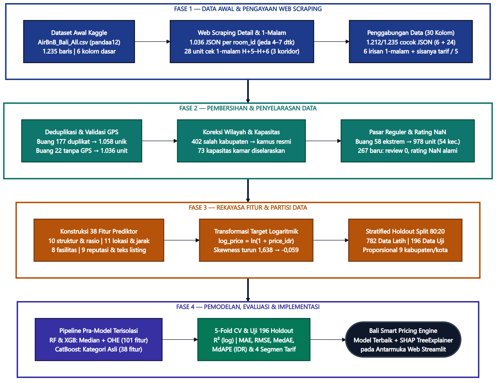
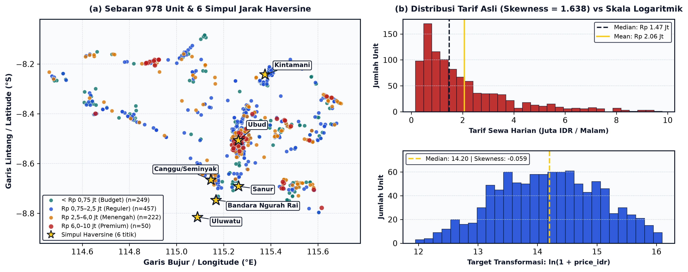
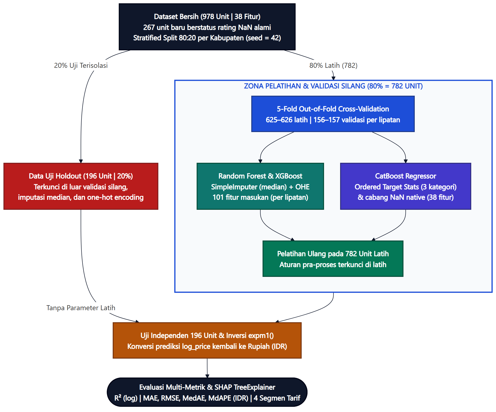
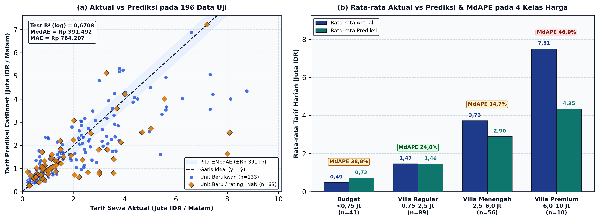
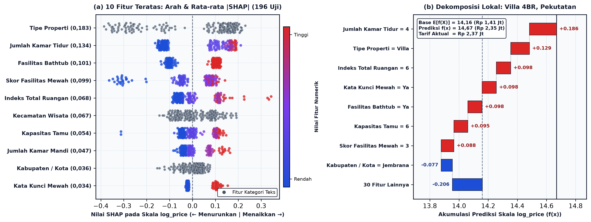
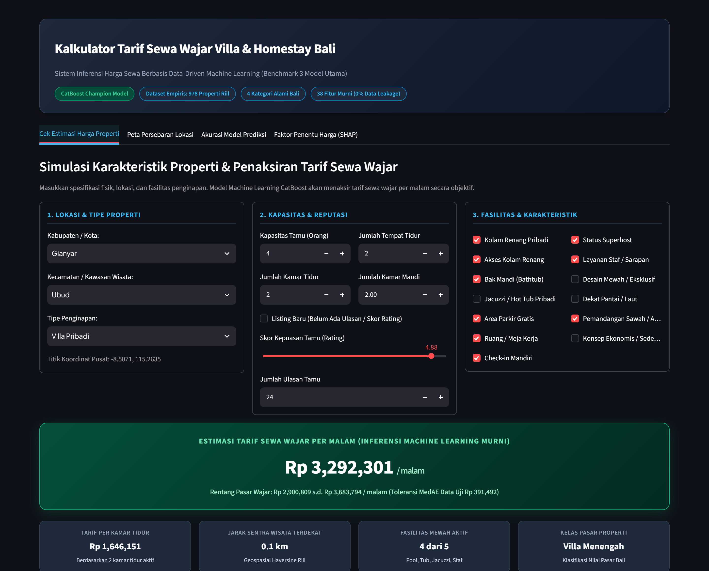

# Villa and Homestay Rental Pricing in Bali Using Categorical Boosting and Extreme Gradient Boosting

**I Kadek Adi Sunetra¹\*, Anthony Wisnu Jati²**  
¹˒²Department of Information Technology, Faculty of Engineering, Udayana University, Badung, Indonesia  
*Corresponding Author:* `sunetra.2305551053@student.unud.ac.id`

## ABSTRACT

*Setting daily rental tariffs for independent villas and homestays in Bali often relies on informal guessing or neighbor imitation, risking lost occupancy or underpriced revenue. This study developed a leakage-free tabular machine learning framework for nightly price recommendation across Bali. Curated Airbnb listings yielded 978 verified regular-market units across 54 canonical subdistricts in nine regencies with 38 predictors covering capacities, facilities, hub distances, and listing attributes. Boundary errors on 402 rows and capacity mismatches on 73 units were resolved, while 267 unrated listings (27.3%) remained un-imputed before an isolated 80:20 holdout split (782 train, 196 test). Random Forest, XGBoost, and CatBoost were evaluated via 5-fold cross-validation and holdout testing. CatBoost led with CV R² 0.6636, test R² 0.6708, MAE IDR 764,207, MedAE IDR 391,492, and RMSE IDR 1,231,953, reaching MedAE IDR 306,870 (MdAPE 24.84%) on regular villas and MdAPE 29.07% on unrated units; XGBoost achieved lowest MdAPE (27.61%). SHAP TreeExplainer was deployed in Streamlit to explain property type, room capacity, luxury amenities, and location drivers.*

**Keywords:** Categorical Boosting; Extreme Gradient Boosting; Daily rental pricing; Explainable AI; Villa and homestay; Bali tourism

## 1. INTRODUCTION

Perkembangan industri pariwisata di Bali mendorong tingginya kebutuhan sarana akomodasi, terutama penginapan mandiri seperti vila dan *homestay* yang banyak dikelola masyarakat lokal maupun pemilik perseorangan. Meskipun kunjungan wisatawan mancanegara ke Bali menembus sekitar 6,9 juta perjalanan pada 2025, tingkat hunian kamar hotel berbintang tertahan di kisaran 57% hingga 67% karena tamu kian memilih vila privat dan penginapan sewa jangka pendek, sehingga properti terdaftar melonjak dari 12.227 pada 2024 menjadi 17.543 unit pada akhir 2025 yang didominasi 7.610 vila serta 5.594 *homestay* [1]. Pertumbuhan ini turut menempatkan pengelola lokal seperti pemilik *homestay* tradisional di Ubud dalam persaingan ketat melawan vila modern di tengah keterbatasan pemasaran digital [2]. Di tengah ketatnya pasar, tarif sewa per malam menentukan kelangsungan usaha penginapan. Survei terhadap 323 sampel dari 1.681 vila privat di Canggu membuktikan bahwa strategi *dynamic pricing* meningkatkan pendapatan harian pemilik [3], sementara studi pada tamu agen perjalanan daring di Legian dan Seminyak menunjukkan bahwa kesesuaian harga dan ulasan jauh lebih memengaruhi keputusan pemesanan vila dibanding promosi diskon saja [4]. Jika tarif dipasang terlalu mahal, calon tamu beralih ke penginapan lain; sebaliknya, tarif yang terlalu murah membuat pemasukan pengelola tidak cukup menutup biaya perawatan harian.

Pada kenyataannya, sebagian besar pengelola mandiri di lapangan masih memasang tarif berdasarkan perkiraan pribadi atau sekadar meniru penginapan di sekitarnya. Riset pada pengelola vila di Canggu mengungkap bahwa perubahan kondisi pasar tidak otomatis mendorong pemilik memakai penetapan harga berbasis data karena keterbatasan pemahaman analitik [3]. Kebiasaan memasang tarif secara reaktif juga menguat di platform Airbnb yang menawarkan komisi tuan rumah rendah sebesar 3%, kemudahan mengelola banyak unit sekaligus, dan ruang negosiasi manual sehingga persaingan harga antarpemilik menjadi sangat cair [5]. Padahal, meniru tarif tetangga sering meleset karena kajian determinan harga Airbnb membuktikan bahwa tarif per malam dipengaruhi secara bersamaan oleh tipe ruang, lokasi tujuan, jarak menuju objek wisata, jumlah foto, serta kelengkapan fasilitas [6]. Dua properti di desa yang sama tentu memiliki nilai jual berbeda apabila yang satu merupakan vila dua kamar dengan kolam renang pribadi dan yang lain adalah kamar sewa sederhana.

Sejumlah cara alternatif yang ditempuh pemilik maupun metode analisis konvensional belum cukup andal memecahkan persoalan ini. Memantau pembanding secara manual atau membeli data pihak ketiga terhambat karena Airbnb tidak merilis statistik resmi inventaris tiap wilayah [7], sedangkan layanan agregator komersial kerap menutup prosedur pengambilan serta pengisian data yang mereka gunakan [8]. Data mentah halaman pencarian yang diambil langsung pun sering tidak konsisten, baik dari sisi satuan tarif per malam, keakuratan lokasi wilayah, maupun kelengkapan informasi kapasitas dan fasilitas properti. Dari sisi pemodelan, regresi linier biasa gagal membaca gabungan pengaruh lokasi dan fasilitas yang tidak linier [6], [9]. Di sisi lain, pendekatan pembelajaran mendalam berbasis sentimen teks menuntut riwayat ulasan tamu dalam jumlah besar [10], sehingga tidak dapat bekerja pada properti baru tanpa ulasan sekaligus menyisakan kendala saat menghadapi puluhan kategori wilayah kecamatan [9].

Untuk mengatasi keterbatasan tersebut, model pembelajaran mesin berbasis ansambel pohon keputusan (*tree-based ensemble*) terbukti jauh lebih efektif mengolah data properti pariwisata berbentuk tabel. Pengujian pada data Airbnb di Indonesia menunjukkan bahwa algoritma *gradient boosting* seperti XGBoost mengungguli jaringan saraf tiruan mendalam, Support Vector Regression, dan K-Nearest Neighbors [10], sementara Random Forest memberi hasil lebih stabil dibanding regresi linier dan pohon keputusan tunggal lintas kota [9]. Kinerjanya kian meningkat ketika dilengkapi atribut spasial: penambahan jarak menuju sentra wisata menaikkan Adjusted R² XGBoost sekitar 22% serta memangkas MAE sebesar 10% di Istanbul [11], sejalan dengan bukti bahwa penyatuan fitur fisik dan letak geografis menekan galat prediksi [12]. Ketiga keluarga model pohon, Random Forest [13], XGBoost [14], dan CatBoost [15], memiliki karakter komplementer dalam mengolah variasi data campuran dan kategori wilayah berkardinalitas tinggi, sedangkan teknik *Explainable AI* berbasis SHAP [16] membuka alasan di balik setiap estimasi tarif guna meningkatkan kepercayaan pemilik properti [17].

Berangkat dari celah tersebut, penelitian ini merancang dan menguji *Bali Smart Pricing Engine*, sebuah sistem rekomendasi tarif sewa harian vila dan *homestay* di Provinsi Bali berbasis pembelajaran mesin. Tujuan utamanya mencakup tiga hal: mengatasi keterbatasan kelengkapan dan kualitas data katalog penginapan daring, membandingkan kinerja model ansambel pohon keputusan secara adil termasuk bagi properti baru tanpa ulasan, serta menghadirkan estimasi tarif yang disertai penjelasan faktor penentu agar mudah dipahami dan dimanfaatkan pemilik penginapan melalui aplikasi web interaktif.

## 2. RESEARCH METHOD

### 2.1. Research Design

Penggabungan spesifikasi fisik bangunan dan posisi geografis menjadi syarat utama dalam memodelkan tarif sewa akomodasi [12]. Karena berkas data awal belum memuat tarif satu malam murni, koordinat GPS, maupun rincian fasilitas, penelitian dijalankan secara bertahap mengikuti empat fase pada Figure 1: pengayaan *dataset* publik melalui *web scraping*, pembersihan anomali menuju himpunan pasar harian reguler, rekayasa fitur beserta penguncian 20% data uji terpisah, lalu pelatihan dan evaluasi komparatif Random Forest, XGBoost, dan CatBoost bersama interpretabilitas SHAP.

**Figure 1.** Alur kerja penelitian *end-to-end* dari pengayaan *dataset* awal Kaggle hingga evaluasi model dan implementasi sistem.

### 2.2. Data Collection

Karena Airbnb tidak menyediakan statistik resmi inventaris maupun spesifikasi properti per wilayah [7], [8], data dibangun dari dua tahap yang saling melengkapi. Pertama, berkas awal bersumber dari repositori publik Kaggle *Indonesia Airbnb Dataset: Bali* (*AirBnB_Bali_All.csv*) oleh Luthfi Abdillah (*pandaa12*) berisi 1.235 baris dengan enam kolom dasar (*nama, harga, rating, jumlah_review, link, wilayah*). Pemeriksaan ke halaman asli Airbnb menemukan tiga kendala utama: kolom *harga* mencatat paket lima malam bawaan pencarian tanpa tanggal, data belum memiliki koordinat maupun fasilitas, dan label *wilayah* sering tertukar ke kabupaten sebelah akibat radius peta sementara kolom *rating* unit baru bercampur teks "New" dan sel kosong.

Kedua, setiap tautan unik properti (*room_id*) diambil rinciannya melalui *web scraping* berjeda acak 4 hingga 7 detik disertai *cooldown* berkala hingga menghasilkan 1.036 berkas JSON lokal berisi koordinat, kecamatan, kapasitas ruang, status *Superhost*, *self check-in*, daftar fasilitas, dan deskripsi. Untuk memverifikasi satuan tarif harian, dilakukan penarikan pembanding menginap satu malam murni (*check-in* H+5 hingga *check-out* H+6) di koridor Denpasar, Kuta, dan Canggu yang memperoleh 28 unit terverifikasi dengan 6 unit beririsan langsung pada *dataset* awal. Pencocokan keenam irisan itu mengonfirmasi pola paket lima malam, sehingga tarif harian ditetapkan memakai nilai terverifikasi langsung pada 6 unit irisan tersebut dan hasil bagi lima (*harga / 5*) pada baris lainnya. Penggabungan seluruh sumber bersama ekstraksi tipe unit dan kata kunci deskripsi memadankan 1.212 dari 1.235 baris ke dalam tabel 30 kolom (Table 1).

**Table 1.** Perbandingan kelengkapan atribut *dataset* sebelum dan sesudah tahap pengayaan.

| Aspek Data | ***Dataset***** Awal Kaggle (6 Kolom)** | ***Dataset***** Hasil Pengayaan (30 Kolom)** | Manfaat Pemodelan |
| :--- | :--- | :--- | :--- |
| Kelengkapan Kolom | 6 kolom dasar (*nama, harga, rating, jumlah_review, link, wilayah*). | 30 kolom (6 diselaraskan + 24 baru: ID, lokasi, kapasitas, status, 7 fasilitas, 4 kata kunci teks). | Menyediakan atribut fisik dan konteks unit di luar katalog pencarian mentah. |
| Skala Tarif Sewa | Tercampur tarif paket 5 malam bawaan pencarian tanpa tanggal. | Dinormalisasi ke 1 malam murni (verifikasi *H+5–H+6* pada 6 irisan & *harga/5*). | Menyamakan satuan target Rupiah per malam di seluruh unit. |
| Posisi Geografis | Hanya label kabupaten/kota yang sering tertukar radius peta. | Koordinat GPS presisi beserta nama kecamatan awal dari JSON unit. | Memungkinkan pemetaan batas wilayah resmi dan jarak sentra wisata. |
| Fisik & Fasilitas | Kosong (tanpa data kamar maupun keberadaan kolam renang). | Lengkap (kapasitas ruang, kolam privat, bathtub, meja kerja, staf). | Membedakan struktur harga kamar hemat hingga vila privat mewah. |

### 2.3. Data Preprocessing

*Dataset* gabungan awal sebanyak 1.235 baris belum dapat langsung dilatih ke model *machine learning* karena memuat duplikasi *listing*, unit tanpa koordinat GPS, salah label kabupaten, kapasitas keliru, serta tarif ekstrem. Pembersihan berurutan pada Table 2 menghapus 177 duplikat kunci *room_id* dan menyisihkan 22 unit tanpa *latitude/longitude* karena posisi spasial merupakan penentu kunci tarif akomodasi [6], [11]. Pada 1.036 unit tersisa, kamus wilayah resmi Bali (*SUBDISTRICT_MAP*) memulihkan 402 salah label kabupaten, ekstraksi pola teks judul (seperti '1BR' atau '2 Bedroom') meluruskan kapasitas 73 unit, lalu penyaringan pasar harian reguler menyisihkan 58 unit ekstrem (1 unit < Rp 150.000, 18 unit > Rp 10.000.000, dan 39 unit > Rp 4.000.000 per kamar tidur) sehingga tersisa 978 unit bersih pada 54 kecamatan di sembilan kabupaten/kota.

Perhatian khusus diberikan pada 267 unit baru (27,3%) yang memiliki nol ulasan (*review_count* = 0) dengan sel *rating* mentah bertuliskan "New" atau kosong, karena Airbnb baru menampilkan skor bintang setelah menerima ulasan memadai (minimal tiga ulasan pada *dataset* ini). Seluruh 267 unit baru tetap mencatat *review_count* = 0, ditandai *is_new_listing* = 1, dan kolom *rating*-nya dibiarkan berstatus *NaN* alami, sedangkan 711 unit berulasan (72,7%) memiliki 3 hingga 839 ulasan dengan *rating* valid 3,50 hingga 5,00 (median 4,95). Nilai *NaN* sengaja tidak diganti nol agar vila baru tidak terbaca bermutu nol jauh di bawah rentang nyata 3,50–5,00; CatBoost memisahkan *NaN* langsung di percabangan pohonnya, sementara Random Forest dan XGBoost mengisinya dengan *median* data latih di tiap lipatan validasi agar bebas *data leakage* [14].

**Table 2.** Tahapan pembersihan data, jumlah anomali, tindakan perbaikan, dan sisa unit.

| Tahap Pembersihan | Temuan Masalah pada Data | Tindakan Perbaikan | Sisa Unit |
| :--- | :--- | :--- | ---: |
| *Dataset* Gabungan Awal | Seluruh baris awal gabungan Kaggle & JSON *scraping*. | Titik awal pembersihan data. | 1.235 |
| Deduplikasi *room_id* | 177 baris ganda akibat irisan area pencarian. | Menghapus duplikat memakai kunci unik *room_id*. | 1.058 |
| Validasi Koordinat GPS | 22 unit tanpa nilai *latitude* dan *longitude*. | Menyisihkan unit tanpa koordinat lokasi. | 1.036 |
| Koreksi Wilayah & Kapasitas | 402 baris salah kabupaten; 73 unit berkapasitas keliru. | Pemetaan *SUBDISTRICT_MAP* & *parsing* judul. | 1.036 |
| Penyaringan Pasar Reguler | 58 tarif ekstrem (<Rp 150 rb, >Rp 10 jt, >Rp 4 jt/kamar). | Menyisihkan tarif uji coba dan resor besar. | 978 |
| Penanganan Unit Baru | 267 unit (27,3%) *review_count*=0 dengan label "New"/kosong. | Menjaga *rating = NaN* alami & mengisi *is_new_listing*=1. | 978 |

### 2.4. Feature Engineering

Dari 30 kolom pengayaan, kolom tautan (*url*) dibuang lalu ditambahkan 12 fitur prediktor rekayasa serta 1 target logaritmik menjadi 42 kolom akhir: 4 kolom nonprediktor (*room_id, name, price_idr, log_price*) dan tepat 38 fitur prediktor *X* yang terbagi atas empat rumpun pada Table 3. Ke-12 fitur baru mencakup empat rasio kepadatan ruang, satu skor jumlah fasilitas mewah tanpa bobot manual (*total_luxury_amenities*, skala 0–5), serta tujuh fitur jarak permukaan bumi memakai formula Haversine pada Equation (1) [18], [19] menuju Canggu/Seminyak, Ubud, Uluwatu, Sanur, Kintamani, Bandara Ngurah Rai, dan jarak sentra wisata terdekat (*min_dist_tourism_hub_km*).

$$
d_{i,h} = 2R \arcsin\left(\sqrt{\sin^2\left(\frac{\Delta\varphi}{2}\right) + \cos(\varphi_i)\cos(\varphi_h)\sin^2\left(\frac{\Delta\lambda}{2}\right)}\right) \qquad (1)
$$

dengan $d_{i,h}$ jarak fisik permukaan bumi (km), $R = 6.371{,}0\text{ km}$ jari-jari bumi, $\varphi_i, \varphi_h$ lintang dan $\lambda_i, \lambda_h$ bujur unit ke-$i$ serta simpul wisata $h$ dalam radian, serta $\Delta\varphi = \varphi_h - \varphi_i$ dan $\Delta\lambda = \lambda_h - \lambda_i$.

Pada sisi target, tarif harian 978 unit terbentang dari Rp 154.358 hingga Rp 9.786.094 per malam (rata-rata Rp 2.064.199, median Rp 1.470.000) dengan *skewness* tinggi 1,638. Agar galat pada segelintir vila mahal tidak mendominasi bobot pelatihan pohon keputusan, target ditransformasi ke logaritma natural pada Equation (2) [19] hingga *skewness* turun menjadi -0,059 (Figure 2(b)). Selanjutnya, 978 unit dipartisi memakai *stratified split* 80:20 menurut kabupaten/kota (*random_state* = 42) [18], menghasilkan 782 data latih dan 196 data uji terpisah di luar seluruh tahap imputasi maupun *encoding* untuk mencegah *data leakage* [20].

$$
y_i^{(\mathrm{log})} = \ln(1 + y_i) \qquad (2)
$$

dengan $y_i^{(\mathrm{log})}$ menyatakan target pada skala logaritmik dan $y_i$ tarif sewa harian aktual unit ke-$i$ (IDR).

**Table 3.** Pengelompokan 38 fitur prediktor beserta statistik utama pada 978 unit bersih.

| Rumpun Fitur & Asal | Jml | Daftar Atribut dan Statistik Utama (978 Unit) | Peran Penentuan Tarif |
| :--- | :---: | :--- | :--- |
| Struktur & Kapasitas (6 Pengayaan + 4 Rasio) | 10 | *property_type* (456 vila, 271 kamar/*homestay*, 142 *cottage*, 109 rumah), *is_room_only* (26,1%), *accommodates, bedrooms, beds, bathrooms*, *guests_per_bedroom* (med 2,0), *baths_per_bedroom* (med 1,0), *beds_per_bedroom, total_rooms_index*. | Membedakan ukuran fisik properti dan kepadatan hunian. |
| Lokasi & Spasial (4 Pengayaan + 7 Jarak) | 11 | *regency* (9 wilayah), *sub_district* (54 kecamatan), *latitude, longitude, min_dist_tourism_hub_km* (med 24,88 km; maks 89,41 km), serta 6 jarak Haversine ke sentra wisata/bandara. | Menangkap variasi harga antarkecamatan dan jarak wisata. |
| Fasilitas & Kemewahan (7 Pengayaan + 1 Skor) | 8 | *has_private_pool* (38,2%), *has_pool* (82,8%), *has_bathtub* (49,4%), *has_parking* (91,6%), *has_workspace* (62,6%), *has_jacuzzi* (5,2%), *has_service_staff* (10,3%), *total_luxury_amenities* (0–5). | Mengukur kelengkapan fasilitas pembeda unit hemat hingga mewah. |
| Reputasi, Operasi & Teks (9 Pengayaan) | 9 | *rating* (711 valid 3,50–5,00; med 4,95; 267 *NaN*), *review_count* (0 / 3–839), *is_new_listing* (27,3%), *is_superhost* (60,6%), *has_self_checkin* (47,4%), *nlp_luxury* (15,6%), *nlp_beach_ocean* (32,8%), *nlp_nature_view* (39,3%), *nlp_budget_cozy* (3,8%). | Mencerminkan kredibilitas ulasan, layanan, dan sinyal deskripsi. |

**Figure 2.** (a) Sebaran spasial 978 unit pasar reguler terhadap enam simpul Haversine utama di Bali; (b) distribusi tarif harian asli (*skewness* = 1,638) sebelum dan sesudah transformasi *ln(1 + price_idr)* (*skewness* = -0,059).

### 2.5. Predictive Modeling

Tiga algoritma ansambel pohon keputusan dilatih memprediksi *log_price* dari 38 prediktor yang sama: Random Forest [13] sebagai *baseline*, XGBoost [14], dan CatBoost [15]. Jalur pra-pemrosesan keduanya dibedakan mengikuti mekanisme tiap algoritma:

> **RF & XGBoost:** `38 Fitur X` $\longrightarrow$ `SimpleImputer(median)` + `One-Hot Encoding` (`66 dummy`) + `35` numerik $\longrightarrow$ **`101` Fitur Masukan**

> **CatBoost:** `38 Fitur X` $\longrightarrow$ `Ordered Target Statistics` (`3` kategori) + `NaN native` $\longrightarrow$ **`38` Fitur Masukan**

Random Forest dan XGBoost dijalankan melalui *pipeline ColumnTransformer* yang di-*fit* ketat di data latih: *SimpleImputer* mengisi kekosongan *rating* unit baru dengan *median* lipatan latih, sedangkan *OneHotEncoder* (*handle_unknown="ignore"*) memekarkan 9 kabupaten, 53 kecamatan latih, dan 4 tipe properti menjadi 66 kolom biner *dummy* sehingga 1 kecamatan yang hanya muncul pada data uji (Kuta Selatan) dipetakan aman sebagai nol tanpa memicu galat maupun kebocoran informasi (total 101 fitur). Sebaliknya, CatBoost bekerja langsung pada 38 fitur asli menggunakan *ordered target statistics* berbasis permutasi acak baris guna mencegah *target leakage* serta percabangan *NaN native* [15], dengan hiperparameter tiap model dirangkum pada Table 4.

**Table 4.** Perbandingan pra-pemrosesan fitur, penanganan nilai kosong, dan hiperparameter tiga model.

| Algoritma | Pra-Pemrosesan Fitur | **Penanganan *****Rating NaN*** | Hiperparameter Utama |
| :--- | :--- | :--- | :--- |
| Random Forest (*Baseline*) | *ColumnTransformer*: *OneHotEncoder* (66 biner) + 35 numerik = 101 fitur. | *SimpleImputer (median)* per lipatan latih. | *n_estimators=300; max_depth=14; min_samples_leaf=2; random_state=42.* |
| XGBoost Regressor | *ColumnTransformer*: *OneHotEncoder* (66 biner) + 35 numerik = 101 fitur. | *SimpleImputer (median)* per lipatan latih. | *n_estimators=350; learning_rate=0,035; max_depth=5; subsample=0,8; colsample_bytree=0,8; random_state=42.* |
| CatBoost Regressor | *Ordered Target Statistics* langsung pada 38 fitur asli. | Percabangan *NaN* bawaan (*native*). | *iterations=600; learning_rate=0,035; depth=6; l2_leaf_reg=3,0; loss_function=RMSE; random_seed=42.* |

### 2.6. Evaluation Metrics

Validasi mengikuti skema pemisahan ketat pada Figure 3: validasi silang lima lipatan (*KFold*, *random_state* = 42) pada 782 unit latih untuk menguji kestabilan prediksi *out-of-fold*, diikuti pelatihan penuh pada 782 unit dan pengujian sekali pada 196 unit *holdout* [20]. Nilai determinasi R² dihitung langsung pada skala *log_price*, sedangkan seluruh galat bisnis dihitung dalam Rupiah pasca-transformasi balik eksponensial pada Equation (3) [19].

**Figure 3.** Arsitektur validasi silang lima lipatan, pemisahan pra-pemrosesan model, dan pengujian independen pada 196 data *holdout*.

$$
\hat{y}_i = \exp\!\left(\hat{y}_i^{(\mathrm{log})}\right) - 1 \qquad (3)
$$

dengan $\hat{y}_i$ tarif prediksi (IDR) dan $\hat{y}_i^{(\mathrm{log})}$ keluaran model pada skala logaritmik.

Karena sebaran tarif Bali melebar dari ratusan ribu hingga hampir sepuluh juta rupiah, evaluasi memadukan metrik rata-rata standar, R² (skala log), *Mean Absolute Error* (MAE), dan *Root Mean Squared Error* (RMSE) yang memberi penalti kuadrat pada galat besar [19], [21], dengan dua ukuran berbasis nilai tengah pada Equation (4) dan Equation (5), yakni *Median Absolute Error* (MedAE) dan *Median Absolute Percentage Error* (MdAPE), agar ketepatan mayoritas unit tidak bias oleh pencilan ekstrem sekaligus sesuai praktik penilaian properti modern [22], [23]. Analisis turut dipecah ke empat segmen harga pasar, kondisi properti baru tanpa ulasan, serta kontribusi fitur melalui SHAP *TreeExplainer* [16], [17], [23].

$$
\mathrm{MedAE} = \mathrm{median}\!\left(\left|y_i - \hat{y}_i\right|\right) \qquad (4)
$$

$$
\mathrm{MdAPE} = \mathrm{median}\!\left(\frac{\left|y_i - \hat{y}_i\right|}{y_i}\right) \times 100\% \qquad (5)
$$

dengan $y_i$ dan $\hat{y}_i$ menyatakan tarif aktual serta tarif prediksi (IDR) pada himpunan uji ($N = 196$).

## 3. RESULTS AND DISCUSSION

### 3.1. Model Performance Comparison

Hasil pengujian tiga model ansambel pohon pada validasi silang lima lipatan (782 unit) dan data uji terpisah (*holdout*, 196 unit) disajikan pada Table 5. Nilai R² yang lebih tinggi (↑) serta nilai kesalahan MAE, RMSE, MedAE, dan MdAPE yang lebih kecil (↓) menandakan prediksi yang semakin akurat. CatBoost Regressor tampil paling unggul pada lima dari tujuh indikator: CV R² tertinggi (0,6636), Test R² tertinggi (0,6708), serta kesalahan Rupiah terendah pada MAE (Rp 764.207), RMSE (Rp 1.231.953), dan MedAE (Rp 391.492). Secara nyata, separuh dari seluruh properti uji diprediksi meleset tidak lebih dari Rp 391.492 per malam. Di sisi lain, XGBoost Regressor unggul tipis pada CV MAE (Rp 714.995 dibanding Rp 717.074) serta meraih persentase kesalahan tengah (Test MdAPE) terendah sebesar 27,61% (unggul 2,48 poin persen atas CatBoost), sedangkan Random Forest berada di posisi terakhir pada seluruh metrik (Test R² 0,6560; MedAE Rp 470.400).

**Table 5.** Perbandingan kinerja tiga model pada validasi silang 5-lipatan (782 unit) dan data uji *holdout* (196 unit).

| Model | CV R² ↑ | CV MAE (IDR) ↓ | Test R² ↑ | Test MAE (IDR) ↓ | Test RMSE (IDR) ↓ | Test MedAE (IDR) ↓ | Test MdAPE (%) ↓ |
| :--- | ---: | ---: | ---: | ---: | ---: | ---: | ---: |
| **CatBoost Regressor** | **0,6636** | Rp 717.074 | **0,6708** | **Rp 764.207** | **Rp 1.231.953** | **Rp 391.492** | 30,09% |
| XGBoost Regressor | 0,6631 | **Rp 714.995** | 0,6622 | Rp 773.730 | Rp 1.249.748 | Rp 411.693 | **27,61%** |
| Random Forest (*Baseline*) | 0,6291 | Rp 737.098 | 0,6560 | Rp 809.098 | Rp 1.264.986 | Rp 470.400 | 31,63% |

*Catatan: ↑ makin tinggi makin baik; ↓ makin rendah makin baik. Sel hijau muda menandai nilai terbaik tiap kolom.*

Keunggulan CatBoost pada kemampuan menjelaskan variasi harga (R²) dan seluruh kesalahan prediksi dalam Rupiah berasal dari cara kerjanya yang memakai *ordered target statistics* serta struktur pohon simetris (*oblivious trees*) [15]. Pemecahan 54 kecamatan melalui *one-hot encoding* membuat masukan Random Forest [13] dan XGBoost [14] melebar menjadi 101 kolom biner yang sebagian besar bernilai nol, sehingga pembagian pohon pada kecamatan dengan sedikit data menjadi kurang efektif; sebaliknya, CatBoost menjaga 38 fitur asli tetap padat sekaligus memproses *rating = NaN* secara langsung (*native*). Keunggulan *gradient boosting* atas *bagging* Random Forest sejalan dengan temuan studi Airbnb Indonesia [10] dan perbandingan lintas kota [9], sementara unggulnya Test MdAPE XGBoost menunjukkan ketepatan persentase yang sedikit lebih rapat pada tarif rendah hingga menengah. Selain itu, rapatnya nilai CV R² (0,6636) terhadap Test R² (0,6708, selisih +0,0072) dibanding R² latih (0,8740) memastikan model tidak mengalami kebocoran data maupun *overfitting* pada 196 data uji terpisah [20], termasuk kecamatan Kuta Selatan yang belum pernah muncul saat pelatihan.

### 3.2. Stratified Error Analysis

Karena rentang tarif sewa di Bali sangat lebar dan beragam, mulai dari kamar ratusan ribu hingga vila hampir sepuluh juta rupiah per malam, satu angka rata-rata global belum cukup menggambarkan performa model. Oleh sebab itu, hasil prediksi model terbaik (CatBoost) dibedah per kelompok pada Table 6 dan Figure 4 menurut empat kelas harga (Panel A) serta status ulasan properti (Panel B). Pada segmen terbesar pasar, yakni Villa Reguler (Rp 750 ribu–2,5 juta; 89 unit atau 45,4% data uji), model meraih akurasi paling tinggi dengan rata-rata prediksi Rp 1.456.611 yang nyaris menyamai harga aktual Rp 1.467.322 (MedAE Rp 306.870; MdAPE 24,84%). Secara keseluruhan pada 196 data uji, 49,5% prediksi meleset maksimal 30% dan 76,5% meleset maksimal 50%, dengan selisih prediksi hampir seimbang antara tebakan terlalu tinggi dan terlalu rendah (nilai tengah selisih -Rp 38.002).

**Table 6.** Evaluasi kesalahan CatBoost per kelompok pada 196 data uji menurut kelas harga pasar (Panel A) dan status ulasan *cold-start* (Panel B).

| Segmen Evaluasi | n | Rata-rata Aktual | Rata-rata Prediksi | MAE (IDR) ↓ | MedAE (IDR) ↓ | MdAPE (%) ↓ |
| :--- | ---: | ---: | ---: | ---: | ---: | ---: |
| Panel A: Homestay / Budget (< Rp 750 rb) | 41 | Rp 488.600 | Rp 717.705 | Rp 269.565 | Rp 150.589 | 38,80% |
| **Panel A: Villa Reguler (Rp 750 rb–2,5 jt)** | **89** | **Rp 1.467.322** | **Rp 1.456.611** | **Rp 432.483** | **Rp 306.870** | **24,84%** |
| Panel A: Villa Menengah (Rp 2,5–6,0 jt) | 56 | Rp 3.732.744 | Rp 2.903.795 | Rp 1.213.631 | Rp 1.231.149 | 34,69% |
| Panel A: Villa Premium (Rp 6,0–10 jt) | 10 | Rp 7.513.136 | Rp 4.347.002 | Rp 3.227.807 | Rp 3.501.920 | 46,94% |
| Panel B: Unit Baru (*rating = NaN*, rev=0) | 63 | Rp 1.946.469 | Rp 1.622.646 | Rp 803.810 | Rp 295.685 | 29,07% |
| Panel B: Unit Berulasan (rev ≥ 3) | 133 | Rp 2.094.828 | Rp 1.724.644 | Rp 745.448 | Rp 417.070 | 30,10% |

*Catatan: ↓ makin kecil makin akurat. Warna kolom MdAPE menandai tingkat kesalahan relatif: hijau muda (≤31%, baik), kuning muda (31%–40%, sedang), merah muda (>40%, tinggi).*

**Figure 4.** (a) Sebaran tarif aktual terhadap prediksi CatBoost pada 196 data uji (membedakan 133 unit berulasan dan 63 unit baru *rating = NaN*) beserta pita toleransi ±MedAE; (b) perbandingan rata-rata aktual vs prediksi dan MdAPE pada empat kelas harga.

Sebaliknya, Figure 4(b) memperlihatkan dua kecenderungan meleset yang wajar pada batas bawah dan batas atas harga: tebakan agak terlalu mahal (*overprediction*) pada kelas Budget (aktual Rp 488.600 dibanding prediksi Rp 717.705; MdAPE 38,80%) serta tebakan terlalu murah (*underprediction*) pada kelas Villa Premium (aktual Rp 7.513.136 dibanding prediksi Rp 4.347.002; MAE Rp 3.227.807; MdAPE 46,94%). Karena kelas Premium hanya berisi 10 unit uji (5,1%) dan faktor pembeda utamanya seperti luas lahan, kualitas arsitektur visual, serta pemandangan langsung belum tersedia di data tabel, selisih besar pada segelintir vila mewah inilah yang menarik RMSE global (Rp 1.231.953) hingga tiga kali lipat MedAE (Rp 391.492). Temuan ini membuktikan bahwa pada data harga yang miring, penilaian akurasi perlu menggabungkan RMSE dan MAE dengan MedAE serta MdAPE [21]–[23].

Pada Panel B Table 6, pengujian properti baru (*cold-start*) membuktikan CatBoost tetap akurat meski tanpa riwayat ulasan. Pada 63 unit baru dengan *rating = NaN* dan *review_count* = 0, model mencatat MedAE Rp 295.685 dan MdAPE 29,07%, sejajar dengan 133 unit berulasan (MdAPE 30,10%), sehingga mengatasi kendala metode berbasis sentimen teks yang tidak bekerja pada properti baru [10]. Nilai R² unit baru (0,5226; MAE Rp 803.810) memang lebih rendah daripada unit berulasan (R² 0,7354; MAE Rp 745.448) karena tanpa validasi ulasan tamu, beberapa vila baru berharga mahal menyebar lebih lebar di Figure 4(a). Menurut tipe properti, akurasi relatif terbaik dicapai *Private Room/Homestay* (n = 50; MedAE Rp 188.054; MdAPE 23,70%), diikuti *Cottage/Bungalow* (n = 33; MdAPE 31,06%), Villa (n = 92; MdAPE 31,08%), dan *Entire House* (n = 21; MdAPE 34,42%) [15].

### 3.3. Feature Interpretability Analysis

Untuk menjelaskan faktor apa saja yang mendorong naik-turunnya estimasi tarif, nilai kontribusi Shapley (SHAP) dari model CatBoost pada 196 data uji disajikan pada Figure 5 [16]. Secara keseluruhan (Figure 5(a)), sepuluh faktor paling berpengaruh adalah tipe properti (*property_type*, rata-rata |SHAP| = 0,183), jumlah kamar tidur (0,134), fasilitas *bathtub* (0,101), skor total fasilitas mewah (*total_luxury_amenities*, 0,099), indeks total ruangan (0,068), kecamatan wisata (0,067), kapasitas tamu (0,054), jumlah kamar mandi (0,047), kabupaten/kota (0,036), dan kata kunci mewah (*nlp_luxury*, 0,034), diikuti jarak ke pusat Ubud (*dist_ubud_center_km*, 0,033) serta sinyal pantai/laut (0,032). Fitur kolam renang pribadi tidak muncul tersendiri di sepuluh besar karena pengaruhnya sudah tergabung ke dalam *total_luxury_amenities* (penjumlahan kolam privat, kolam umum, *bathtub*, *jacuzzi*, dan staf) serta melekat erat pada kategori Villa.

**Figure 5.** (a) Peringkat dan arah pengaruh 10 fitur teratas berdasarkan SHAP *TreeExplainer* pada 196 data uji (angka dalam kurung adalah rata-rata |SHAP| skala *log_price*); (b) rincian kontribusi fitur (*waterfall*) pada satu properti nyata Villa 4 kamar di Pekutatan, Jembrana.

Arah sebaran titik pada Figure 5(a) menunjukkan pola pengaruh yang sejalan dengan kondisi pasar nyata: makin banyak kamar tidur, tersedianya *bathtub*, skor fasilitas mewah, kapasitas tamu, dan desain eksklusif mendorong tarif ke kanan (lebih mahal), sedangkan kamar tunggal atau minim fasilitas mewah menarik tarif ke kiri (lebih murah). Pada tingkat satu properti, Figure 5(b) merinci satu contoh nyata dari data uji, vila empat kamar tidur di Pekutatan, Jembrana (*room_id* 909805552777906282). Dari nilai dasar pasar *E[f(X)]* = 14,16 (setara Rp 1,41 juta), spesifikasi fisik dan fasilitas mendorong tarif naik melalui empat kamar tidur (+0,186), tipe Villa (+0,129), total enam ruangan (+0,098), kata kunci mewah (+0,098), *bathtub* (+0,098), kapasitas enam tamu (+0,095), dan tiga fasilitas mewah (+0,088). Namun lokasi di Kabupaten Jembrana (-0,077) beserta 30 atribut jarak dan konteks lainnya (-0,206) menahan prediksi agar tidak menyamai vila seukuran di Badung atau Ubud, sehingga menghasilkan *f(x)* = 14,67 (Rp 2.347.158) yang hanya terpaut 1,1% dari tarif aktual Rp 2.373.648. Temuan tiga pilar utama ini (struktur ruang, kelengkapan fasilitas, dan lokasi) sejalan dengan studi harga Airbnb global [6], peran jarak wisata [11], [18], serta manfaat transparansi XAI bagi kepercayaan pemilik properti [17].

### 3.4. System Deployment and Limitations

Model terbaik CatBoost (*catboost_pricing_model.cbm*, berukuran 726 KiB) diterapkan ke dalam aplikasi web interaktif Streamlit (*Bali Smart Pricing Engine*) dengan empat modul utama: kalkulator estimasi tarif berbasis 38 fitur yang menghitung otomatis tujuh jarak Haversine dan rasio kapasitas, peta OpenStreetMap untuk 978 properti bersih, dasbor perbandingan tiga model beserta akurasi per kelas harga, dan panel penjelasan SHAP. Seperti terlihat pada Figure 6, untuk simulasi vila dua kamar di Ubud berfasilitas lengkap, sistem menampilkan estimasi Rp 3.292.301 per malam beserta rentang pasar wajar Rp 2.900.809 hingga Rp 3.683.794 (toleransi ±MedAE Rp 391.492), kelas pasar properti, serta tabel simulasi *what-if* untuk memperkirakan kenaikan tarif bila fasilitas ditambah (seperti *bathtub* +Rp 425.726/malam, interior mewah +Rp 238.125/malam, dan *Superhost* +Rp 202.853/malam) [3], [17].

**Figure 6.** Antarmuka modul kalkulator estimasi tarif pada aplikasi web *Bali Smart Pricing Engine* berbasis model CatBoost (978 unit, 38 fitur murni, toleransi ±MedAE Rp 391.492).

Meskipun sistem bekerja baik pada segmen pasar utama Bali, tiga keterbatasan nyata perlu dicatat secara terbuka. Pertama, sisa 32,92% variasi harga yang belum mampu dijelaskan model (1 − R²) berasal dari faktor di luar data tabel, seperti kualitas foto arsitektur, luas tanah dan bangunan (m²), pemandangan langsung, serta perubahan tarif musiman (*high/low season*) [6], [12], [18]. Kedua, jumlah sampel pada kelas Villa Premium (10 unit uji) dan beberapa kecamatan berkepadatan rendah masih terbatas sehingga prediksi pada vila sangat mahal cenderung terlalu rendah. Ketiga, keterbatasan keterbukaan data platform daring [7], [8] membuat tarif harian di luar enam unit irisan verifikasi langsung masih memakai pembagian *harga / 5* pada satu periode cuplikan, sehingga pemantauan tarif harian lintas musim menjadi agenda penting pada tahap pengembangan berikutnya.

## 4. CONCLUSION

Penelitian ini menjawab persoalan penetapan tarif sewa harian vila dan *homestay* di Bali dengan merancang serta menguji *Bali Smart Pricing Engine*. Keterbatasan *dataset* katalog daring awal yang hanya memuat enam atribut dasar berhasil diatasi melalui pengayaan rincian properti, penyamaan satuan tarif satu malam, dan pembersihan anomali wilayah, kapasitas, serta tarif ekstrem hingga menghasilkan 978 unit pasar reguler pada 54 kecamatan di sembilan kabupaten/kota dengan 38 fitur siap latih, sembari menjaga 267 properti baru tanpa ulasan tetap pada kondisi kosong alami (*rating = NaN*). Pada pengujian 196 data uji yang tidak dilibatkan dalam pelatihan, CatBoost Regressor mencatat kinerja terbaik dan paling seimbang dengan R² 0,6708, MAE Rp 764.207, MedAE Rp 391.492, dan RMSE Rp 1.231.953, mengungguli Random Forest (R² 0,6560) serta mengungguli XGBoost (R² 0,6622) pada seluruh metrik Rupiah absolut meski XGBoost meraih MdAPE terendah (27,61%).

Pengujian menurut kelas harga dan status ulasan memperlihatkan bahwa model bekerja paling akurat pada segmen inti pasar, yakni Villa Reguler (45,4% data uji, MedAE Rp 306.870, MdAPE 24,84%), dan tetap andal saat memprediksi properti baru yang belum memiliki ulasan (63 unit tanpa ulasan, MedAE Rp 295.685, MdAPE 29,07%). Analisis SHAP memberikan dasar estimasi yang transparan bagi pemilik dengan mengonfirmasi bahwa tipe properti, jumlah kamar tidur, fasilitas *bathtub* serta total fasilitas mewah, jumlah ruangan, dan lokasi kecamatan merupakan penentu utama tarif harian. Seluruh model dan penjelasan tersebut telah diterapkan ke aplikasi web interaktif Streamlit yang menyajikan estimasi tarif, rentang harga wajar (±Rp 391.492), serta simulasi penambahan fasilitas.

Ke depan, akurasi sistem pada segmen vila mewah di atas Rp 6 juta per malam serta kepekaan terhadap perubahan musim dapat ditingkatkan melalui pengumpulan data berkala lintas musim ramai dan sepi, penambahan informasi non-tabular seperti kualitas visual foto properti dan luas lahan, serta perluasan sampel pada kategori vila premium dan kecamatan dengan jumlah unit terbatas.

## REFERENCES

[1] A. M. Y. Iswara, I. G. A. N. D. Suyasa, R. A. B. N. Putra, and P. H. Susanti, “Tourist Arrivals Increase, Hotel Occupancy Declines: Governance Strategies for Sustainable Tourism Accommodation in Bali,” *Jurnal Kajian Bali (Journal of Bali Studies)*, vol. 16, no. 2, pp. 494–521, Aug. 2026. DOI: https://doi.org/10.24843/JKB.2026.v16.i02.p03

[2] R. Pramono, R. Sianipar, and I. W. R. Junaedi, “Between Tradition and Transformation: Revitalizing Traditional Homestays for Sustainable Ecotourism in Ubud, Bali,” *TourismSpectrum: Diversity & Dynamics*, vol. 2, no. 1, pp. 7–17, 2025. DOI: https://doi.org/10.56578/tsdd020102

[3] I. G. A. E. Widiningsih, K. A. R. I. Laksmana, and I. G. A. D. W. S. W. Suyasa, “The Effect of Dynamic Pricing Strategy on Sales Performance through the Airbnb Platform: Evidence from Private Villas in Canggu, Bali,” *Formosa Journal of Multidisciplinary Research (FJMR)*, vol. 4, no. 9, pp. 4699–4708, 2025. DOI: https://doi.org/10.55927/fjmr.v4i9.506

[4] P. E. Pramadewi, Murtianingsih, and Fathorrahman, “The Influence of Online Reviews, Price, and Promotions on Hotel Room Booking Decisions via Online Travel Agents for Hotels and Villas Managed by Samhita Bali Hospitality,” *International Journal of Economics, Business and Innovation Research (IJEBIR)*, vol. 5, no. 5, pp. 1858–1872, 2026. DOI: https://doi.org/10.63922/ijebir.v5i05.5798

[5] I. N. M. Wijaya, I. M. D. Oka, N. G. N. S. Murni, and P. W. Darmayanti, “E-Marketing in Accommodation Business Model Innovation at Airbnb in Bali,” *Jurnal Ilmiah Hospitality Management*, vol. 13, no. 2, pp. 119–126, 2023. DOI: https://doi.org/10.22334/jihm.v13i2.249

[6] C. Chang and S. Li, “Study of Price Determinants of Sharing Economy-Based Accommodation Services: Evidence from Airbnb.com,” *Journal of Theoretical and Applied Electronic Commerce Research*, vol. 16, no. 4, pp. 584–601, 2021. DOI: https://doi.org/10.3390/jtaer16040035

[7] C. Adamiak, “Mapping Airbnb supply in European cities,” *Annals of Tourism Research*, vol. 71, pp. 67–71, 2018. DOI: https://doi.org/10.1016/j.annals.2018.02.008

[8] Y. Wang, M. Livingston, D. P. McArthur, and N. Bailey, “Enhancing our understanding of short-term rental activity: A daily scrape-based approach for Airbnb listings,” *PLoS One*, vol. 19, no. 2, p. e0298131, Feb. 2024. DOI: https://doi.org/10.1371/journal.pone.0298131

[9] N. Camatti, G. di Tollo, G. Filograsso, and S. Ghilardi, “Predicting Airbnb pricing: a comparative analysis of artificial intelligence and traditional approaches,” *Computational Management Science*, vol. 21, p. 30, May 2024. DOI: https://doi.org/10.1007/s10287-024-00511-4

[10] C. Digno, M. I. Jauhar, and M. N. Syaifullah, “Pendekatan Deep Learning dan Gradient Boosting dalam Prediksi Harga Properti Airbnb dengan Analisis Sentimen,” *Jurnal Elektronik Ilmu Komputer Udayana (JELIKU)*, vol. 12, no. 1, pp. 191–200, Aug. 2023. DOI: https://doi.org/10.24843/JLK.2023.v12.i01.p22

[11] Ö. Akalın and G. I. Alptekin, “Enhancing Airbnb Price Predictions with Location-Based Data: A Case Study of Istanbul,” in *Proceedings of the 19th Conference on Computer Science and Intelligence Systems (FedCSIS)*, vol. 39, pp. 207–212, 2024. DOI: https://doi.org/10.15439/2024F7603

[12] L. Jiang, Y. Li, N. Luo, J. Wang, and Q. Ning, “A Multi-Source Information Learning Framework for Airbnb Price Prediction,” in *2022 IEEE International Conference on Data Mining Workshops (ICDMW)*, pp. 1–7, 2022. DOI: https://doi.org/10.1109/ICDMW58026.2022.00009

[13] L. Breiman, “Random Forests,” *Machine Learning*, vol. 45, no. 1, pp. 5–32, 2001. DOI: https://doi.org/10.1023/A:1010933404324

[14] T. Chen and C. Guestrin, “XGBoost: A Scalable Tree Boosting System,” in *Proceedings of the 22nd ACM SIGKDD International Conference on Knowledge Discovery and Data Mining*, pp. 785–794, 2016. DOI: https://doi.org/10.1145/2939672.2939785

[15] L. Prokhorenkova, G. Gusev, A. Vorobev, A. V. Dorogush, and A. Gulin, “CatBoost: unbiased boosting with categorical features,” in *Advances in Neural Information Processing Systems*, vol. 31, pp. 6638–6648, 2018. [Online]. Available: https://proceedings.neurips.cc/paper_files/paper/2018/file/14491b756b3a51daac41c24863285549-Paper.pdf

[16] S. M. Lundberg and S.-I. Lee, “A Unified Approach to Interpreting Model Predictions,” in *Advances in Neural Information Processing Systems*, vol. 30, pp. 4765–4774, 2017. [Online]. Available: https://proceedings.neurips.cc/paper_files/paper/2017/file/8a20a8621978632d76c43dfd28b67767-Paper.pdf

[17] C. Kmen, G. Navratil, M. Kattenbeck, and I. Giannopoulos, “Evaluating human–machine collaboration through a comparative analysis of experts, machine learning, and hybrid approaches in real estate valuation,” *Scientific Reports*, vol. 16, p. 4044, Jan. 2026. DOI: https://doi.org/10.1038/s41598-025-34099-9

[18] M. Geerts, S. vanden Broucke, and J. De Weerdt, “A Survey of Methods and Input Data Types for House Price Prediction,” *ISPRS International Journal of Geo-Information*, vol. 12, no. 5, p. 200, May 2023. DOI: https://doi.org/10.3390/ijgi12050200

[19] J. Paik, S.-J. Baek, J.-W. Kim, and K. Ko, “Influence of Social Overhead Capital Facilities on Housing Prices Using Machine Learning,” *Applied Sciences*, vol. 13, no. 19, p. 10732, Sep. 2023. DOI: https://doi.org/10.3390/app131910732

[20] Y. Xu and R. Goodacre, “On Splitting Training and Validation Set: A Comparative Study of Cross-Validation, Bootstrap and Systematic Sampling for Estimating the Generalization Performance of Supervised Learning,” *Journal of Analysis and Testing*, vol. 2, pp. 249–262, Oct. 2018. DOI: https://doi.org/10.1007/s41664-018-0068-2

[21] T. O. Hodson, “Root-mean-square error (RMSE) or mean absolute error (MAE): when to use them or not,” *Geoscientific Model Development*, vol. 15, pp. 5481–5487, Jul. 2022. DOI: https://doi.org/10.5194/gmd-15-5481-2022

[22] J. Deppner, B. von Ahlefeldt-Dehn, E. Beracha, and W. Schaefers, “Boosting the Accuracy of Commercial Real Estate Appraisals: An Interpretable Machine Learning Approach,” *The Journal of Real Estate Finance and Economics*, vol. 71, pp. 314–351, 2025. DOI: https://doi.org/10.1007/s11146-023-09944-1

[23] M. Stang, B. Krämer, C. Nagl, and W. Schäfers, “From human business to machine learning—methods for automating real estate appraisals and their practical implications,” *Zeitschrift für Immobilienökonomie*, vol. 9, pp. 81–108, 2023. DOI: https://doi.org/10.1365/s41056-022-00063-1
