# BALI SMART PRICING: PREDIKSI TARIF SEWA HARIAN VILLA DAN HOMESTAY DI BALI MENGGUNAKAN CATEGORICAL BOOSTING DAN EXTREME GRADIENT BOOSTING

## LAPORAN TUGAS BESAR

**Diajukan guna memenuhi tugas besar mata kuliah Pembelajaran Mesin (Machine Learning)**

---

### Disusun Oleh:
* **I Kadek Adi Sunetra** (NIM: 2305551053)
* **Anthony Wisnu Jati** (NIM: 2305551138)

### Dosen Pengampu:
* **Yogiswara Dharma Putra, S.TI., M.T.** (NIP: 199601192023211007)

**PROGRAM STUDI TEKNOLOGI INFORMASI — FAKULTAS TEKNIK — UNIVERSITAS UDAYANA (2026)**

---

## BAB I PENDAHULUAN

### 1.1 Latar Belakang

Perkembangan sektor pariwisata Bali memicu pertumbuhan pesat akomodasi mandiri seperti vila privat dan *homestay* yang banyak dikelola oleh masyarakat lokal maupun pemilik perseorangan. Meskipun kunjungan wisatawan mancanegara ke Bali menembus sekitar 6,9 juta perjalanan pada tahun 2025, tingkat hunian kamar hotel berbintang justru tertahan pada kisaran 57% hingga 67% karena wisatawan semakin memilih vila privat dan akomodasi sewa jangka pendek, sehingga jumlah properti terdaftar melonjak dari 12.227 unit pada 2024 menjadi 17.543 unit pada akhir 2025 yang didominasi oleh 7.610 vila serta 5.594 *homestay* [1]. Lonjakan pasokan ini menempatkan pengelola lokal, seperti pemilik *homestay* tradisional di Ubud, dalam persaingan ketat melawan vila modern di tengah keterbatasan kapasitas pemasaran digital [2].

Dalam persaingan yang ketat tersebut, ketepatan penetapan tarif sewa per malam menentukan kelangsungan usaha penginapan. Survei terhadap 323 sampel dari populasi 1.681 vila privat di Canggu membuktikan bahwa strategi *dynamic pricing* secara nyata meningkatkan pendapatan harian pemilik [3]. Sejalan dengan itu, kajian terhadap perilaku pemesanan tamu agen perjalanan daring di Legian dan Seminyak memperlihatkan bahwa kesesuaian harga serta ulasan tamu berpengaruh jauh lebih besar terhadap keputusan pemesanan dibandingkan promosi diskon semata [4]. Apabila tarif dipasang terlalu tinggi, calon tamu cepat beralih ke pesaing; sebaliknya, tarif yang terlalu rendah membuat pendapatan tidak menutup biaya operasional dan perawatan harian.

Di lapangan, sebagian besar pemilik penginapan mandiri masih memasang tarif berdasarkan perkiraan pribadi atau sekadar meniru tarif properti tetangga. Kajian di Canggu mengungkap bahwa perubahan kondisi pasar tidak otomatis mendorong pemilik mengadopsi penetapan harga berbasis data karena keterbatasan literasi analitik [3]. Perilaku penetapan harga yang reaktif juga menguat di platform Airbnb yang menawarkan komisi tuan rumah rendah sebesar 3%, fleksibilitas pengelolaan banyak unit, serta ruang negosiasi manual sehingga persaingan tarif antarpemilik menjadi sangat dinamis [5]. Padahal, meniru harga tetangga sering kali meleset karena kajian determinan harga Airbnb membuktikan bahwa tarif sewa harian dipengaruhi secara simultan oleh tipe ruang, lokasi, jarak menuju objek wisata, kelengkapan fasilitas, dan sinyal visual iklan [6].

Upaya memperoleh acuan harga melalui pengamatan manual atau data katalog mentah menghadapi berbagai hambatan. Airbnb tidak merilis statistik resmi inventaris properti per wilayah [7], sedangkan layanan agregator komersial kerap menutup prosedur pengambilan serta pengisian data yang mereka gunakan [8]. Data mentah hasil penelusuran publik pun sering tidak konsisten, baik dari sisi keseragaman satuan tarif per malam, keakuratan label wilayah, maupun kelengkapan informasi kapasitas ruang dan fasilitas properti. Dari sisi pemodelan, regresi linier konvensional tidak mampu menangkap interaksi nonlinier antara lokasi dan fasilitas [6], [9], sementara pendekatan pembelajaran mendalam berbasis analisis sentimen ulasan [10] gagal bekerja pada properti baru yang belum memiliki ulasan sekaligus menghadapi kendala saat memproses puluhan kategori wilayah kecamatan [9].

Berdasarkan permasalahan tersebut, penelitian ini merancang dan menguji *Bali Smart Pricing Engine*, sebuah sistem rekomendasi tarif sewa harian vila dan *homestay* di Provinsi Bali berbasis pembelajaran mesin. Melalui pengayaan dan pembersihan data katalog properti daring secara terstruktur, penelitian ini membandingkan kinerja model ansambel pohon keputusan (*tree-based ensemble*) untuk menghasilkan estimasi harga yang objektif—termasuk bagi properti baru yang belum memiliki ulasan—serta menyajikan penjelasan faktor penentu tarif secara transparan agar mudah dipahami dan dimanfaatkan pemilik penginapan [13]–[17].

### 1.2 Rumusan Masalah

Berdasarkan uraian latar belakang di atas, rumusan masalah pada tugas besar ini ditetapkan sebagai berikut:

1. Bagaimana membantu pemilik vila dan *homestay* di Bali mengatasi kesulitan dalam menentukan rekomendasi tarif sewa per malam yang sesuai dengan karakteristik fisik, kelengkapan fasilitas, dan lokasi geografis propertinya?
2. Bagaimana mengatasi keterbatasan kelengkapan dan kualitas atribut pada *dataset* katalog akomodasi daring awal agar tersedia informasi properti yang memadai untuk memodelkan harga sewa?
3. Bagaimana membangun dan menguji sistem prediksi tarif sewa berbasis pembelajaran mesin yang andal—termasuk bagi properti baru yang belum memiliki ulasan—sekaligus memberikan dasar estimasi yang jelas dan mudah dipahami pemilik penginapan?

### 1.3 Tujuan Tugas

Sesuai dengan rumusan masalah di atas, tujuan yang dicapai dalam pelaksanaan tugas besar ini adalah:

1. Merancang sistem rekomendasi tarif sewa harian (*Bali Smart Pricing Engine*) guna membantu pemilik vila dan *homestay* di Bali memperoleh acuan harga per malam yang wajar sesuai spesifikasi fisik, kelengkapan fasilitas, serta lokasi propertinya.
2. Menyusun tahapan pengayaan dan pembersihan data katalog properti daring dari *dataset* awal guna menghasilkan himpunan data properti yang lengkap, akurat, dan siap dimodelkan.
3. Membangun, membandingkan, dan mengevaluasi model prediksi berbasis pembelajaran mesin pada data properti Bali serta menyajikannya ke dalam antarmuka aplikasi web interaktif yang menampilkan alasan di balik estimasi tarif.

### 1.4 Manfaat Tugas

Pelaksanaan penelitian ini memberikan tiga manfaat utama:

1. **Bagi Pemilik Vila dan Pengelola *Homestay* di Bali:** Menyediakan acuan estimasi tarif sewa harian yang objektif berbasis data pasar untuk mencegah risiko tarif terlalu mahal (sepi peminat) maupun terlalu murah (tidak menutup biaya perawatan), dilengkapi rentang pasar wajar dan simulasi dampak penambahan fasilitas bagi properti lama maupun baru.
2. **Bagi Mahasiswa dan Praktisi Pembelajaran Mesin:** Memberikan rujukan alur kerja *data science end-to-end* pada data properti nyata, mulai dari pengayaan data web, pembersihan anomali data tabular, rekayasa fitur lokasi geografis, hingga evaluasi komparatif model ansambel dan interpretasi faktor penentu prediksi.
3. **Bagi Kajian Akademik:** Melengkapi bukti empiris perbandingan model ansambel pohon keputusan (*bagging* dan *gradient boosting*) pada ekosistem akomodasi pariwisata Bali lengkap dengan evaluasi lintas kelas harga dan penjelasan kontribusi fitur.

### 1.5 Batasan Masalah

Agar pembahasan tetap terfokus dan terukur, ruang lingkup tugas besar ini dibatasi pada hal-hal berikut:

1. Data *listing* berasal dari cuplikan *cross-sectional* platform Airbnb wilayah Provinsi Bali yang dimulai dari *dataset* publik Kaggle *Indonesia Airbnb Dataset: Bali* (`AirBnB_Bali_All.csv`) sebanyak 1.235 baris lalu diperkaya melalui penarikan halaman detail properti.
2. Cakupan geografis dan target prediksi difokuskan pada pasar sewa harian reguler (durasi satu malam murni dalam Rupiah) di sembilan kabupaten/kota Provinsi Bali dengan rentang tarif Rp 150.000 hingga Rp 10.000.000 per malam serta maksimal Rp 4.000.000 per kamar tidur, menghasilkan 978 unit bersih pada 54 kecamatan.
3. Variabel masukan dibatasi pada 38 atribut tabular (fisik, fasilitas, reputasi, sinyal teks judul/deskripsi, dan jarak spasial Haversine); faktor di luar tabel seperti kualitas foto visual interior, luas lahan dalam meter persegi, tingkat hunian (*occupancy*), serta fluktuasi tarif musiman (*high/low season*) belum dimodelkan.

---

## BAB II TINJAUAN PUSTAKA DAN LANDASAN TEORI

### 2.1 Penelitian Terdahulu

Kajian empiris mengenai industri akomodasi Bali, determinan harga Airbnb, dan pemodelan pembelajaran mesin properti menjadi landasan utama penyusunan kerangka penelitian ini. Pada tingkat konteks lokal Bali, Iswara dkk. [1] mencatat pergeseran struktural preferensi wisatawan ke vila privat dan *homestay* (17.543 unit terdaftar pada 2025), Pramono dkk. [2] menyoroti tekanan persaingan *homestay* tradisional di Ubud melawan vila modern, Widiningsih dkk. [3] membuktikan efektivitas *dynamic pricing* sekaligus rendahnya adopsi analitik pada vila privat Canggu, Pramadewi dkk. [4] menegaskan dominasi harga dan ulasan atas diskon pada keputusan pemesanan, sedangkan Wijaya dkk. [5] mengurai fleksibilitas model bisnis dan persaingan tarif Airbnb di Bali.

Pada sisi ketersediaan data dan pemodelan *machine learning*, Adamiak [7] serta Wang dkk. [8] menegaskan keterbatasan keterbukaan data inventaris Airbnb dan pentingnya dokumentasi prosedur *web scraping* yang transparan. Chang dan Li [6] membuktikan bahwa harga sewa Airbnb dibentuk secara bersamaan oleh tipe ruang, lokasi, jarak objek wisata, dan fasilitas. Camatti dkk. [9] membandingkan pendekatan AI dan tradisional lintas kota serta menunjukkan stabilitas Random Forest dibandingkan regresi linier maupun pohon tunggal. Di Indonesia, Digno dkk. [10] membuktikan bahwa *gradient boosting* (XGBoost) mengungguli *deep learning*, SVR, dan KNN pada data Airbnb, meskipun ketergantungan pada analisis sentimen ulasan menyisakan kendala bagi properti baru tanpa ulasan. Akalın dan Alptekin [11] menunjukkan bahwa penambahan fitur jarak lokasi menuju sentra wisata meningkatkan Adjusted R² XGBoost sebesar 22% dan memangkas MAE sebesar 10% di Istanbul, sejalan dengan kerangka pembelajaran multisumber Jiang dkk. [12]. Ringkasan pemetaan literatur utama disajikan pada Tabel 2.1.

Tabel 2.1 Ringkasan Pemetaan Penelitian Terdahulu

| Peneliti & Tahun | Fokus Kajian | Metode Utama | Temuan Kunci & Kaitan Penelitian |
| :--- | :--- | :--- | :--- |
| Iswara dkk. (2026) [1] | Pergeseran akomodasi pariwisata Bali | Analisis tata kelola pariwisata | Properti non-hotel melonjak ke 17.543 unit (7.610 vila, 5.594 *homestay*); menegaskan urgensi alat bantu tarif lokal. |
| Widiningsih dkk. (2025) [3] | *Dynamic pricing* 323 vila di Canggu | Survei kuantitatif | *Dynamic pricing* menaikkan pendapatan, namun adopsi analitik pemilik masih rendah. |
| Chang & Li (2021) [6] | Determinan harga Airbnb | Model penetapan harga | Tipe ruang, lokasi, jarak wisata, dan kelengkapan fasilitas menentukan tarif secara simultan. |
| Wang dkk. (2024) [8] | Validasi *scraping* sewa jangka pendek | *Daily scrape* Airbnb | Agregator komersial sering menutup prosedur data; audit *scraping* mandiri wajib transparan. |
| Camatti dkk. (2024) [9] | Komparasi AI vs tradisional pada Airbnb | Random Forest, regresi, *tree* | Model ansambel pohon jauh lebih stabil daripada regresi linier; wilayah berkardinalitas tinggi tetap menantang. |
| Digno dkk. (2023) [10] | Prediksi harga Airbnb Indonesia | XGBoost, *Deep Learning*, SVR, KNN | *Gradient boosting* mengungguli *deep learning*, namun fitur sentimen teks menuntut ulasan dalam jumlah besar. |
| Akalın & Alptekin (2024) [11] | Fitur lokasi pada harga Airbnb Istanbul | XGBoost + fitur jarak | Penambahan jarak sentra wisata menaikkan Adjusted R² ~22% dan menurunkan MAE ~10%. |
| Deppner dkk. (2025) [22] & Stang dkk. (2023) [23] | Valuasi properti otomatis & XAI | *Gradient boosting*, MedAE, MdAPE, SHAP | Metrik berbasis median (MedAE/MdAPE) dan SHAP menjadi standar evaluasi objektif pada data harga miring. |

### 2.2 Gap Analysis dan Arah Pengembangan

Pemetaan studi pada Tabel 2.1 memperlihatkan tiga celah riset yang dijawab secara langsung oleh penelitian ini:

1. **Kualitas dan Kelengkapan Data Katalog Daring:** Sebagian besar kajian *machine learning* Airbnb memakai data sekunder siap pakai tanpa memverifikasi konsistensi satuan tarif per malam, keakuratan batas wilayah administratif, maupun kelengkapan informasi kapasitas dan fasilitas properti [7], [8].
2. **Ketergantungan Ulasan pada Properti Baru (*Cold-Start*) dan Wilayah Berkardinalitas Tinggi:** Pendekatan berbasis sentimen ulasan [10] tidak dapat melayani properti baru yang belum memiliki ulasan, sedangkan penyandian *one-hot encoding* atas puluhan kecamatan pada wilayah kepulauan wisata seperti Bali menghasilkan matriks renggang (*sparse*) [9], [15].
3. **Evaluasi Global Tunggal dan Kotak Hitam Model:** Penilaian akurasi yang hanya menonjolkan R² atau MAE/RMSE global menutupi perbedaan performa antarsegmen harga (dari *homestay* ekonomis hingga vila mewah) dan tidak memberi penjelasan kontribusi fitur kepada pemilik properti [16], [17], [21]–[23].

### 2.3 Determinan Harga Sewa dan Transformasi Logaritmik

Dalam literatur ekonomi properti dan akomodasi daring, tarif sewa harian dipandang sebagai agregasi nilai implisit dari atribut fisik bangunan, kelengkapan fasilitas, reputasi layanan, serta aksesibilitas geografis terhadap pusat kegiatan dan wisata [6], [11], [12], [18]. Pengukuran kedekatan geografis pada permukaan lengkung bumi dilakukan menggunakan jarak lingkaran besar (*great-circle distance*) melalui formula Haversine [18], [19]. Selain itu, karena distribusi harga properti pada pasar pariwisata umumnya miring tajam ke kanan (*right-skewed*), transformasi logaritma natural $y^{(\log)} = \ln(1 + y)$ diterapkan pada variabel target sebelum pelatihan agar galat absolut pada segelintir properti sangat mahal tidak mendominasi bobot fungsi kerugian, sebelum hasil prediksi dikembalikan ke satuan mata uang melalui eksponensial balik [19].

### 2.4 Algoritma Ansambel Pohon Keputusan (Random Forest, XGBoost, dan CatBoost)

Penelitian ini membandingkan tiga keluarga algoritma ansambel berbasis pohon keputusan yang mapan pada data tabular campuran:

1. **Random Forest Regressor (Baseline Bagging):** Diperkenalkan oleh Breiman [13], Random Forest membangun ratusan pohon keputusan secara paralel pada sampel *bootstrap* acak dan memilih sebagian fitur pada tiap simpul pemisahan, lalu merata-ratakan keluaran seluruh pohon guna meredam variansi. Karena seluruh masukan harus numerik dan bebas nilai kosong, variabel kategorikal perlu diubah via *one-hot encoding* dan nilai kosong diimputasi sebelum pelatihan.
2. **Extreme Gradient Boosting (XGBoost):** Diperkenalkan oleh Chen dan Guestrin [14], XGBoost membangun pohon secara sekuensial untuk memperbaiki galat sisa (*residual*) iterasi sebelumnya dengan memanfaatkan gradien orde pertama dan kedua serta regularisasi L1/L2 pada bobot daun untuk menahan *overfitting*. Pada jalur pra-pemrosesan standar *scikit-learn* yang seragam dengan Random Forest, variabel kategori teks disandikan dengan *one-hot encoding* dan nilai kosong diimputasi pada setiap lipatan latih.
3. **Categorical Boosting (CatBoost):** Diperkenalkan oleh Prokhorenkova dkk. [15], CatBoost mengatasi dua sumber bias utama *gradient boosting* pada data kategorikal melalui *ordered target statistics*—yang mengonversi label kategori menjadi estimasi statistik target secara berurutan berdasarkan permutasi acak baris guna mencegah *target leakage*—serta *oblivious trees* (pohon keputusan simetris) yang bertindak sebagai regularisasi struktural alami. Selain itu, CatBoost memproses nilai kosong (`NaN`) langsung di percabangan pohon secara *native* tanpa imputasi buatan.

### 2.5 Validasi Silang, Metrik Evaluasi, dan Explainable AI (SHAP)

Untuk memperoleh taksiran generalisasi yang objektif tanpa kebocoran informasi, literatur merekomendasikan pemisahan data uji *holdout* secara terpisah sejak awal dan penggunaan *K-Fold Cross-Validation* pada himpunan latih, di mana seluruh parameter pra-pemrosesan (*imputer* dan *encoder*) hanya dipelajari pada lipatan latih [20]. Pada data harga properti dengan sebaran ekor kanan panjang, Hodson [21] menjelaskan bahwa RMSE menghukum galat besar secara kuadratis sementara MAE mengukur deviasi rata-rata linier. Oleh sebab itu, literatur penilaian properti modern menambahkan dua metrik tahan pencilan berbasis nilai tengah, yaitu *Median Absolute Error* (MedAE) dan *Median Absolute Percentage Error* (MdAPE), guna mencerminkan ketepatan tipikal mayoritas unit secara adil lintas rentang harga [22], [23]. Untuk membuka kotak hitam prediksi ansambel pohon, *SHapley Additive exPlanations* (SHAP) oleh Lundberg dan Lee [16] menghitung kontribusi marjinal aditif setiap fitur berdasarkan teori permainan kooperatif, sehingga meningkatkan transparansi dan kepercayaan pengguna akhir dalam pengambilan keputusan valuasi properti [17], [23].

---

## BAB III METODOLOGI PENELITIAN DAN SPESIFIKASI DATA

### 3.1 Gambaran Umum dan Alur Kerja Penelitian

Penelitian ini dirancang sebagai alur kerja *end-to-end* empat fase yang terverifikasi secara kronologis karena data mentah publik Airbnb Bali belum memuat tarif satu malam bersih, koordinat lokasi presisi, maupun spesifikasi fasilitas unit. Sesuai bukti bahwa penyatuan atribut fisik dan spasial menjadi prasyarat utama pemodelan tarif akomodasi [12], keluaran bersih tiap fase menjadi masukan sah bagi fase berikutnya sebagaimana digambarkan pada Gambar 3.1.

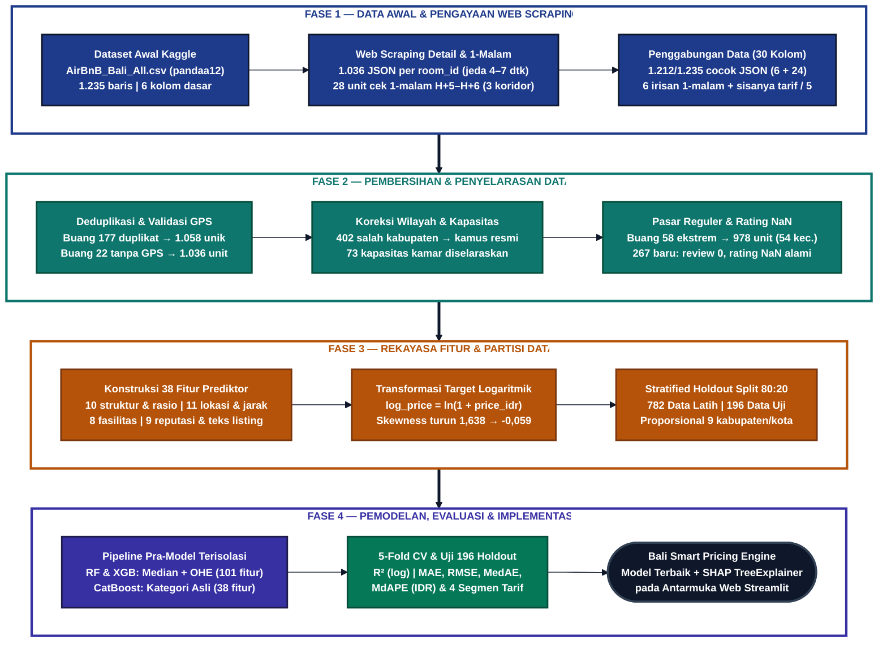

### 3.2 Pengumpulan dan Pengayaan Data

Karena Airbnb tidak menyediakan basis data resmi spesifikasi properti per wilayah [7], [8], pengumpulan data memadukan repositori publik dengan pengayaan *web scraping* dalam dua tahap:

1. **Pemeriksaan Dataset Awal Kaggle (`AirBnB_Bali_All.csv`):** Data awal bersumber dari *Indonesia Airbnb Dataset: Bali* oleh Luthfi Abdillah (`pandaa12`) di Kaggle yang memuat 1.235 baris dan enam kolom dasar (`nama`, `harga`, `rating`, `jumlah_review`, `link`, `wilayah`). Verifikasi terhadap halaman asli Airbnb menemukan tiga kendala: kolom `harga` merupakan akumulasi paket lima malam bawaan pencarian tanpa tanggal, tidak tersedia koordinat GPS maupun daftar fasilitas, serta label `wilayah` kerap tertukar ke kabupaten sebelah akibat radius pencarian peta sementara `rating` unit baru bercampur teks `"New"` dan sel kosong.
2. **Pengayaan Detail Properti dan Verifikasi Tarif Satu Malam:** Melalui tautan unik properti (`room_id`), dilakukan penarikan halaman rincian dengan jeda acak 4 hingga 7 detik serta waktu tunggu (*cooldown*) berkala hingga menghasilkan 1.036 berkas JSON lokal berisi koordinat lintang-bujur, nama kecamatan, kapasitas fisik, status *Superhost*, *self check-in*, daftar fasilitas, dan deskripsi unit. Secara paralel, dilakukan pengambilan pembanding menginap satu malam murni (*check-in* H+5 hingga *check-out* H+6) pada koridor Denpasar, Kuta, dan Canggu yang memperoleh 28 unit terverifikasi dengan 6 unit beririsan langsung pada dataset awal. Pencocokan keenam irisan tersebut mengonfirmasi pola paket lima malam, sehingga tarif satu malam ditetapkan memakai angka terverifikasi langsung pada 6 irisan tersebut dan hasil bagi lima (`harga / 5`) pada baris lainnya. Penggabungan seluruh sumber bersama ekstraksi tipe properti dan kata kunci deskripsi memadankan 1.212 dari 1.235 baris ke dalam tabel pengayaan 30 kolom seperti dirangkum pada Tabel 3.1.

Tabel 3.1 Perbandingan Kelengkapan Atribut Dataset Sebelum dan Sesudah Pengayaan

| Aspek Data | Dataset Awal Kaggle (6 Kolom) | Dataset Hasil Pengayaan (30 Kolom) | Manfaat Pemodelan |
| :--- | :--- | :--- | :--- |
| Kelengkapan Kolom | 6 kolom dasar (`nama`, `harga`, `rating`, `jumlah_review`, `link`, `wilayah`). | 30 kolom (6 diselaraskan + 24 atribut baru: ID, lokasi, kapasitas, status, 7 fasilitas, 4 kata kunci teks). | Menyediakan spesifikasi fisik dan konteks unit di luar katalog pencarian mentah. |
| Skala Tarif Sewa | Tercampur tarif paket 5 malam bawaan pencarian tanpa tanggal. | Dinormalisasi ke sewa 1 malam murni (verifikasi `H+5–H+6` pada 6 irisan & `harga / 5`). | Menyamakan satuan target Rupiah per malam secara konsisten di seluruh unit. |
| Posisi Geografis | Hanya label kabupaten/kota yang sering tertukar radius peta. | Titik koordinat GPS presisi beserta nama kecamatan awal dari JSON unit. | Memungkinkan pemetaan batas wilayah resmi Bali dan penghitungan jarak wisata. |
| Fisik & Fasilitas | Kosong (tanpa data jumlah kamar maupun keberadaan kolam renang). | Lengkap (kapasitas ruang, kolam privat, *bathtub*, meja kerja, *jacuzzi*, staf). | Membedakan struktur harga kamar sewa hemat hingga vila privat mewah. |

### 3.3 Pembersihan Data dan Penanganan Unit Baru (Rating NaN)

Dataset pengayaan awal sebanyak 1.235 baris dibersihkan melalui enam tahapan berurutan pada Tabel 3.2. Pertama, deduplikasi berdasarkan kunci unik `room_id` menghapus 177 baris ganda akibat irisan area pencarian sehingga menyisakan 1.058 unit unik. Kedua, sebanyak 22 unit tanpa koordinat `latitude` dan `longitude` disisihkan karena posisi spasial merupakan determinan vital harga sewa [6], [11], meninggalkan 1.036 unit berkoordinat di Bali. Ketiga, pemetaan ulang kecamatan menggunakan kamus wilayah resmi Bali (`SUBDISTRICT_MAP`) memulihkan 402 baris yang salah label kabupaten, sementara ekstraksi pola teks judul (seperti `'1BR'` atau `'2 Bedroom'`) dan aturan deteksi lingkup kamar menyelaraskan kapasitas 73 unit. Keempat, penyaringan pasar harian reguler menyingkirkan 58 unit bertarif ekstrem—terdiri atas 1 unit di bawah Rp 150.000/malam, 18 unit di atas Rp 10.000.000/malam, dan 39 unit di atas Rp 4.000.000 per kamar tidur—sehingga menghasilkan tepat 978 unit bersih lintas 54 kecamatan pada sembilan kabupaten/kota.

Kelima, penanganan khusus diterapkan pada 267 unit baru (27,3%) yang memiliki `review_count = 0` dengan kolom `rating` mentah berisi teks `"New"` atau kosong, karena Airbnb baru menampilkan skor bintang setelah menerima ulasan yang cukup (minimal 3 ulasan pada dataset ini). Seluruh 267 unit baru dipertahankan pada `review_count = 0`, diberi penanda biner `is_new_listing = 1`, dan kolom `rating`-nya dibiarkan berstatus `NaN` alami, sedangkan 711 unit berulasan (72,7%) memiliki 3 hingga 839 ulasan dengan skor `rating` 3,50 hingga 5,00 (median 4,95). Nilai `NaN` sengaja tidak diganti angka nol agar properti baru tidak dianggap memiliki mutu bintang nol jauh di bawah rentang nyata 3,50–5,00; CatBoost memisahkan `NaN` langsung pada percabangan pohonnya, sementara Random Forest dan XGBoost mengisinya dengan median lipatan latih guna mencegah *data leakage* [14].

Tabel 3.2 Rekapitulasi Tahapan Pembersihan Data Menuju 978 Unit Pasar Reguler

| Tahap Pembersihan | Temuan Masalah pada Data | Tindakan Perbaikan | Sisa Unit |
| :--- | :--- | :--- | :--- |
| Dataset Gabungan Awal | Seluruh baris gabungan Kaggle dan JSON hasil *scraping*. | Titik awal proses kurasi data. | 1.235 |
| Deduplikasi `room_id` | 177 baris ganda akibat irisan area pencarian. | Menghapus baris duplikat memakai kunci `room_id`. | 1.058 |
| Validasi Koordinat GPS | 22 unit tanpa nilai `latitude` dan `longitude`. | Menyisihkan unit tanpa koordinat lokasi. | 1.036 |
| Koreksi Wilayah & Kapasitas | 402 baris salah kabupaten; 73 unit berkapasitas keliru. | Pemetaan `SUBDISTRICT_MAP` & ekstraksi pola judul. | 1.036 |
| Penyaringan Pasar Reguler | 58 tarif ekstrem (<Rp 150 rb, >Rp 10 jt, >Rp 4 jt/kamar). | Menyisihkan tarif uji coba dan resor skala besar. | 978 |
| Penanganan Unit Baru | 267 unit (27,3%) `review_count = 0` berlabel `"New"`/kosong. | Menjaga `rating = NaN` alami & mengisi `is_new_listing = 1`. | 978 |

### 3.4 Rekayasa 38 Fitur Prediktor dan Transformasi Target

Dari 30 kolom hasil pengayaan, kolom tautan (`url`) dibuang dan ditambahkan 12 fitur prediktor rekayasa serta 1 target logaritmik hingga membentuk 42 kolom akhir: 4 kolom nonprediktor (`room_id`, `name`, `price_idr`, `log_price`) dan tepat 38 fitur prediktor $X$ yang dikelompokkan ke dalam empat rumpun pada Tabel 3.3. Dua belas fitur rekayasa mencakup empat rasio kepadatan ruang (`guests_per_bedroom`, `baths_per_bedroom`, `beds_per_bedroom`, `total_rooms_index`), satu skor agregasi fasilitas mewah tanpa bobot subjektif (`total_luxury_amenities`, skala 0–5), serta tujuh fitur jarak permukaan bumi memakai formula Haversine menuju Canggu/Seminyak, Ubud, Uluwatu, Sanur, Kintamani, Bandara Ngurah Rai, dan jarak sentra wisata terdekat (`min_dist_tourism_hub_km`) [18], [19]:

$$d_{i,h} = 2R \arcsin\left(\sqrt{\sin^2\left(\frac{\Delta\varphi}{2}\right) + \cos(\varphi_i)\cos(\varphi_h)\sin^2\left(\frac{\Delta\lambda}{2}\right)}\right)$$

dengan $d_{i,h}$ menyatakan jarak permukaan bumi (km), $R = 6.371{,}0\text{ km}$ jari-jari bumi, $\varphi_i, \varphi_h$ lintang dan $\lambda_i, \lambda_h$ bujur dalam radian, serta $\Delta\varphi = \varphi_h - \varphi_i$ dan $\Delta\lambda = \lambda_h - \lambda_i$.

Pada sisi target, tarif harian 978 unit terbentang dari Rp 154.358 hingga Rp 9.786.094 per malam (rata-rata Rp 2.064.199; median Rp 1.470.000) dengan kemiringan kanan (*skewness*) tinggi sebesar 1,638. Target kemudian ditransformasi ke skala logaritma natural [19]:

$$y_i^{(\mathrm{log})} = \ln(1 + y_i)$$

sehingga *skewness* turun menjadi -0,059 sebagaimana ditunjukkan bersama peta persebaran spasial 978 unit dan enam simpul Haversine pada Gambar 3.2.

Tabel 3.3 Pengelompokan 38 Fitur Prediktor beserta Statistik Utama pada 978 Unit Bersih

| Rumpun Fitur & Asal | Jumlah | Daftar Atribut dan Statistik Utama (978 Unit) | Peran Penentuan Tarif |
| :--- | :--- | :--- | :--- |
| Struktur & Kapasitas (6 Pengayaan + 4 Rasio) | 10 fitur | `property_type` (456 vila, 271 kamar/*homestay*, 142 *cottage*, 109 rumah), `is_room_only` (26,1%), `accommodates`, `bedrooms`, `beds`, `bathrooms`, `guests_per_bedroom` (med 2,0), `baths_per_bedroom` (med 1,0), `beds_per_bedroom`, `total_rooms_index`. | Membedakan ukuran fisik properti dan kepadatan hunian per kamar. |
| Lokasi & Spasial (4 Pengayaan + 7 Jarak) | 11 fitur | `regency` (9 kabupaten/kota), `sub_district` (54 kecamatan), `latitude`, `longitude`, `min_dist_tourism_hub_km` (med 24,88 km; maks 89,41 km), serta 6 jarak Haversine ke sentra wisata/bandara. | Menangkap variasi harga antarwilayah dan kedekatan sentra wisata. |
| Fasilitas & Kemewahan (7 Pengayaan + 1 Skor) | 8 fitur | `has_private_pool` (38,2%), `has_pool` (82,8%), `has_bathtub` (49,4%), `has_parking` (91,6%), `has_workspace` (62,6%), `has_jacuzzi` (5,2%), `has_service_staff` (10,3%), `total_luxury_amenities` (0–5). | Mengukur kelengkapan fasilitas pembeda unit hemat hingga mewah. |
| Reputasi, Operasi & Teks (9 Pengayaan) | 9 fitur | `rating` (711 valid 3,50–5,00; med 4,95; 267 `NaN`), `review_count` (0 atau 3–839), `is_new_listing` (27,3%), `is_superhost` (60,6%), `has_self_checkin` (47,4%), `nlp_luxury` (15,6%), `nlp_beach_ocean` (32,8%), `nlp_nature_view` (39,3%), `nlp_budget_cozy` (3,8%). | Mencerminkan kredibilitas ulasan, layanan, dan sinyal deskripsi iklan. |

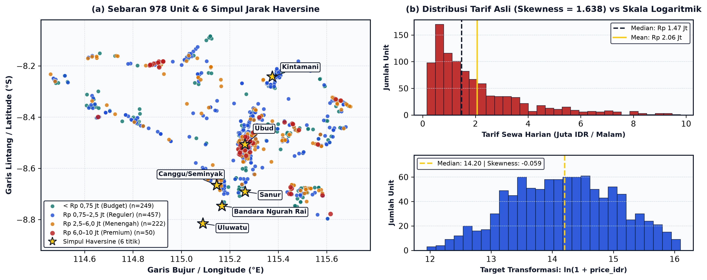{width=13.8cm}

### 3.5 Rancangan Pra-Pemrosesan Model, Partisi Data, dan Evaluasi

Dataset bersih sebanyak 978 unit dipartisi memakai *stratified split* 80:20 berdasarkan kabupaten/kota (`random_state = 42`) [18], menghasilkan 782 unit data latih dan 196 unit data uji *holdout* yang dikunci penuh di luar proses pelatihan, imputasi, maupun penyandian kategori guna mencegah kebocoran data (*data leakage*) [20]. Pada tahap pemodelan, Random Forest [13] dan XGBoost [14] dijalankan melalui *pipeline* `ColumnTransformer` yang diproses terpisah di tiap lipatan latih menggunakan `SimpleImputer(strategy="median")` untuk `rating` kosong serta `OneHotEncoder(handle_unknown="ignore")` yang memekarkan 9 kabupaten, 53 kecamatan latih, dan 4 tipe properti menjadi 66 kolom biner *dummy* (total 101 fitur masukan bersama 35 kolom numerik) sehingga 1 kecamatan yang hanya muncul pada data uji (`Kuta Selatan`) dipetakan aman bernilai nol. Sebaliknya, CatBoost [15] menerima langsung 38 fitur asli menggunakan *ordered target statistics* dan percabangan `NaN` secara *native*. Rincian konfigurasi ketiga model dirangkum pada Tabel 3.4, sementara arsitektur validasi silang 5-lipatan (`KFold`) dan uji *holdout* disajikan pada Gambar 3.3.

Tabel 3.4 Perbandingan Pra-Pemrosesan Fitur, Penanganan Nilai Kosong, dan Hiperparameter Model

| Algoritma | Pra-Pemrosesan Fitur | Penanganan Rating Kosong (`NaN`) | Hiperparameter Utama |
| :--- | :--- | :--- | :--- |
| Random Forest (*Baseline*) | `ColumnTransformer`: `OneHotEncoder` (66 biner) + 35 numerik = 101 fitur. | `SimpleImputer` (median) dihitung per lipatan latih. | `n_estimators = 300; max_depth = 14; min_samples_leaf = 2; random_state = 42.` |
| XGBoost Regressor | `ColumnTransformer`: `OneHotEncoder` (66 biner) + 35 numerik = 101 fitur. | `SimpleImputer` (median) dihitung per lipatan latih. | `n_estimators = 350; learning_rate = 0,035; max_depth = 5; subsample = 0,8; colsample_bytree = 0,8; random_state = 42.` |
| CatBoost Regressor | *Ordered Target Statistics* langsung pada 38 fitur asli. | Percabangan nilai `NaN` bawaan (*native*). | `iterations = 600; learning_rate = 0,035; depth = 6; l2_leaf_reg = 3,0; loss_function = RMSE; random_seed = 42.` |

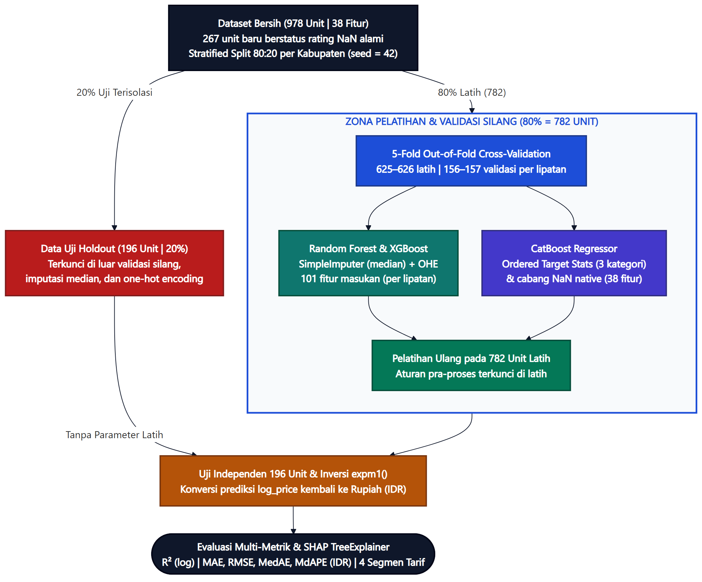{width=11.5cm}

Nilai determinasi R² dihitung langsung pada skala `log_price`, sedangkan seluruh galat bisnis dihitung dalam satuan Rupiah setelah prediksi dikembalikan memakai eksponensial balik [19]:

$$\hat{y}_i = \exp\!\left(\hat{y}_i^{(\mathrm{log})}\right) - 1$$

Evaluasi menggabungkan metrik standar R², MAE, dan RMSE [19], [21] dengan dua ukuran nilai tengah yang tahan terhadap pencilan vila mewah [22], [23]:

$$\mathrm{MedAE} = \mathrm{median}\!\left(\left|y_i - \hat{y}_i\right|\right)$$

$$\mathrm{MdAPE} = \mathrm{median}\!\left(\frac{\left|y_i - \hat{y}_i\right|}{y_i}\right) \times 100\%$$

Selanjutnya, performa model terbaik dianalisis menurut empat segmen harga pasar, kondisi properti baru (*cold-start*), serta kontribusi marjinal fitur berbasis SHAP *TreeExplainer* [16], [17], [23].

---

## BAB IV HASIL DAN PEMBAHASAN

### 4.1 Komparasi Performa Tiga Model Machine Learning

Hasil pengujian ketiga algoritma ansambel pohon pada validasi silang lima lipatan (782 unit latih) dan data uji terpisah (*holdout*, 196 unit) disajikan secara lengkap pada Tabel 4.1. Semakin tinggi nilai R² (↑) dan semakin kecil nilai kesalahan MAE, RMSE, MedAE, serta MdAPE (↓), semakin akurat hasil prediksi model; sel berwarna hijau muda menandai nilai terbaik pada tiap kolom.

Tabel 4.1 Perbandingan Kinerja Tiga Model pada Validasi Silang 5-Lipatan dan 196 Data Uji Holdout

| Model | CV R² ↑ | CV MAE (IDR) ↓ | Test R² ↑ | Test MAE (IDR) ↓ | Test RMSE (IDR) ↓ | Test MedAE (IDR) ↓ | Test MdAPE (%) ↓ |
| :--- | :--- | :--- | :--- | :--- | :--- | :--- | :--- |
| CatBoost Regressor | 0,6636 | Rp 717.074 | 0,6708 | Rp 764.207 | Rp 1.231.953 | Rp 391.492 | 30,09% |
| XGBoost Regressor | 0,6631 | Rp 714.995 | 0,6622 | Rp 773.730 | Rp 1.249.748 | Rp 411.693 | 27,61% |
| Random Forest (*Baseline*) | 0,6291 | Rp 737.098 | 0,6560 | Rp 809.098 | Rp 1.264.986 | Rp 470.400 | 31,63% |

Berdasarkan Tabel 4.1, CatBoost Regressor tampil sebagai model terbaik dengan memimpin pada lima dari tujuh indikator: CV R² tertinggi (0,6636), Test R² tertinggi (0,6708), serta kesalahan Rupiah terendah pada MAE (Rp 764.207), RMSE (Rp 1.231.953), dan MedAE (Rp 391.492). Secara nyata, separuh dari seluruh properti uji diprediksi meleset tidak lebih dari Rp 391.492 per malam. Di sisi lain, XGBoost Regressor unggul tipis pada CV MAE (Rp 714.995 dibanding Rp 717.074) serta mencatat persentase kesalahan tengah (Test MdAPE) terbaik sebesar 27,61% (unggul 2,48 poin persen atas CatBoost), sedangkan Random Forest berada di posisi terakhir pada seluruh metrik (Test R² 0,6560; MedAE Rp 470.400).

Keunggulan CatBoost pada kemampuan menjelaskan variasi harga (R²) dan seluruh kesalahan prediksi dalam Rupiah berasal dari mekanisme *ordered target statistics* serta struktur pohon simetris (*oblivious trees*) [15]. Pemecahan 54 kecamatan melalui *one-hot encoding* membuat masukan Random Forest [13] dan XGBoost [14] melebar menjadi 101 kolom biner yang sebagian besar bernilai nol, sehingga pembagian pohon pada kecamatan dengan sedikit sampel menjadi kurang efektif; sebaliknya, CatBoost menjaga 38 fitur asli tetap padat sekaligus memproses `rating = NaN` secara langsung (*native*). Keunggulan *gradient boosting* atas *bagging* sejalan dengan studi Airbnb Indonesia [10] dan perbandingan lintas kota [9], sedangkan rapatnya nilai CV R² (0,6636) terhadap Test R² (0,6708; selisih +0,0072) dibanding R² latih (0,8740) memastikan model tidak mengalami kebocoran data maupun *overfitting* pada 196 data uji terpisah [20], termasuk kecamatan Kuta Selatan yang belum pernah muncul saat pelatihan.

### 4.2 Evaluasi Akurasi per Segmen Harga dan Unit Baru

Karena rentang tarif sewa di Bali sangat lebar dan beragam—mulai dari kamar ratusan ribu hingga vila hampir sepuluh juta rupiah per malam—satu angka rata-rata global belum cukup menggambarkan performa model. Oleh sebab itu, hasil prediksi CatBoost pada 196 data uji dibedah per kelompok pada Tabel 4.2 dan Gambar 4.1 menurut empat kelas harga pasar (Panel A) serta ketersediaan riwayat ulasan (Panel B). Semakin kecil nilai MAE, MedAE, dan MdAPE (↓), semakin tepat estimasi model; warna pada kolom MdAPE menandai tingkat kesalahan relatif, yakni hijau muda (≤31%, baik), kuning muda (31%–40%, sedang), dan merah muda (>40%, tinggi).

Tabel 4.2 Evaluasi Kesalahan CatBoost per Kelompok pada 196 Data Uji Menurut Kelas Harga dan Status Ulasan

| Segmen Evaluasi | n | Rata-rata Aktual | Rata-rata Prediksi | MAE (IDR) ↓ | MedAE (IDR) ↓ | MdAPE (%) ↓ |
| :--- | :--- | :--- | :--- | :--- | :--- | :--- |
| Panel A: Homestay / Budget (< Rp 750 rb) | 41 | Rp 488.600 | Rp 717.705 | Rp 269.565 | Rp 150.589 | 38,80% |
| Panel A: Villa Reguler (Rp 750 rb–2,5 jt) | 89 | Rp 1.467.322 | Rp 1.456.611 | Rp 432.483 | Rp 306.870 | 24,84% |
| Panel A: Villa Menengah (Rp 2,5–6,0 jt) | 56 | Rp 3.732.744 | Rp 2.903.795 | Rp 1.213.631 | Rp 1.231.149 | 34,69% |
| Panel A: Villa Premium (Rp 6,0–10 jt) | 10 | Rp 7.513.136 | Rp 4.347.002 | Rp 3.227.807 | Rp 3.501.920 | 46,94% |
| Panel B: Unit Baru (`rating = NaN`, rev = 0) | 63 | Rp 1.946.469 | Rp 1.622.646 | Rp 803.810 | Rp 295.685 | 29,07% |
| Panel B: Unit Berulasan (rev >= 3) | 133 | Rp 2.094.828 | Rp 1.724.644 | Rp 745.448 | Rp 417.070 | 30,10% |

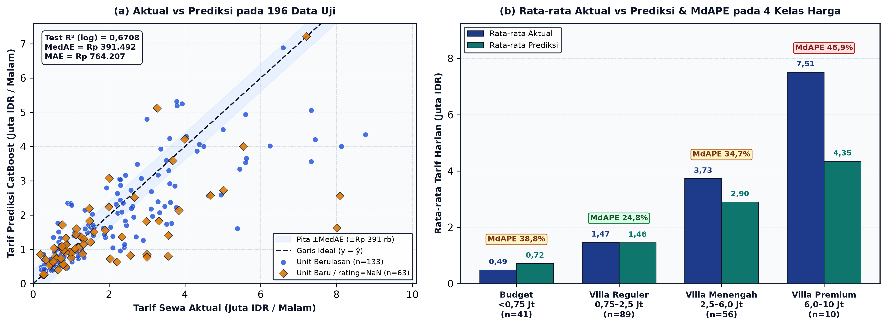{width=13.8cm}

Pada segmen terbesar pasar, yaitu Villa Reguler (Rp 750 ribu–2,5 juta; 89 unit atau 45,4% data uji), model meraih akurasi paling tinggi dengan rata-rata prediksi Rp 1.456.611 yang hampir menyamai harga aktual Rp 1.467.322 (MedAE Rp 306.870; MdAPE 24,84%). Secara keseluruhan pada 196 data uji, 49,5% prediksi meleset maksimal 30% dan 76,5% meleset maksimal 50%, dengan selisih prediksi yang hampir seimbang antara tebakan terlalu tinggi dan terlalu rendah (nilai tengah selisih -Rp 38.002). Sebaliknya, Gambar 4.1(b) memperlihatkan dua kecenderungan meleset pada batas bawah dan batas atas harga: tebakan agak terlalu mahal (*overprediction*) pada kelas Budget (aktual Rp 488.600 vs prediksi Rp 717.705; MdAPE 38,80%) serta tebakan terlalu murah (*underprediction*) pada Villa Premium (aktual Rp 7.513.136 vs prediksi Rp 4.347.002; MAE Rp 3.227.807; MdAPE 46,94%). Karena kelas Premium hanya berisi 10 unit uji (5,1%) dan faktor pembeda utamanya seperti luas tanah serta arsitektur visual tidak tersedia di data tabel, selisih besar pada 10 unit inilah yang menarik RMSE global (Rp 1.231.953) hingga tiga kali lipat MedAE (Rp 391.492), membuktikan pentingnya menggabungkan RMSE dan MAE dengan MedAE serta MdAPE [21]–[23].

Pada Panel B Tabel 4.2, pengujian properti baru (*cold-start*) membuktikan bahwa CatBoost tetap akurat memprediksi 63 unit baru tanpa riwayat ulasan (`rating = NaN`, `review_count = 0`) dengan MedAE Rp 295.685 dan MdAPE 29,07%—sejajar dengan 133 unit berulasan (MdAPE 30,10%)—sehingga mengatasi kendala pendekatan berbasis sentimen ulasan [10]. Nilai R² unit baru (0,5226; MAE Rp 803.810) memang lebih rendah daripada unit berulasan (R² 0,7354; MAE Rp 745.448) karena tanpa validasi ulasan tamu, beberapa vila baru berharga mahal menyebar lebih lebar di Gambar 4.1(a). Menurut tipe properti, akurasi relatif terbaik dicapai *Private Room/Homestay* (n = 50; MedAE Rp 188.054; MdAPE 23,70%), diikuti *Cottage/Bungalow* (n = 33; MdAPE 31,06%), Villa (n = 92; MdAPE 31,08%), dan *Entire House* (n = 21; MdAPE 34,42%) [15].

### 4.3 Interpretasi Faktor Penentu Tarif Berbasis SHAP

Analisis SHAP *TreeExplainer* [16] pada 196 data uji disajikan pada Gambar 4.2. Secara keseluruhan pada panel (a), sepuluh faktor paling berpengaruh adalah `property_type` (rata-rata |SHAP| = 0,183), `bedrooms` (0,134), `has_bathtub` (0,101), `total_luxury_amenities` (0,099), `total_rooms_index` (0,068), `sub_district` (0,067), `accommodates` (0,054), `bathrooms` (0,047), `regency` (0,036), dan `nlp_luxury` (0,034), diikuti jarak ke pusat Ubud (`dist_ubud_center_km`, 0,033) serta sinyal pantai/laut (`nlp_beach_ocean`, 0,032). Fitur kolam renang pribadi tidak muncul tersendiri di sepuluh besar karena pengaruhnya sudah tergabung ke dalam `total_luxury_amenities` dan melekat erat pada kategori Villa.

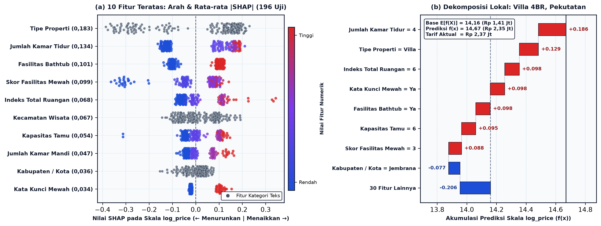{width=13.8cm}

Pada Gambar 4.2(b), rincian kontribusi fitur (*waterfall*) membedah satu contoh nyata dari data uji, yaitu vila empat kamar tidur di Pekutatan, Jembrana (`room_id` 909805552777906282). Dari nilai dasar pasar $E[f(X)] = 14{,}16$ (setara Rp 1,41 juta), spesifikasi fisik dan fasilitas mendorong tarif naik melalui 4 kamar tidur (+0,186), tipe Villa (+0,129), total 6 ruangan (+0,098), kata kunci mewah (+0,098), *bathtub* (+0,098), kapasitas 6 tamu (+0,095), dan 3 fasilitas mewah (+0,088). Sebaliknya, lokasi di Kabupaten Jembrana (-0,077) beserta 30 fitur jarak dan konteks lainnya (-0,206) menahan prediksi agar sesuai dengan kelas pasar wilayah barat Bali, sehingga menghasilkan $f(x) = 14{,}67$ (Rp 2.347.158) yang hanya terpaut 1,1% dari tarif aktual Rp 2.373.648. Temuan tiga pilar utama (struktur ruang, kelengkapan fasilitas, dan lokasi) ini sejalan dengan literatur determinan harga Airbnb [6], [11], [18] sekaligus membuktikan manfaat transparansi XAI bagi pemilik properti [17].

### 4.4 Implementasi Antarmuka Web Interaktif dan Simulasi Bisnis

Model terbaik CatBoost (`catboost_pricing_model.cbm`, berukuran 726 KiB) beserta metadata fitur (`feature_metadata.joblib`) diterapkan ke dalam aplikasi web interaktif Streamlit (*Bali Smart Pricing Engine*) dengan empat tab fungsional:

1. **Tab 1 — Kalkulator Estimasi Tarif & Simulasi *What-If*:** Menerima masukan lokasi, tipe unit, kapasitas, status properti baru (`rating = NaN`), dan fasilitas lalu menghitung otomatis seluruh 38 fitur termasuk 7 jarak Haversine. Seperti terlihat pada Gambar 4.3, simulasi vila dua kamar di Ubud berfasilitas lengkap menghasilkan estimasi Rp 3.292.301/malam dengan rentang pasar wajar Rp 2.900.809 s.d. Rp 3.683.794/malam (toleransi ±MedAE Rp 391.492). Pada bagian bawah tab yang sama (Gambar 4.4), modul simulasi *what-if* memperkirakan kenaikan tarif apabila fasilitas ditambah (misalnya *bathtub* +Rp 425.726/malam, interior mewah +Rp 238.125/malam, dan status *Superhost* +Rp 202.853/malam) [3], [17].
2. **Tab 2 — Peta Persebaran Geospasial 978 Unit:** Memetakan seluruh 978 properti bersih di sembilan kabupaten/kota Bali di atas peta interaktif OpenStreetMap dengan penyaring wilayah, tipe properti, dan batas tarif tertinggi (Gambar 4.5).
3. **Tab 3 — Dasbor Akurasi Model & Evaluasi Segmen:** Menampilkan kartu KPI utama CatBoost, tabel dan grafik perbandingan 3 model utama (Gambar 4.6), serta tabel akurasi empat kelas harga pasar (Gambar 4.7).
4. **Tab 4 — Faktor Penentu Harga (Explainable AI - SHAP):** Menyajikan visualisasi *global feature importance* dan distribusi *beeswarm* agar pengguna non-teknis dapat meninjau arah dampak fitur terhadap tarif (Gambar 4.8).

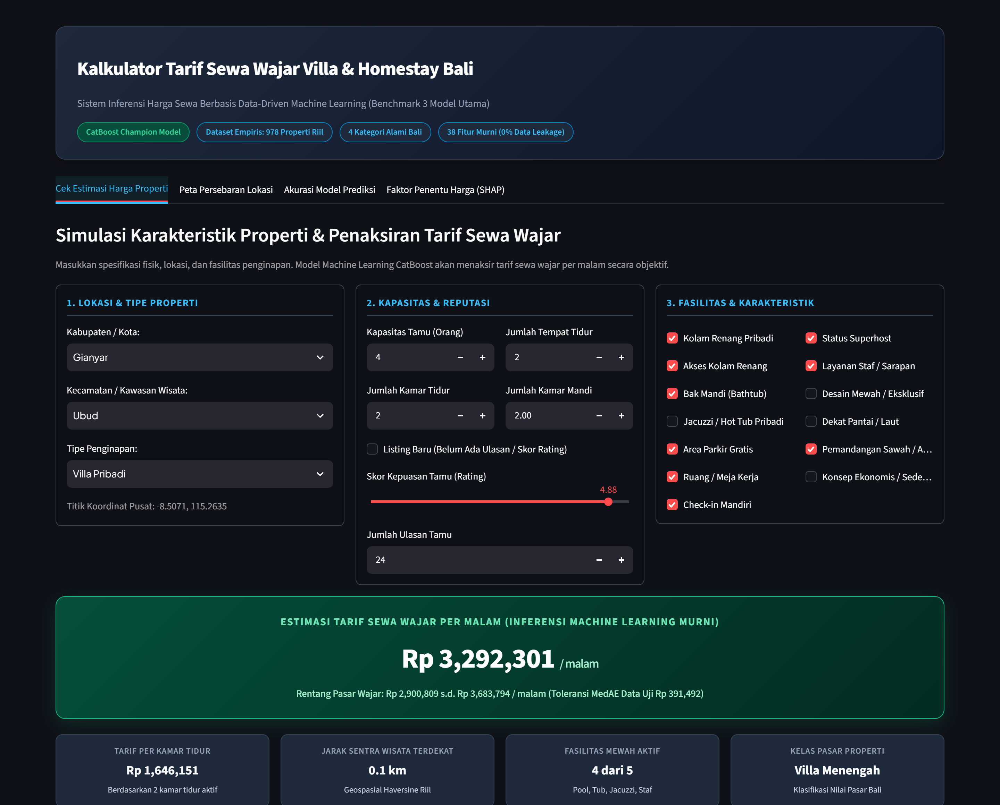{width=13.5cm}

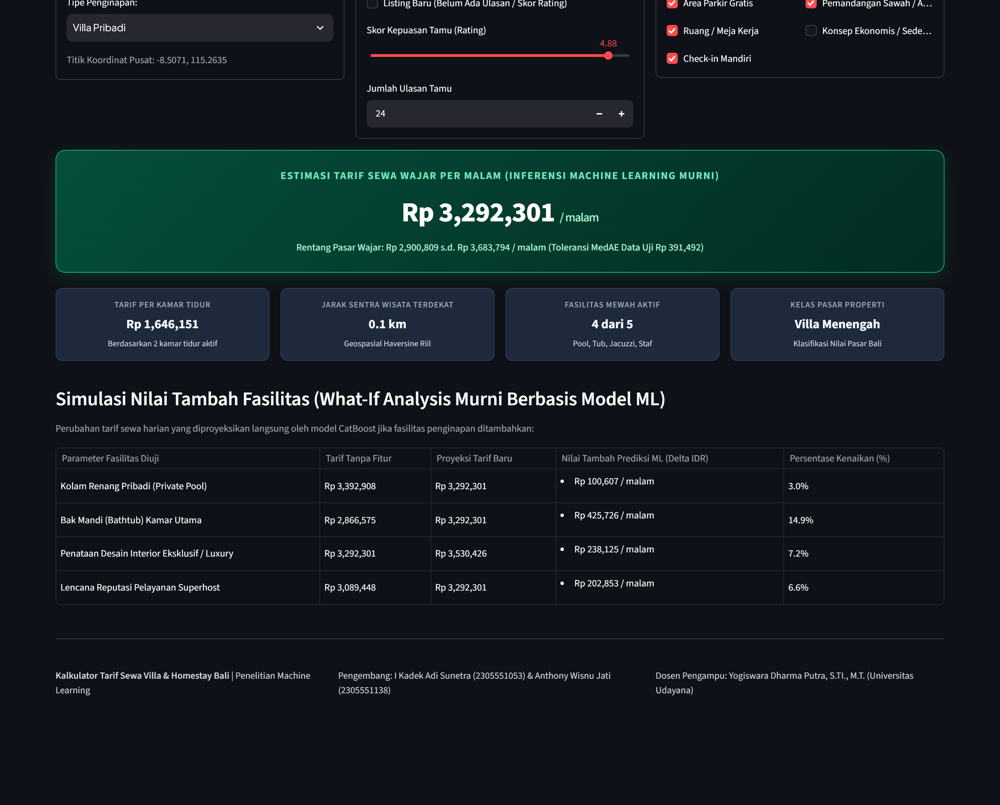{width=13.5cm}

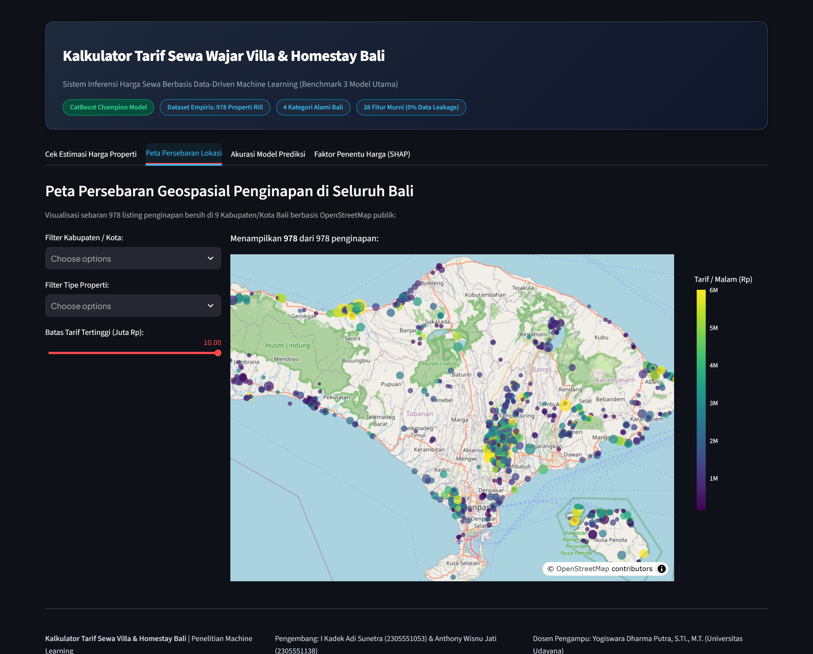{width=13.5cm}

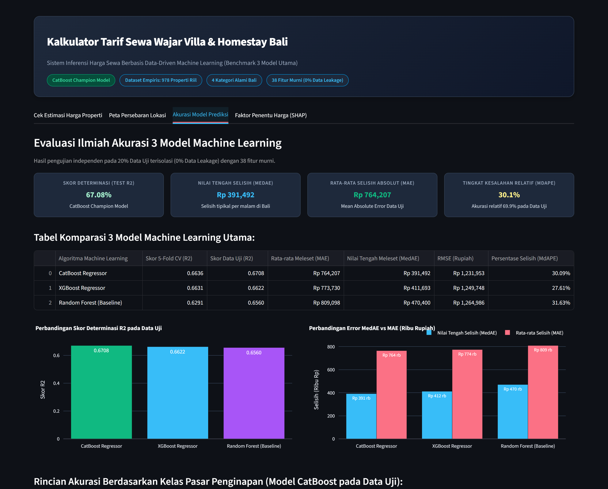{width=13.5cm}

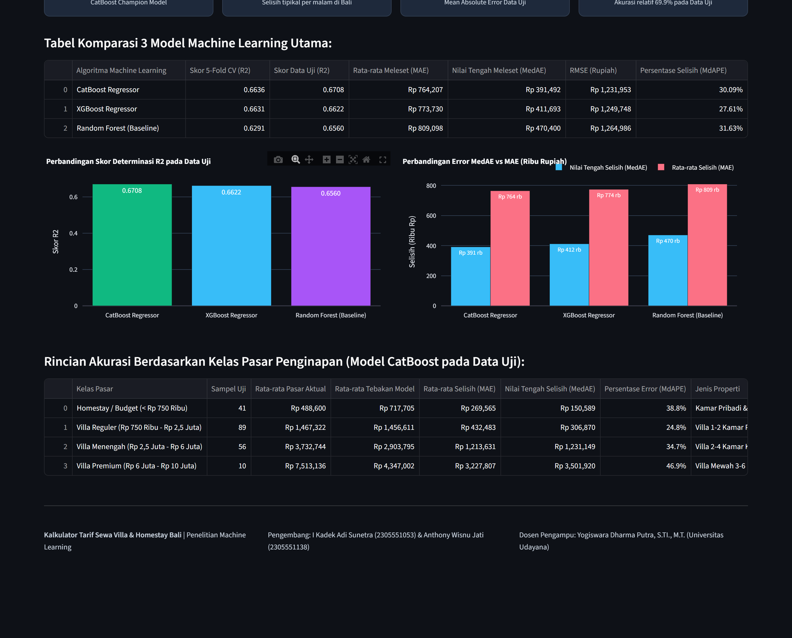{width=13.5cm}

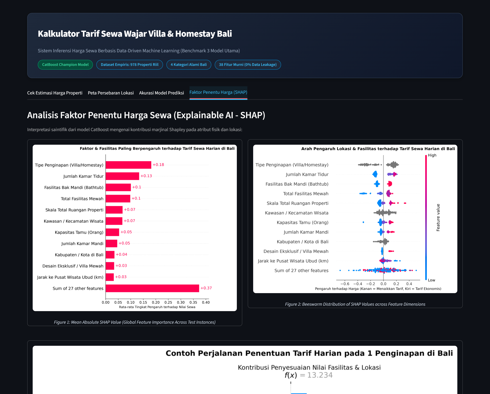{width=13.5cm}

### 4.5 Diskusi Keterbatasan Penelitian

Meskipun sistem bekerja stabil dan akurat pada segmen pasar utama Bali, tiga keterbatasan nyata perlu dicatat secara terbuka:

1. **Faktor di Luar Data Tabel (*Unobserved Variance*):** Sisa 32,92% variasi harga yang belum mampu dijelaskan model (1 − R²) berasal dari atribut yang belum tersedia pada data tabel, seperti kualitas foto arsitektur/interior, luas tanah dan bangunan (m²), pemandangan langsung laut atau tebing, serta perubahan tarif musiman (*peak/low season*) [6], [12], [18].
2. **Keterbatasan Sampel pada Vila Sangat Mahal:** Segmen Villa Premium (Rp 6–10 juta) hanya mencakup 10 unit pada data uji dan beberapa kecamatan berkepadatan rendah memiliki sedikit observasi (termasuk Kuta Selatan yang hanya muncul di data uji), sehingga prediksi pada vila sangat mahal cenderung terlalu rendah (*underprediction*).
3. **Ketergantungan Normalisasi Cuplikan Tunggal:** Akibat keterbatasan keterbukaan data resmi platform daring [7], [8], tarif satu malam pada mayoritas baris di luar enam unit irisan verifikasi langsung masih diturunkan melalui pembagian `harga / 5` pada satu periode waktu cuplikan.

---

## BAB V PENUTUP

### 5.1 Kesimpulan

Berdasarkan seluruh tahapan perancangan, pengolahan data, pemodelan, dan pengujian yang telah dilakukan, penelitian ini menyimpulkan tiga hal utama yang menjawab rumusan masalah:

1. **Membantu Pemilik Menentukan Tarif Sewa Harian yang Sesuai Karakteristik Properti:** Sistem rekomendasi tarif *Bali Smart Pricing Engine* berhasil dibangun dan diterapkan dalam aplikasi web interaktif agar pemilik vila dan *homestay* di Bali tidak lagi bergantung pada perkiraan pribadi atau sekadar meniru tarif tetangga. Dengan memasukkan spesifikasi fisik, kelengkapan fasilitas, dan lokasi properti, pemilik memperoleh estimasi harga pasar per malam beserta rentang harga wajar (±Rp 391.492), peta pembanding di seluruh Bali, serta simulasi perubahan tarif apabila fasilitas tertentu ditambahkan.
2. **Mengatasi Keterbatasan Atribut dan Kualitas Data Katalog Awal:** Keterbatasan *dataset* katalog daring awal yang hanya memuat enam kolom dasar berhasil diatasi melalui pengambilan rincian halaman properti, penyamaan satuan tarif ke satu malam murni, serta pembersihan duplikasi, ketiadaan koordinat, kesalahan batas kabupaten maupun kapasitas kamar, dan tarif ekstrem. Proses ini menghasilkan 978 data properti pasar reguler yang lengkap pada 54 kecamatan di sembilan kabupaten/kota Bali dengan 38 fitur siap latih, sembari menjaga 267 properti baru tanpa ulasan tetap pada kondisi alaminya (`rating = NaN`) tanpa pengisian angka buatan.
3. **Membangun Model Prediksi yang Andal—Termasuk bagi Properti Baru—beserta Dasar Estimasi yang Jelas:** Dari perbandingan tiga algoritma ansambel pohon keputusan pada 196 data uji terpisah, CatBoost Regressor memberikan kinerja terbaik dan paling seimbang dengan R² sebesar 0,6708, rata-rata kesalahan (MAE) Rp 764.207, dan kesalahan tengah (MedAE) Rp 391.492 per malam, mengungguli Random Forest (R² 0,6560; MedAE Rp 470.400) serta mengungguli XGBoost (R² 0,6622; MedAE Rp 411.693) pada seluruh kesalahan Rupiah meskipun XGBoost mencatat persentase kesalahan tengah terendah (MdAPE 27,61%). Model CatBoost bekerja paling akurat pada segmen mayoritas Villa Reguler (MdAPE 24,84%) dan tetap andal pada properti baru yang belum memiliki ulasan (MdAPE 29,07%). Penerapan analisis SHAP memberikan dasar estimasi yang mudah dipahami dengan membuktikan bahwa tipe properti, jumlah kamar tidur, fasilitas *bathtub* dan total kemewahan, jumlah ruangan, serta lokasi kecamatan menjadi pendorong utama tarif sewa harian di Bali.

### 5.2 Saran

1. Memperluas pengumpulan data menjadi seri waktu (*longitudinal scraping*) lintas musim sepi dan puncak liburan agar model mampu menangkap fluktuasi *dynamic pricing* musiman secara langsung tanpa bergantung pada satu cuplikan waktu.
2. Memperkaya himpunan fitur dengan modalitas tambahan seperti skor estetika visual foto properti berbasis *computer vision* serta informasi luas tanah/bangunan guna menekan sisa 32,92% variansi harga yang belum terjelaskan.
3. Memperbesar jumlah sampel pada segmen vila mewah di atas Rp 6 juta per malam dan kecamatan berkepadatan rendah agar bias *underprediction* pada ujung atas pasar dapat ditekan secara signifikan.

---

## DAFTAR PUSTAKA

[1] A. M. Y. Iswara, I. G. A. N. D. Suyasa, R. A. B. N. Putra, and P. H. Susanti, “Tourist Arrivals Increase, Hotel Occupancy Declines: Governance Strategies for Sustainable Tourism Accommodation in Bali,” *Jurnal Kajian Bali (Journal of Bali Studies)*, vol. 16, no. 2, pp. 494–521, Aug. 2026. DOI: https://doi.org/10.24843/JKB.2026.v16.i02.p03

[2] R. Pramono, R. Sianipar, and I. W. R. Junaedi, “Between Tradition and Transformation: Revitalizing Traditional Homestays for Sustainable Ecotourism in Ubud, Bali,” *TourismSpectrum: Diversity & Dynamics*, vol. 2, no. 1, pp. 7–17, 2025. DOI: https://doi.org/10.56578/tsdd020102

[3] I. G. A. E. Widiningsih, K. A. R. I. Laksmana, and I. G. A. D. W. S. W. Suyasa, “The Effect of Dynamic Pricing Strategy on Sales Performance through the Airbnb Platform: Evidence from Private Villas in Canggu, Bali,” *Formosa Journal of Multidisciplinary Research (FJMR)*, vol. 4, no. 9, pp. 4699–4708, 2025. DOI: https://doi.org/10.55927/fjmr.v4i9.506

[4] P. E. Pramadewi, Murtianingsih, and Fathorrahman, “The Influence of Online Reviews, Price, and Promotions on Hotel Room Booking Decisions via Online Travel Agents for Hotels and Villas Managed by Samhita Bali Hospitality,” *International Journal of Economics, Business and Innovation Research (IJEBIR)*, vol. 5, no. 5, pp. 1858–1872, 2026. DOI: https://doi.org/10.63922/ijebir.v5i05.5798

[5] I. N. M. Wijaya, I. M. D. Oka, N. G. N. S. Murni, and P. W. Darmayanti, “E-Marketing in Accommodation Business Model Innovation at Airbnb in Bali,” *Jurnal Ilmiah Hospitality Management*, vol. 13, no. 2, pp. 119–126, 2023. DOI: https://doi.org/10.22334/jihm.v13i2.249

[6] C. Chang and S. Li, “Study of Price Determinants of Sharing Economy-Based Accommodation Services: Evidence from Airbnb.com,” *Journal of Theoretical and Applied Electronic Commerce Research*, vol. 16, no. 4, pp. 584–601, 2021. DOI: https://doi.org/10.3390/jtaer16040035

[7] C. Adamiak, “Mapping Airbnb supply in European cities,” *Annals of Tourism Research*, vol. 71, pp. 67–71, 2018. DOI: https://doi.org/10.1016/j.annals.2018.02.008

[8] Y. Wang, M. Livingston, D. P. McArthur, and N. Bailey, “Enhancing our understanding of short-term rental activity: A daily scrape-based approach for Airbnb listings,” *PLoS One*, vol. 19, no. 2, p. e0298131, Feb. 2024. DOI: https://doi.org/10.1371/journal.pone.0298131

[9] N. Camatti, G. di Tollo, G. Filograsso, and S. Ghilardi, “Predicting Airbnb pricing: a comparative analysis of artificial intelligence and traditional approaches,” *Computational Management Science*, vol. 21, p. 30, May 2024. DOI: https://doi.org/10.1007/s10287-024-00511-4

[10] C. Digno, M. I. Jauhar, and M. N. Syaifullah, “Pendekatan Deep Learning dan Gradient Boosting dalam Prediksi Harga Properti Airbnb dengan Analisis Sentimen,” *Jurnal Elektronik Ilmu Komputer Udayana (JELIKU)*, vol. 12, no. 1, pp. 191–200, Aug. 2023. DOI: https://doi.org/10.24843/JLK.2023.v12.i01.p22

[11] Ö. Akalın and G. I. Alptekin, “Enhancing Airbnb Price Predictions with Location-Based Data: A Case Study of Istanbul,” in *Proceedings of the 19th Conference on Computer Science and Intelligence Systems (FedCSIS)*, vol. 39, pp. 207–212, 2024. DOI: https://doi.org/10.15439/2024F7603

[12] L. Jiang, Y. Li, N. Luo, J. Wang, and Q. Ning, “A Multi-Source Information Learning Framework for Airbnb Price Prediction,” in *2022 IEEE International Conference on Data Mining Workshops (ICDMW)*, pp. 1–7, 2022. DOI: https://doi.org/10.1109/ICDMW58026.2022.00009

[13] L. Breiman, “Random Forests,” *Machine Learning*, vol. 45, no. 1, pp. 5–32, 2001. DOI: https://doi.org/10.1023/A:1010933404324

[14] T. Chen and C. Guestrin, “XGBoost: A Scalable Tree Boosting System,” in *Proceedings of the 22nd ACM SIGKDD International Conference on Knowledge Discovery and Data Mining*, pp. 785–794, 2016. DOI: https://doi.org/10.1145/2939672.2939785

[15] L. Prokhorenkova, G. Gusev, A. Vorobev, A. V. Dorogush, and A. Gulin, “CatBoost: unbiased boosting with categorical features,” in *Advances in Neural Information Processing Systems*, vol. 31, pp. 6638–6648, 2018. [Online]. Available: https://proceedings.neurips.cc/paper_files/paper/2018/file/14491b756b3a51daac41c24863285549-Paper.pdf

[16] S. M. Lundberg and S.-I. Lee, “A Unified Approach to Interpreting Model Predictions,” in *Advances in Neural Information Processing Systems*, vol. 30, pp. 4765–4774, 2017. [Online]. Available: https://proceedings.neurips.cc/paper_files/paper/2017/file/8a20a8621978632d76c43dfd28b67767-Paper.pdf

[17] C. Kmen, G. Navratil, M. Kattenbeck, and I. Giannopoulos, “Evaluating human–machine collaboration through a comparative analysis of experts, machine learning, and hybrid approaches in real estate valuation,” *Scientific Reports*, vol. 16, p. 4044, Jan. 2026. DOI: https://doi.org/10.1038/s41598-025-34099-9

[18] M. Geerts, S. vanden Broucke, and J. De Weerdt, “A Survey of Methods and Input Data Types for House Price Prediction,” *ISPRS International Journal of Geo-Information*, vol. 12, no. 5, p. 200, May 2023. DOI: https://doi.org/10.3390/ijgi12050200

[19] J. Paik, S.-J. Baek, J.-W. Kim, and K. Ko, “Influence of Social Overhead Capital Facilities on Housing Prices Using Machine Learning,” *Applied Sciences*, vol. 13, no. 19, p. 10732, Sep. 2023. DOI: https://doi.org/10.3390/app131910732

[20] Y. Xu and R. Goodacre, “On Splitting Training and Validation Set: A Comparative Study of Cross-Validation, Bootstrap and Systematic Sampling for Estimating the Generalization Performance of Supervised Learning,” *Journal of Analysis and Testing*, vol. 2, pp. 249–262, Oct. 2018. DOI: https://doi.org/10.1007/s41664-018-0068-2

[21] T. O. Hodson, “Root-mean-square error (RMSE) or mean absolute error (MAE): when to use them or not,” *Geoscientific Model Development*, vol. 15, pp. 5481–5487, Jul. 2022. DOI: https://doi.org/10.5194/gmd-15-5481-2022

[22] J. Deppner, B. von Ahlefeldt-Dehn, E. Beracha, and W. Schaefers, “Boosting the Accuracy of Commercial Real Estate Appraisals: An Interpretable Machine Learning Approach,” *The Journal of Real Estate Finance and Economics*, vol. 71, pp. 314–351, 2025. DOI: https://doi.org/10.1007/s11146-023-09944-1

[23] M. Stang, B. Krämer, C. Nagl, and W. Schäfers, “From human business to machine learning—methods for automating real estate appraisals and their practical implications,” *Zeitschrift für Immobilienökonomie*, vol. 9, pp. 81–108, 2023. DOI: https://doi.org/10.1365/s41056-022-00063-1
