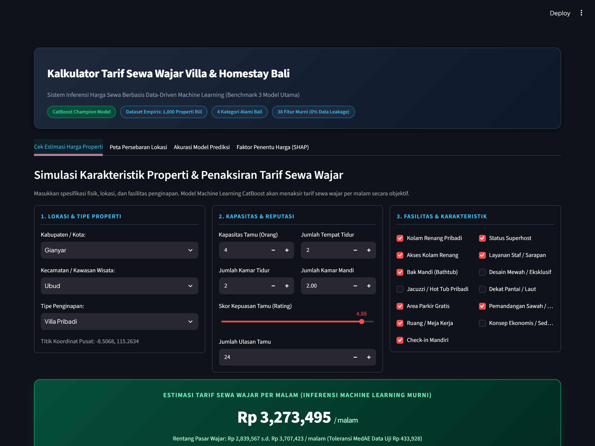
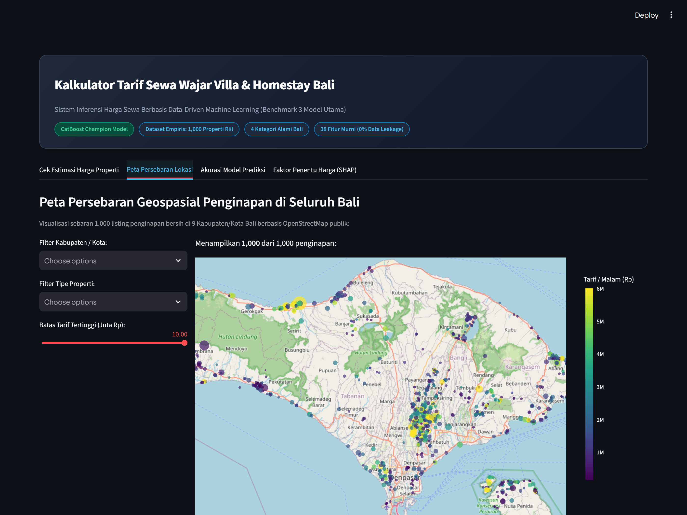
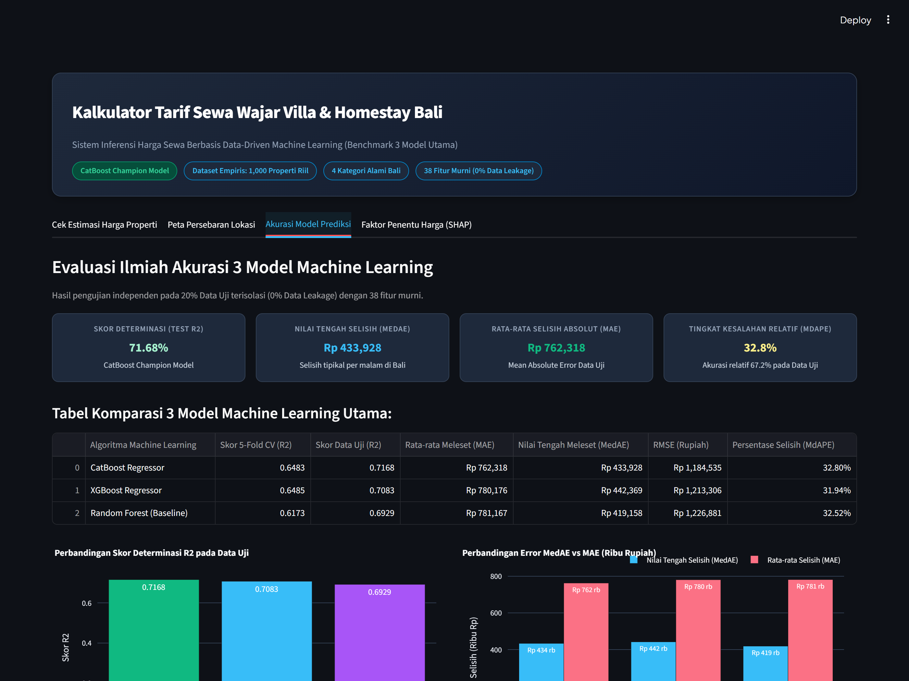
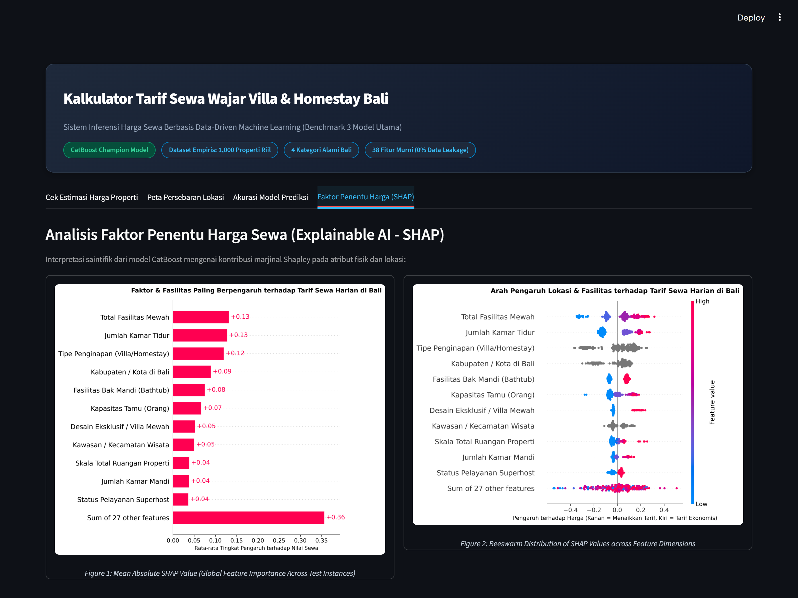

# BALI SMART PRICING: PREDIKSI TARIF SEWA HARIAN VILLA DAN HOMESTAY DI BALI MENGGUNAKAN CATEGORICAL BOOSTING DAN EXTREME GRADIENT BOOSTING

## LAPORAN TUGAS BESAR

**Diajukan guna memenuhi tugas besar mata kuliah Pembelajaran Mesin (Machine Learning)**

> [!NOTE]
> **Arsip Historis Iterasi Awal:** Dokumen laporan tugas besar ini mencatat versi awal eksperimen (`1.000` unit properti, `42` kecamatan, `29` kolom, split `800/200`, CatBoost Test `R² = 71,68%`). Data, arsitektur fitur, hasil benchmark, dan 23 rujukan versi final yang berlaku saat ini didokumentasikan pada [README.md](../../README.md), [panduan proyek](../panduan/quickstart.md), dan [naskah jurnal ilmiah](../jurnal/peta_semua_rumus_jurnal.md).

---

### Disusun Oleh:

1. **I KADEK ADI SUNETRA** (NIM: 2305551053)  
2. **ANTHONY WISNU JATI** (NIM: 2305551138)  

---

### Dosen Pengampu:

**Yogiswara Dharma Putra, S.TI., M.T.**  
**NIP: 199601192023211007**  

**PROGRAM STUDI TEKNOLOGI INFORMASI**  
**FAKULTAS TEKNIK**  
**UNIVERSITAS UDAYANA**  
**DENPASAR 2026**  

---

## DAFTAR ISI

- **BAB I PENDAHULUAN**
  - 1.1 Latar Belakang
  - 1.2 Rumusan Masalah
  - 1.3 Tujuan Tugas
  - 1.4 Manfaat Tugas
  - 1.5 Batasan Masalah
- **BAB II TINJAUAN PUSTAKA DAN LANDASAN TEORI**
  - 2.1 Penelitian Terdahulu
  - 2.2 Gap Analysis dan Arah Pengembangan
  - 2.3 Teori Hedonic Pricing pada Akomodasi Pariwisata
  - 2.4 Formulasi Regresi Prediksi Tarif Sewa
  - 2.5 Random Forest Regressor sebagai Baseline Bagging
  - 2.6 XGBoost Regressor sebagai Pembanding Gradient Boosting
  - 2.7 CatBoost Regressor dengan Penanganan Kategori Native
  - 2.8 Explainable AI Berbasis Shapley Values
  - 2.9 Simulasi Skenario Bisnis Properti
- **BAB III METODOLOGI PENELITIAN DAN SPESIFIKASI DATA**
  - 3.1 Gambaran Umum dan Skenario Penerapan
  - 3.2 Alur Kerja Penelitian
  - 3.3 Profil dan Karakteristik Dataset
  - 3.4 Metodologi Pengumpulan dan Pengayaan Data
  - 3.5 Kamus Data Master Awal
  - 3.6 Inventaris Data dan Audit Kualitas
  - 3.7 Rekonsiliasi Data Menuju Dataset Bersih
  - 3.8 Rancangan Partisi Data, Rekayasa Fitur, dan Evaluasi Model
- **BAB IV HASIL DAN PEMBAHASAN**
  - 4.1 Rekonsiliasi Data dan Karakteristik Dataset Bersih
  - 4.2 Evaluasi Komparasi Tiga Model Machine Learning
  - 4.3 Evaluasi Akurasi Bertingkat Berdasarkan Empat Segmen Pasar
  - 4.4 Interpretasi Faktor Penentu Tarif Berbasis Explainable AI
  - 4.5 Implementasi Antarmuka Sistem dan Diseminasi Aplikasi Web
- **BAB V PENUTUP**
  - 5.1 Kesimpulan
  - 5.2 Saran
- **DAFTAR PUSTAKA**

---

## BAB I PENDAHULUAN

### 1.1 Latar Belakang

Perkembangan industri pariwisata di Bali mendorong tingginya kebutuhan sarana akomodasi, terutama penginapan mandiri seperti villa dan *homestay* yang banyak dikelola oleh masyarakat lokal maupun pemilik perseorangan [1]. Bagi para pemilik, menentukan harga sewa per malam yang tepat merupakan keputusan penting yang menentukan kelangsungan operasional properti. Menentukan tarif sewa tidak bisa dilakukan sembarangan. Jika harga dipasang terlalu tinggi, kamar akan sepi karena wisatawan memilih tempat lain. Sebaliknya, jika harga dipasang terlalu murah, pemasukan yang diperoleh tidak akan cukup untuk menutup biaya operasional harian, tagihan listrik dan air, serta pemeliharaan fasilitas [2].

Selama ini, sebagian besar pemilik menentukan harga hanya berdasarkan perkiraan pribadi atau sekadar meniru tarif penginapan lain di sekitarnya. Pendekatan ini memiliki risiko yang besar karena dua properti yang berada pada kawasan yang sama belum tentu memiliki kondisi dan fasilitas yang serupa [3]. Sebagai contoh, sebuah villa dengan dua kamar tidur dan kolam renang pribadi memiliki nilai yang berbeda dibandingkan *homestay* sederhana yang hanya menyewakan satu kamar tidur, meskipun keduanya berada di desa yang sama [4]. Menyamakan harga tanpa memperhitungkan kapasitas fisik dan fasilitas membuat tarif yang dipasang menjadi tidak realistis.

Di sisi lain, memantau patokan harga secara mandiri melalui katalog properti daring seperti Airbnb juga memakan waktu yang lama dan kerap mengecoh. Harga yang muncul pada halaman detail dari suatu katalog properti sering kali bukan merupakan tarif sewa yang murni untuk satu malam menginap, melainkan jumlah total harga untuk paket yang durasinya lebih dari sehari, seperti paket beberapa malam, mingguan, atau bahkan bulanan. Akibatnya, pemilik properti harus menyaring kembali data tersebut hanya untuk mengetahui tarif dasar harian yang sebenarnya. Mengandalkan patokan dari beberapa tampilan acak pada katalog properti daring pada akhirnya tidak jauh berbeda dengan sekadar meniru tarif penginapan sekitar tanpa dasar perhitungan yang jelas.

Melihat hal tersebut, pengumpulan data dari platform katalog properti daring sebenarnya memiliki potensi yang sangat besar jika dikelola secara terstruktur. Informasi yang tersedia tidak hanya mencakup patokan harga, melainkan juga menyediakan rincian spesifikasi properti yang lebih transparan sehingga dapat dijadikan acuan berbasis data yang akurat. Peluang ini tercermin pada dataset publik di repositori Kaggle mengenai sebaran penginapan di Bali. Namun, dataset awal tersebut masih memiliki kelemahan mendasar: jumlah atributnya sangat terbatas, yakni hanya mencatat nama tempat, harga mentah pada halaman muka, skor rating, jumlah ulasan, nama wilayah, dan tautan web listing. Informasi kunci penentu harga seperti jumlah kamar tidur, kapasitas tempat tidur, ketersediaan kamar mandi, kolam renang pribadi, dan fasilitas penunjang lainnya belum tercatat di dalamnya. Oleh karena itu, data awal tersebut perlu diperkaya terlebih dahulu dengan menelusuri kembali tautan listing yang tersedia agar spesifikasi fisik, fasilitas, dan koordinat lokasinya tercatat secara lengkap.

Berdasarkan permasalahan tersebut, penelitian ini mengembangkan **Bali Smart Pricing Engine**, yaitu sistem estimasi harga sewa villa dan homestay di Bali berbasis *Machine Learning*. Melalui pemanfaatan data kapasitas fisik, kelengkapan fasilitas kemewahan, dan jarak fisik ke sentra pariwisata yang telah diperkaya, sistem ini dirancang untuk memberikan rekomendasi tarif sewa per malam yang objektif, proporsional, dan sesuai dengan karakteristik unik properti milik masyarakat di lapangan.

### 1.2 Rumusan Masalah

Berdasarkan latar belakang tersebut, rumusan masalah dalam tugas besar ini dirumuskan sebagai berikut:

1. Bagaimana membantu pemilik villa dan homestay di Bali mengatasi kesulitan dalam menentukan rekomendasi harga sewa per malam yang cocok dengan karakteristik fisik, fasilitas, dan lokasi geografis propertinya?
2. Bagaimana membangun model prediksi tarif sewa villa dan homestay yang memiliki dasar estimasi jelas melalui pendekatan *Machine Learning* berbasis data dan pengujian berulang?
3. Bagaimana mengatasi keterbatasan atribut pada dataset awal untuk memperkaya kelengkapan fitur properti guna meningkatkan ketepatan estimasi model?

### 1.3 Tujuan Tugas

Sesuai dengan rumusan masalah di atas, tujuan yang hendak dicapai dalam pelaksanaan tugas besar ini adalah:

1. Merancang sistem estimasi cerdas (*Bali Smart Pricing Engine*) guna membantu pemilik villa dan homestay di Bali memperoleh rekomendasi harga sewa per malam yang proporsional dan kompetitif sesuai spesifikasi fisik, fasilitas, serta lokasi propertinya.
2. Membangun dan menguji performa model *machine learning* berbasis *tree ensemble* (*Random Forest*, *XGBoost*, dan *CatBoost*) melalui pengujian *cross-validation* berulang, serta mengintegrasikan model terbaik ke dalam antarmuka web interaktif yang transparan dan mudah digunakan.
3. Melakukan pengayaan data (*data enrichment*) melalui penelusuran mendalam terhadap tautan (*URL*) listing pada dataset awal guna mengekstrak rincian spesifikasi fisik, fasilitas properti, dan koordinat geospasial pendukung akurasi pemodelan.

### 1.4 Manfaat Tugas

Pelaksanaan tugas besar ini diharapkan memberikan manfaat teoretis dan praktis sebagai berikut:

1. **Bagi Mahasiswa**: Memberikan pengalaman komprehensif dalam mengelola siklus *data science end-to-end*, mulai dari pengumpulan data web secara terstruktur, audit dan pembersihan anomali data tabular, rekayasa fitur berbasis domain pariwisata dan geospasial, hingga evaluasi komparatif algoritma *tree-based ensemble* mutakhir.
2. **Bagi Pemilik Properti dan Pelaku Pariwisata**: Menyediakan sarana kalkulasi tarif sewa berbasis data empiris yang dapat dijadikan rujukan penetapan harga yang wajar dan kompetitif, mencegah risiko kerugian akibat tarif terlalu murah (*underpricing*) maupun kamar sepi akibat tarif terlalu mahal (*overpricing*), serta memberikan simulasi nilai tambah saat merencanakan renovasi fasilitas.
3. **Bagi Kalangan Akademisi**: Menyediakan dokumentasi ilmiah mengenai metodologi penarikan tarif satu malam murni dari katalog daring, standarisasi data listing geospasial kepulauan tropis, serta bukti empiris performa algoritma *gradient boosting* dalam menangani sebaran wilayah yang sangat beragam (42 kecamatan baku di Bali).

### 1.5 Batasan Masalah

Guna menjaga fokus dan ketelitian kajian ilmiah, batasan masalah pada penelitian ini ditetapkan sebagai berikut:

1. Dataset bersumber dari repositori publik Kaggle `pandaa12/indonesia-airbnb-dataset-bali-listings` [1]. Berkas mentah awal berisi **1.235 baris data** dengan **1.058 identitas properti unik (`room_id`)**.
2. Cakupan geografis dibatasi pada sembilan kabupaten dan kota di Provinsi Bali: Badung, Bangli, Buleleng, Denpasar, Gianyar, Jembrana, Karangasem, Klungkung, dan Tabanan.
3. Target prediksi berfokus pada tarif sewa harian untuk durasi satu malam menginap murni dalam mata uang Rupiah (IDR). Tarif yang diestimasi merupakan harga listing penawaran resmi pada platform daring dan tidak disamakan dengan harga transaksi setelah negosiasi langsung antar-individu.
4. Model pembelajaran mesin yang dikaji dibatasi pada tiga arsitektur *tree-based ensemble*: *Random Forest Regressor* sebagai model acuan (*baseline bagging*), *XGBoost Regressor* sebagai pembanding *gradient boosting* sekuensial, dan *CatBoost Regressor* sebagai model *gradient boosting* berbasis *Ordered Target Statistics*.
5. Variabel prediktor yang digunakan murni berasal dari karakteristik fisik properti, kelengkapan fasilitas rekreasi dan kerja, reputasi ulasan tamu, serta jarak fisik lingkaran besar Haversine ke sentra pariwisata utama. Seluruh variabel harga sewa properti tetangga masa lalu (*spatial target lag*) dieliminasi secara penuh agar model belajar secara mandiri dan terbebas dari kebocoran data (*data leakage*).
6. Penelitian ini tidak memodelkan fluktuasi harga musiman kalender tahunan (*seasonality time-series*), tingkat keterisian kamar (*occupancy rate*), maupun laporan laba bersih operasional pemilik properti karena data dinamis tersebut tidak tersedia pada dataset publik yang digunakan.
7. Laporan tugas besar ini mencakup pembahasan menyeluruh mulai dari Bab I Pendahuluan, Bab II Tinjauan Pustaka, Bab III Metodologi Penelitian, Bab IV Hasil dan Pembahasan, hingga Bab V Penutup.

---

## BAB II TINJAUAN PUSTAKA DAN LANDASAN TEORI

### 2.1 Penelitian Terdahulu

Kajian literatur disusun secara terstruktur berdasarkan keterkaitan metodologis terhadap permasalahan estimasi harga akomodasi dan pengolahan data tabular. Laporan ini menelaah lima studi pemodelan harga akomodasi pariwisata dan pengayaan geospasial, serta studi rujukan algoritma dan teori pembentukan harga. Rangkuman studi disajikan pada Tabel 2.1 berikut:

**Tabel 2.1 Rangkuman Studi Terdahulu yang Menjadi Dasar Penelitian**

| Peneliti dan Tahun | Objek dan Data Penelitian | Metode dan Algoritma | Temuan dan Relevansi terhadap Penelitian |
| :--- | :--- | :--- | :--- |
| Digno dkk. (2023) [3] | 50.220 listing Inside Airbnb New York dengan 96 kolom dan analisis sentimen ulasan teks. | XGBoost Regressor, Deep Neural Network, dan Random Forest. | Menjadi rujukan utama penerapan gradient boosting untuk penentuan tarif akomodasi. Data New York telah memiliki 96 atribut sejak awal, berbeda dengan data Bali yang membutuhkan pengayaan mandiri. |
| Syawaludin dan Sunu (2025) [4] | 8.142 listing sewa indekos di DKI Jakarta dari platform daring lokal. | Random Forest, XGBoost, CatBoost, dan LightGBM. | Menyarankan penelusuran fitur fisik dan fasilitas properti secara mendalam untuk meningkatkan akurasi estimasi tarif sewa properti di Indonesia. |
| Tang dkk. (2024) [5] | Data listing akomodasi liburan di Sydney, Australia. | Membandingkan 10 algoritma *Machine Learning* tabular. | Menemukan bahwa CatBoost Regressor menghasilkan performa terbaik pada data tabular akomodasi. Studi ini menjadi dasar pengujian CatBoost pada konteks pariwisata Bali. |
| Zhang dkk. (2026) [6] | Listing homestay pariwisata dengan pembobotan fasilitas dan indeks layanan. | XGBoost Regressor dan Explainable AI (SHAP TreeExplainer). | Membuktikan bahwa pengaruh fasilitas penginapan dapat dijelaskan secara transparan menggunakan nilai Shapley sebagai panduan bisnis pemilik properti. |
| Akalın dan Alptekin (2024) [7] | Listing Airbnb di Istanbul, Turki, diperkaya dengan data geospasial eksternal. | Algoritma regresi spasial dan ensemble learning. | Memperlihatkan bahwa penambahan jarak geospasial ke sentra keramaian dan simpul transportasi meningkatkan ketepatan estimasi tarif akomodasi. |

Digno dkk. [3] dan Tang dkk. [5] menjadi dua studi komparatif utama dalam penelitian ini. Digno dkk. memprediksi harga sewa akomodasi di New York dengan memanfaatkan sentimen ulasan tamu dan XGBoost, sedangkan Tang dkk. mengevaluasi sepuluh model di Sydney dan menyimpulkan keunggulan CatBoost. Meskipun demikian, kedua studi tersebut beroperasi pada kota metropolitan di negara maju dengan struktur wilayah terpusat yang berbeda dari ekosistem pariwisata tropis Bali. Karakteristik sewa villa di Bali sangat dipengaruhi oleh keberadaan kolam renang pribadi, konsep bangunan terbuka, dan klaster pariwisata pantai atau budaya (seperti Canggu, Seminyak, dan Ubud), sehingga temuan di kota metropolitan luar negeri tidak dapat diasumsikan berlaku langsung di Bali.

Dataset Airbnb Bali sempat dianalisis secara sederhana oleh Brian Risk [2] pada platform Kaggle. Dalam analisis tersebut, Random Forest dilatih hanya menggunakan tiga atribut dasar (nama wilayah kabupaten, nilai rating, dan jumlah ulasan) tanpa menelusuri tautan web untuk mengekstrak kapasitas kamar maupun fasilitas. Selain itu, proses penggabungan berkas CSV wilayah pada studi tersebut menggandakan data yang telah ada, sehingga menimbulkan risiko pencatatan ganda (*data duplication*). Keterbatasan ini menjadi pijakan penting bagi penelitian ini untuk menerapkan audit data yang ketat dan pembersihan data berbasis nomor identitas unik properti.

### 2.2 Gap Analysis dan Arah Pengembangan

Berdasarkan telaah kritis terhadap studi terdahulu, diidentifikasi tiga kesenjangan penelitian (*research gap*) yang mendasari kebaruan usulan tugas besar ini:

1. **Ketiadaan Rincian Fisik dan Fasilitas pada Data Publik Bali**: Dataset awal Kaggle [1] hanya memiliki enam kolom dasar. Model yang hanya menerima informasi lokasi umum, rating, dan ulasan (seperti pada studi Brian Risk [2]) tidak memiliki kemampuan membedakan nilai sewa antara villa mewah multi-kamar dengan homestay sederhana satu kamar tidur.
2. **Belum Terujinya Komparasi Model Tree Ensemble pada Ragam Wilayah Bali**: Meskipun Tang dkk. [5] menguji CatBoost di Sydney, belum ada kajian ilmiah yang membandingkan secara komprehensif Random Forest (*bagging*), XGBoost (*gradient boosting* sekuensial), dan CatBoost (*ordered boosting*) pada data akomodasi pariwisata Bali dengan penanganan langsung 42 kecamatan administratif baku.
3. **Distorsi Tarif Paket Multi-Hari dan Duplikasi Wilayah Perbatasan**: Belum ada studi terdahulu pada data Bali yang secara transparan mengaudit dan memperbaiki anomali harga paket menginap multi-hari pada katalog daring serta tumpang-tindih pencatatan data pada perbatasan antar-kabupaten.

**Tabel 2.2 Matriks Gap Analysis terhadap Penelitian Pembanding**

| Aspek Metodologis | Digno dkk. (2023) [3] | Brian Risk (2026) [2] | Pendekatan Usulan Bali Smart Pricing Engine |
| :--- | :--- | :--- | :--- |
| **Wilayah Objek** | New York, Amerika Serikat | Bali, Indonesia | 9 Kabupaten/Kota & 42 Kecamatan Baku di Provinsi Bali |
| **Kelengkapan Fitur** | 96 kolom bawaan Inside Airbnb | 3 kolom awal (wilayah, rating, ulasan) | 38 fitur murni hasil rekayasa pengayaan metadata web |
| **Normalisasi Tarif** | Menggunakan tarif bawaan data | Menggunakan harga mentah Kaggle | Penarikan tarif 1 malam murni (jendela dinamis H+5 s.d. H+6) |
| **Penanganan Duplikat** | Mengikuti dataset Inside Airbnb | Menggabungkan ulang CSV tanpa deduplikasi | Audit room_id unik dan eliminasi 177 listing perbatasan |
| **Model yang Diuji** | XGBoost, RF, Deep Learning | Random Forest Regressor tunggal | Random Forest, XGBoost, dan CatBoost Regressor |
| **Transparansi Model** | Analisis sentimen teks ulasan | Tidak menggunakan interpretasi fitur | Explainable AI (SHAP Summary Beeswarm, Feature Importance, Waterfall) |

Arah pengembangan tugas besar ini berfokus pada penyelesaian gap tersebut melalui pembangunan alur data yang terstandarisasi, penataan 38 fitur murni yang terbebas dari contekan data masa depan (*zero data leakage*), serta pembuktian performa CatBoost dalam memodelkan interaksi kategori wilayah mikro di Bali.

### 2.3 Teori Hedonic Pricing pada Akomodasi Pariwisata

Landasan teoretis penentuan harga dalam penelitian ini mengacu pada teori *Hedonic Pricing Model* yang dikemukakan oleh Sherwin Rosen [8]. Teori ini menjelaskan bahwa harga sewa suatu properti pada dasarnya ditentukan oleh gabungan nilai dari berbagai ciri khas yang melekat pada properti tersebut, mulai dari lokasi geografis, daya tampung fisik, kelengkapan fasilitas, hingga kualitas layanan. Dalam konteks sewa villa dan homestay di Bali, seorang wisatawan tidak semata-mata membayar sebuah kamar untuk tidur, melainkan membayar kombinasi kepuasan dari lokasi strategis, luas dan jumlah kamar, kemewahan fasilitas (seperti kolam renang pribadi), serta reputasi pelayanan. Hubungan fungsional tersebut dapat dirumuskan sebagai:

$$P = f(L, C, A, R)$$

di mana $P$ menyatakan estimasi tarif sewa per malam, $L$ adalah faktor lokasi geografis, $C$ adalah kapasitas fisik bangunan, $A$ adalah kelengkapan fasilitas (*amenities*), dan $R$ adalah reputasi ulasan properti.

Pengaruh fasilitas maupun jarak terhadap harga sewa di lapangan sangat dinamis dan tidak bisa dihitung hanya dengan perkalian garis lurus sederhana. Melalui kerangka *hedonic pricing*, algoritma *Machine Learning* bertindak sebagai estimator yang mempelajari fungsi implisit $f$ secara langsung dari data riil tanpa memaksakan asumsi kaku garis lurus.

### 2.4 Formulasi Regresi Prediksi Tarif Sewa

Tugas prediksi tarif sewa diformulasikan sebagai permasalahan regresi terawasi (*supervised regression*). Diberikan matriks fitur prediktor $X \in \mathbb{R}^{n \times d}$ yang merepresentasikan $d$ atribut dari $n$ properti, serta vektor target kontinu $y \in \mathbb{R}^n$ yang menyatakan tarif sewa harian per malam dalam Rupiah. Model bertujuan memetakan fungsi prediksi $\hat{y} = f(X)$ yang meminimalkan galat selisih antara nilai riil $y$ dan estimasi $\hat{y}$.

Harga penginapan di Bali memiliki rentang yang sangat lebar, mulai dari ratusan ribu rupiah untuk kamar homestay sederhana hingga jutaan rupiah untuk villa mewah. Sebagian besar properti berkumpul pada segmen harga reguler dan sebagian kecil bernilai sangat tinggi (*positively skewed*). Untuk menjaga kestabilan proses pelatihan model dari lonjakan nilai ekstrem tersebut, variabel target harga sewa ditransformasikan terlebih dahulu menggunakan logaritma natural:

$$z_i = \ln(y_i + 1)$$

Proses pembelajaran bobot model *Machine Learning* dioptimalkan pada skala logaritmik $z_i$. Setelah inferensi selesai dieksekusi, nilai prediksi dikembalikan ke satuan mata uang Rupiah menggunakan fungsi kebalikan eksponensial:

$$\hat{y}_i = \exp(\hat{z}_i) - 1$$

### 2.5 Random Forest Regressor sebagai Baseline Bagging

Random Forest [9] merupakan algoritma pembelajaran ansambel berbasis *Bootstrap Aggregating* (Bagging). Algoritma ini membangun kumpulan dari $B$ pohon keputusan (*decision tree*) yang dilatih secara paralel pada subset data acak dengan pengembalian (*bootstrap sample*). Selain pengacakan baris data, Random Forest menerapkan pengacakan subset fitur pada setiap simpul cabang pohon untuk menentukan pemisahan terbaik.

Prediksi regresi akhir merupakan nilai rata-rata dari keluaran seluruh pohon:

$$\hat{y}_{\text{RF}}(x) = \frac{1}{B} \sum_{b=1}^{B} T_b(x)$$

Random Forest dijadikan sebagai model acuan pembanding (*baseline*) karena sifatnya yang stabil dan tangguh dalam meredam variansi galat data tanpa meningkatkan bias prediksi.

### 2.6 XGBoost Regressor sebagai Pembanding Gradient Boosting

XGBoost (*Extreme Gradient Boosting*) [10] menerapkan paradigma *gradient boosting* di mana pohon keputusan dibangun secara sekuensial bertahap. Setiap pohon baru $f_t(x)$ dilatih secara khusus untuk memperbaiki galat sisa (*residual error*) yang dihasilkan oleh gabungan pohon-pohon sebelumnya.

XGBoost meminimalkan fungsi tujuan yang dilengkapi penalti regularisasi menggunakan aproksimasi deret Taylor orde kedua:

$$\mathcal{L}^{(t)} \approx \sum_{i=1}^{n} \left[ l(y_i, \hat{y}_i^{(t-1)}) + g_i f_t(x_i) + \frac{1}{2} h_i f_t^2(x_i) \right] + \Omega(f_t)$$

di mana $g_i$ adalah gradien tingkat pertama, $h_i$ adalah turunan kedua (Hessian), dan $\Omega(f_t)$ adalah suku penalti regularisasi untuk mengendalikan kompleksitas struktur pohon:

$$\Omega(f_t) = \gamma T + \frac{1}{2} \lambda \sum_{j=1}^{T} w_j^2$$

XGBoost merupakan standar industri yang tangguh untuk data tabular, namun memerlukan pengubahan variabel kategori wilayah (seperti 42 kecamatan di Bali) menjadi matriks biner (*One-Hot Encoding*).

### 2.7 CatBoost Regressor dengan Penanganan Kategori Native

CatBoost (*Categorical Boosting*) [11] merupakan inovasi mutakhir algoritma *gradient boosting* yang dirancang khusus untuk mengatasi keterbatasan pohon keputusan dalam mengolah fitur kategori. CatBoost memiliki tiga keunggulan mekanis utama:

1. **Ordered Target Statistics**: Menghitung nilai statistik kategori wilayah secara bertahap tanpa menyontek label harga pada baris data itu sendiri. Pada setiap putaran, urutan data diacak dan nilai representasi suatu kecamatan dihitung murni dari baris-baris data sebelumnya, sehingga model terbebas dari bias hafalan (*target leakage*).
2. **Ordered Boosting**: Mengatasi pergeseran distribusi gradien (*prediction shift*) yang sering terjadi pada algoritma boosting standar saat memproses data berukuran menengah.
3. ***Oblivious Decision Trees***: Menggunakan pohon keputusan simetris di mana simpul-simpul pada kedalaman yang sama menggunakan kriteria pemisah yang identik. Struktur ini membatasi risiko *overfitting* dan membuat inferensi berjalan sangat cepat pada tingkat prosesor (CPU).

Pada penelitian ini, variabel `regency`, `sub_district`, dan `property_type` diproses langsung oleh mesin native CatBoost tanpa perlu diubah secara manual menjadi puluhan kolom biner yang renggang (*sparse*).

### 2.8 Explainable AI Berbasis Shapley Values

Guna menghindari sifat model kotak hitam (*black-box*), sistem menerapkan kerangka *Explainable AI* berbasis SHAP (*SHapley Additive exPlanations*) [12]. SHAP berakar pada Teori Permainan Kooperatif (*Cooperative Game Theory*) yang diperkenalkan oleh Lloyd Shapley untuk membagi kontribusi setiap pemain terhadap hasil akhir secara adil. Dalam konteks regresi tarif properti, setiap atribut fitur diposisikan sebagai pemain yang berkontribusi menaikkan atau menurunkan estimasi harga dari nilai rata-rata dasar (*base value* $\phi_0$):

$$\hat{f}(x) = \phi_0 + \sum_{j=1}^{M} \phi_j(x)$$

di mana $\phi_j(x)$ menyatakan nilai kontribusi Shapley dari fitur ke-$j$. Sistem memanfaatkan algoritma `TreeExplainer` yang dapat menghitung nilai Shapley secara eksak pada struktur pohon keputusan. Tiga bentuk visualisasi dihasilkan: *Feature Importance* (peringkat pengaruh global), *Summary Beeswarm Plot* (arah dorongan positif atau negatif tiap fitur), dan *Waterfall Plot* (rincian langkah demi langkah pembentukan tarif pada satu unit kasus riil).

### 2.9 Simulasi Skenario Bisnis Properti

Integrasi model prediksi ke dalam aplikasi web interaktif diwujudkan melalui modul simulasi *What-If Analysis*. Simulasi ini mengevaluasi respon model terhadap perubahan spesifikasi properti secara terkontrol dengan mengisolasi satu variabel dan mempertahankan variabel lainnya (*ceteris paribus*). Pemilik properti dapat menguji berbagai rencana bisnis riil, seperti penambahan fasilitas kolam renang pribadi, instalasi bak mandi (*bathtub*), atau peningkatan kualitas layanan untuk meraih status Superhost, guna melihat estimasi kenaikan tarif wajar di pasar sebelum memutuskan untuk mengeluarkan modal renovasi fisik.

---

## BAB III METODOLOGI PENELITIAN DAN SPESIFIKASI DATA

### 3.1 Gambaran Umum dan Skenario Penerapan

Bali Smart Pricing Engine dirancang sebagai sistem berbasis *Machine Learning* untuk membantu pemilik villa dan homestay di Bali menentukan rekomendasi tarif sewa per malam secara objektif. Alur kerja sistem dibangun secara bertahap mulai dari pengumpulan data mentah, audit integritas data, rekayasa fitur domain, pemodelan komparatif tiga algoritma, hingga penyajian antarmuka web interaktif menggunakan Streamlit.

Sebagai contoh penerapan di lapangan, seorang pemilik properti yang baru selesai membangun villa dua kamar tidur di kawasan Canggu, Kecamatan Kuta Utara, Kabupaten Badung, sering kali mengalami kebingungan saat menentukan harga sewa harian. Jika memantau penginapan di sekitarnya melalui katalog daring, pemilik akan menemukan perbedaan harga yang cukup besar: ada villa yang disewakan Rp 1,5 juta per malam, tetapi ada pula yang mencapai Rp 4 juta per malam. Perbedaan tarif tersebut dipengaruhi oleh faktor-faktor yang sering kali luput dari perkiraan sederhana, seperti keberadaan kolam renang pribadi, kapasitas ranjang, dan lokasi spesifik terhadap pantai.

Melalui sistem ini, pemilik cukup memasukkan rincian spesifikasi propertinya ke dalam formulir antarmuka:

**Tabel 3.1 Parameter Spesifikasi Villa pada Skenario Penerapan Sistem**

| Kategori Parameter | Karakteristik Properti Contoh | Peran dalam Sistem |
| :--- | :--- | :--- |
| **Wilayah Administratif** | Canggu, Kuta Utara, Kabupaten Badung | Penentuan koordinat median GPS (-8.6650, 115.1450) |
| **Tipe Akomodasi** | Villa Pribadi (Unit Utuh) | Kategori alami 1 dari 4 kelas seimbang Bali |
| **Kapasitas Fisik** | 4 Tamu, 2 Kamar Tidur, 2 Tempat Tidur, 2 Kamar Mandi | Variabel skala primer dan rasio kapasitas |
| **Fasilitas Rekreasi** | Kolam Renang Pribadi, Bathtub, Dapur, Meja Kerja, Wi-Fi | Fitur biner kelengkapan fasilitas mewah |
| **Status Reputasi** | Listing Baru (0 Ulasan, Rating Belum Ada, Reguler) | Pengenalan status awal tanpa riwayat ulasan |

Berdasarkan parameter masukan tersebut, sistem mengeksekusi inferensi model CatBoost dan menghasilkan rekomendasi tarif sewa wajar per malam beserta rentang toleransi pasar yang dihitung dari *Median Absolute Error* (MedAE). Pemilik juga dapat mengeksplorasi modul *What-If Analysis* untuk melihat estimasi nilai tambah jika properti tersebut kelak meraih sertifikasi Superhost.

### 3.2 Alur Kerja Penelitian

Alur kerja penelitian disusun secara logis dan terstruktur dari hulu ke hilir sebagaimana disajikan pada Diagram Alur Kerja Penelitian berikut:

```mermaid
flowchart LR
    classDef phase1 fill:#1E40AF,stroke:#1E3A8A,color:#ffffff,font-weight:bold;
    classDef phase2 fill:#0D9488,stroke:#0F766E,color:#ffffff,font-weight:bold;
    classDef phase3 fill:#D97706,stroke:#B45309,color:#ffffff,font-weight:bold;
    classDef phase4 fill:#4F46E5,stroke:#4338CA,color:#ffffff,font-weight:bold;
    classDef nodecard fill:#ffffff,stroke:#CBD5E1,color:#0f172a,stroke-width:1.5px;
    classDef terminal fill:#0F172A,stroke:#1E293B,color:#ffffff,font-weight:bold;

    subgraph S1["1. PENGGALIAN DATA"]
        direction TB
        D1["Katalog Mentah Kaggle<br/>(1.235 baris, 6 atribut)"]:::nodecard
        P1["Simulasi Reservasi 1 Malam<br/>Jendela H+5..H+6<br/>(1.036 JSON cache)"]:::nodecard
        D2["Master Pengayaan Awal<br/>(1.235 baris, 29 kolom)"]:::nodecard
        D1 --> P1 --> D2
    end

    subgraph S2["2. PEMBERSIHAN DATA"]
        direction TB
        P2["Audit Duplikasi:<br/>- Hapus 177 listing perbatasan<br/>- Saring 58 pencilan ekstrem"]:::nodecard
        P3["Standarisasi Domain:<br/>- 42 kecamatan baku Bali<br/>- Rekonsiliasi kamar tidur regex<br/>- 4 kategori akomodasi alami"]:::nodecard
        D3["Dataset Bersih Final<br/>(1.000 pasar reguler)"]:::nodecard
        P2 --> P3 --> D3
    end

    subgraph S3["3. PENATAAN FITUR"]
        direction TB
        P4["Partisi Data Terisolasi:<br/>- Data Latih 80% (800 unit)<br/>- Data Uji 20% (200 unit)"]:::nodecard
        P5["38 Fitur Murni (0% Leakage):<br/>- 8 rasio kapasitas fisik<br/>- 11 fasilitas kemewahan<br/>- 19 lokasi & jarak Haversine"]:::nodecard
        P4 --> P5
    end

    subgraph S4["4. PEMODELAN & SISTEM"]
        direction TB
        P6["Tiga Model Pohon:<br/>- Random Forest (Baseline)<br/>- XGBoost (Sequential Boosting)<br/>- CatBoost (Champion Model)"]:::nodecard
        P7["Evaluasi Berulang 5-Fold CV:<br/>- Metrik Moneter (MedAE, MdAPE)<br/>- Explainable AI (SHAP)"]:::nodecard
        OUT(["Bali Smart Pricing Engine<br/>Web Streamlit & Peta"]) :::terminal
        P6 --> P7 --> OUT
    end

    S1 --> S2 --> S3 --> S4
```

Alur kerja tersebut menggaransi bahwa setiap tahapan rekayasa data dan pemodelan berjalan secara deterministik dan transparan, menghindari asumsi yang tidak berdasar pada data empiris.

### 3.3 Profil dan Karakteristik Dataset

Dataset awal diperoleh dari repositori publik Kaggle `pandaa12/indonesia-airbnb-dataset-bali-listings` [1]. Berkas acuan utama adalah `AirBnB_Bali_All.csv` yang memuat kompilasi listing penginapan di Pulau Bali. Profil awal dataset mentah ini mencakup:
* **Total Baris Mentah**: **1.235 baris data**.
* **Dimensi Kolom Awal**: 6 kolom (`nama`, `harga`, `rating`, `jumlah_review`, `link`, `wilayah`).
* **Format Berkas**: Comma-Separated Values (CSV).
* **Cakupan Wilayah**: Sembilan kabupaten dan kota di Provinsi Bali.

**Tabel 3.2 Distribusi Baris Data Mentah Berdasarkan Kabupaten/Kota**

| No | Kabupaten / Kota | Jumlah Baris Mentah | Proporsi Sampel |
| :---: | :--- | ---: | ---: |
| 1 | Gianyar | 239 baris | 19,35% |
| 2 | Karangasem | 223 baris | 18,06% |
| 3 | Bangli | 222 baris | 17,98% |
| 4 | Jembrana | 219 baris | 17,73% |
| 5 | Klungkung | 126 baris | 10,20% |
| 6 | Buleleng | 64 baris | 5,18% |
| 7 | Denpasar | 63 baris | 5,10% |
| 8 | Badung | 49 baris | 3,97% |
| 9 | Tabanan | 30 baris | 2,43% |
| **Total** | **Seluruh Wilayah Bali** | **1.235 baris** | **100,00%** |

Distribusi data mentah memperlihatkan ketimpangan spasial yang nyata. Kabupaten Badung, yang merupakan episentrum pariwisata villa komersial Bali (Canggu, Seminyak, Kuta Selatan), hanya mencakup 49 baris data mentah. Hal ini membuktikan pentingnya kanonisasi lokasi mikro berbasis kecamatan dan koordinat lintang/bujur agar model tidak mengalami distorsi akibat generalisasi kabupaten yang terlalu kasar.

### 3.4 Metodologi Pengumpulan dan Pengayaan Data

Guna mengatasi keterbatasan dataset awal yang hanya memuat enam atribut tanpa rincian kapasitas fisik dan fasilitas, dibangun alur penelusuran data yang mengekstrak metadata lengkap langsung dari platform katalog daring.

Penyelidikan terhadap antarmuka web platform menunjukkan bahwa pencarian listing tanpa penyematan tanggal reservasi secara default menampilkan akumulasi harga paket menginap lima malam atau sewa mingguan. Jika angka ini diambil mentah, estimasi tarif harian akan mengalami kesalahan fatal. Guna memperoleh tarif sewa harian satu malam murni, sistem menerapkan strategi jendela tanggal dinamis:

$$\text{Check-in} = H + 5$$

$$\text{Check-out} = H + 6$$

di mana $H$ menyatakan hari penarikan data. Pemilihan jendela waktu 5 hari ke depan ini didasarkan pada dua pertimbangan praktis:
1. **Waktu Persiapan Pengelola (*Advance Notice*)**: Pengelola villa umumnya membutuhkan waktu 1 hingga 2 hari untuk mempersiapkan akomodasi sebelum menerima tamu, sehingga pemesanan mendadak untuk hari yang sama sering kali ditutup. Rentang 5 hari ke depan mencerminkan ketersediaan kamar yang wajar.
2. **Kalender Pemesanan Homestay**: Pemilik homestay lokal umumnya belum membuka kalender reservasi untuk jangka waktu lebih dari 14 hari ke depan. Rentang $H+5$ berada aman pada kalender reservasi terbuka.

Untuk proses penarikan data, sistem memanfaatkan pemanggilan halaman grid pencarian resmi wilayah Bali dengan menyertakan parameter tanggal yang telah ditetapkan:

`https://www.airbnb.com/s/Bali--Indonesia/homes?checkin=YYYY-MM-DD&checkout=YYYY-MM-DD`

Dalam satu permintaan jaringan, sistem dapat mengekstrak 18 hingga 20 listing sekaligus dari struktur data JSON yang tertanam pada kode halaman web (*Server-Side Rendering State*). Metode ini mengekstrak koordinat GPS presisi, rincian kamar, kelengkapan fasilitas, serta tarif harian bersih yang valid.

Penarikan data dari ratusan tautan katalog daring juga memiliki risiko kegagalan jaringan atau pembatasan akses dari *server* (seperti *rate limiting*). Sebagai langkah antisipasi, sistem menerapkan mekanisme penyimpanan bertahap (*incremental caching*), di mana setiap respons data yang berhasil diperoleh langsung disimpan ke dalam direktori lokal dalam format JSON (menghasilkan 1.036 berkas *cache*). Melalui teknik ini, proses penarikan data dapat dijeda dan dilanjutkan sewaktu-waktu tanpa harus mengulang dari awal dan tanpa membebani lalu lintas jaringan.

### 3.5 Kamus Data Master Awal

Penggabungan data mentah Kaggle dengan metadata hasil penelusuran menghasilkan struktur **29 kolom master** awal sebagai fondasi audit.

**Tabel 3.3 Kamus Data Master Pengayaan Awal Bali Smart Pricing Engine**

| No | Nama Kolom | Tipe Data | Peran Variabel | Keterangan dan Definisi Atribut |
| :---: | :--- | :--- | :--- | :--- |
| 1 | `room_id` | String | Identifier | Kunci unik identitas listing Airbnb; rujukan deduplikasi. |
| 2 | `name` | Teks | Referensi | Judul listing properti pada katalog daring. |
| 3 | `price_idr` | Integer | Target Y | Tarif sewa harian satu malam dalam mata uang Rupiah. |
| 4 | `rating` | Float | Fitur X | Skor kepuasan tamu dari skala 1.0 hingga 5.0. |
| 5 | `is_new_listing` | Biner | Fitur X | Penanda listing baru yang belum memiliki riwayat ulasan. |
| 6 | `review_count` | Integer | Fitur X | Akumulasi jumlah ulasan yang diberikan oleh tamu. |
| 7 | `regency` | Kategori | Fitur X | Wilayah administratif tingkat kabupaten/kota di Bali. |
| 8 | `sub_district` | Kategori | Fitur X | Kawasan wisata atau kecamatan administratif mikro. |
| 9 | `property_type` | Kategori | Fitur X | Klasifikasi jenis penginapan (Villa, Homestay, dll). |
| 10 | `latitude` | Float | Fitur X | Koordinat garis lintang geospasial lokasi properti. |
| 11 | `longitude` | Float | Fitur X | Koordinat garis bujur geospasial lokasi properti. |
| 12 | `accommodates` | Integer | Fitur X | Kapasitas daya tampung maksimum tamu (orang). |
| 13 | `bedrooms` | Integer | Fitur X | Jumlah kamar tidur yang tersedia. |
| 14 | `beds` | Integer | Fitur X | Jumlah tempat tidur/ranjang yang disediakan. |
| 15 | `bathrooms` | Float | Fitur X | Jumlah kamar mandi yang dapat digunakan. |
| 16 | `is_superhost` | Biner | Fitur X | Status lencana pelayanan prima Superhost (1 = Ya, 0 = Tidak). |
| 17 | `is_guest_favorite` | Biner | Fitur X | Lencana properti favorit tamu pada platform daring. |
| 18 | `has_self_checkin` | Biner | Fitur X | Ketersediaan fasilitas check-in mandiri tanpa kontak staf. |
| 19 | `has_private_pool` | Biner | Fitur X | Fasilitas kolam renang pribadi khusus penghuni unit. |
| 20 | `has_pool` | Biner | Fitur X | Akses kolam renang (baik pribadi maupun kolam bersama). |
| 21 | `has_kitchen` | Biner | Fitur X | Ketersediaan fasilitas dapur atau area memasak. |
| 22 | `has_ac` | Biner | Fitur X | Pendingin udara (*Air Conditioning*). |
| 23 | `has_wifi` | Biner | Fitur X | Fasilitas koneksi internet nirkabel (Wi-Fi). |
| 24 | `has_parking` | Biner | Fitur X | Ketersediaan area parkir kendaraan gratis di lokasi. |
| 25 | `has_workspace` | Biner | Fitur X | Meja atau area kerja khusus yang ramah laptop. |
| 26 | `has_bathtub` | Biner | Fitur X | Ketersediaan fasilitas bak mandi (*bathtub*). |
| 27 | `has_washer` | Biner | Fitur X | Fasilitas mesin cuci pakaian bagi tamu. |
| 28 | `has_view` | Biner | Fitur X | Pemandangan alam (sawah, lembah, pantai, atau gunung). |
| 29 | `url` | String | Referensi | Tautan langsung menuju laman penawaran properti di Airbnb. |

Kamus data master awal ini memperjelas definisi operasional setiap variabel sebelum dilakukan penyaringan dan rekayasa fitur lanjutan.

### 3.6 Inventaris Data dan Audit Kualitas

Pemeriksaan integritas terhadap berkas-berkas data aktif di workspace dilakukan secara kuantitatif guna memastikan transparansi data tanpa ada manipulasi tersembunyi.

**Tabel 3.4 Inventaris Data dan Hasil Audit Kualitas Workspace**

| Entitas Data yang Diperiksa | Jumlah Catatan | Penjelasan Ilmiah dan Status Integritas Data |
| :--- | :---: | :--- |
| **CSV Mentah Awal** | **1.235 baris** | Dataset sumber Kaggle `AirBnB_Bali_All.csv` (6 kolom). |
| **Master Pengayaan Awal** | **1.235 baris** | Gabungan awal metadata penelusuran (**29 kolom**). |
| **ID Properti Unik (`room_id`)** | **1.058 ID** | Jumlah listing riil setelah eliminasi baris duplikat. |
| **Baris Duplikat Perbatasan** | **177 baris** | Listing yang terjaring ganda pada dua kata kunci pencarian. |
| **Berkas JSON Cache Listing** | **1.036 file** | Berkas cache respon server yang tersimpan di `data/scraped/`. |
| **Baris Master dengan Pasangan Cache** | **1.212 baris** | Sebanyak 98,14% baris master terhubung langsung ke cache JSON. |
| **Baris Master Tanpa Pasangan Cache** | **23 baris** | Sebanyak 1,86% baris data mentah yang halamannya telah nonaktif. |

Audit asal rating mengungkap fakta penting bahwa terdapat **168 listing unik** yang pada data awal berlabel `New` (belum memiliki ulasan) tetapi pada master awal sempat terisi rating numerik default (misalnya listing `1707098436600237984` yang nol ulasan namun memuat rating 4,95). Melalui temuan audit ini, atribut `is_new_listing` dibakukan secara tegas bernilai 1 jika `review_count == 0` guna mencegah distorsi reputasi buatan.

### 3.7 Rekonsiliasi Data Menuju Dataset Bersih

Dari 1.235 baris mentah awal, dilakukan rekonsiliasi data bertahap melalui modul pembersihan data untuk menghasilkan dataset bersih berkualitas tinggi (**1.000 unit pasar reguler**):

1. **Eliminasi Duplikat Perbatasan (-177 baris)**: Sebanyak 177 baris data yang memiliki duplikasi `room_id` identik akibat tumpang-tindih radius pencarian dihapus secara permanen, menyisakan 1.058 listing unik.
2. **Penyaringan Pasar Reguler (-58 baris)**: Membuang properti sewa tahunan (> Rp 10 juta/malam) dan akomodasi transit non-standar (< Rp 150 ribu/malam) serta properti dengan tarif > Rp 4 juta per kamar tidur, menghasilkan tepat **1.000 unit penginapan pasar reguler**.
3. **Kanonisasi 42 Kecamatan Baku**: Mengoreksi 402 baris data mentah yang mengalami pencemaran silang label kabupaten (misalnya mengembalikan Ubud, Tegallalang, dan Sukawati ke Kabupaten Gianyar; mengembalikan Seririt dan Lovina ke Kabupaten Buleleng).
4. **Rekonsiliasi Kamar Tidur (Regex XBR)**: Memperbaiki kesalahan bilah pencarian default platform pada 28 villa multi-kamar dengan mengekstrak pola teks kamar tidur dari judul properti (misalnya pola "5BR Villa").
5. **Konsolidasi 4 Kategori Alami Bali**: Mengelompokkan jenis penginapan menjadi 4 kelas seimbang yang secara statistik mewakili pasar pariwisata Bali:
   * *Villa Pribadi* (281 unit).
   * *Rumah / Hunian Utuh* (315 unit).
   * *Kamar Sewa / Homestay* (234 unit).
   * *Bungalow / Cottage Unik* (170 unit).

### 3.8 Rancangan Partisi Data, Rekayasa Fitur, dan Evaluasi Model

Dataset bersih yang mencakup 1.000 unit penginapan pasar reguler dipartisi menjadi dua kelompok terpisah: sebanyak 800 unit (80%) dialokasikan sebagai data latih (*training set*) untuk proses pembelajaran model dan pengujian validasi silang lima lipatan (*5-Fold Cross Validation*). Sementara itu, 200 unit sisanya (20%) diisolasi secara ketat sejak awal sebagai data uji (*test set*) mandiri yang tidak pernah dilihat oleh model selama proses pelatihan guna menguji kemampuan generalisasi secara objektif pada data baru.

Setelah partisi data dilakukan, tahapan rekayasa fitur membentuk 38 atribut prediktor murni yang terdiri dari 35 fitur numerik atau biner serta 3 fitur kategori wilayah. Rekayasa fitur ini mencakup empat kelompok variabel utama:

Pertama, rasio proporsi kapasitas fisik dirancang untuk mengukur skala fungsional properti secara relatif. Variabel ini mencakup kepadatan tamu per kamar tidur, rasio kamar mandi terhadap kamar tidur, rasio tempat tidur terhadap kamar tidur, serta skala total ruangan yang diformulasikan sebagai:

$$\text{Kepadatan Tamu} = \frac{\text{accommodates}}{\text{bedrooms}}$$

$$\text{Rasio Kamar Mandi} = \frac{\text{bathrooms}}{\text{bedrooms}}$$

$$\text{Rasio Ranjang} = \frac{\text{beds}}{\text{bedrooms}}$$

$$\text{Total Ruangan} = \text{bedrooms} + \text{bathrooms}$$

Kedua, fasilitas kemewahan properti dirangkum ke dalam satu skor objektif (`total_luxury_amenities`). Nilai ini dihitung sebagai jumlahan biner murni dari lima fasilitas unggulan tanpa pembobotan subjektif:

$$\text{total\_luxury\_amenities} = x_{\text{pool\_pvt}} + x_{\text{pool}} + x_{\text{bathtub}} + x_{\text{jacuzzi}} + x_{\text{staff}}$$

di mana setiap variabel bernilai 1 jika fasilitas tersedia pada listing dan bernilai 0 jika tidak tersedia.

Ketiga, faktor aksesibilitas lokasi dimodelkan melalui jarak fisik lingkaran besar Haversine riil (dalam kilometer) dari koordinat GPS properti ke enam sentra pariwisata utama dan simpul transportasi di Bali, yaitu kawasan Seminyak–Canggu, pusat Ubud, tebing Uluwatu, pesisir Sanur, kaldera Kintamani, dan Bandara Internasional Ngurah Rai. Selain itu, dihitung pula variabel `min_dist_tourism_hub_km` sebagai jarak terdekat ke salah satu sentra tersebut.

Keempat, seluruh fitur target-lag spasial (seperti rata-rata tarif sewa properti sekitar) dieliminasi secara total. Langkah ini memastikan model belajar secara mandiri tanpa menyontek harga properti lain, sehingga siap menaksir harga secara objektif saat diaplikasikan pada unit akomodasi baru di lapangan.

Pada tahap pemodelan, penelitian ini menguji tiga arsitektur *decision tree ensemble* dengan konfigurasi parameter berikut:

1. **Random Forest Regressor (Baseline Bagging)**  
   Model ini menggunakan 250 pohon keputusan (`n_estimators = 250`), kedalaman maksimum 14 tingkat (`max_depth = 14`), serta batas minimal 2 sampel per daun (`min_samples_leaf = 2`).

2. **XGBoost Regressor (Gradient Boosting Sekuensial)**  
   Model ini menggunakan 300 pohon keputusan bertahap (`n_estimators = 300`), laju pembelajaran 0,035 (`learning_rate = 0.035`), kedalaman 5 tingkat (`max_depth = 5`), serta rasio subsampel baris dan kolom sebesar 80%. Variabel kategori wilayah diproses menggunakan *One-Hot Encoding*.

3. **CatBoost Regressor (Champion Model)**  
   Model ini menggunakan 500 iterasi pohon simetris (`iterations = 500`), kedalaman 6 tingkat (`depth = 6`), nilai regularisasi L2 sebesar 3,0 (`l2_leaf_reg = 3.0`), serta fungsi loss RMSE. Variabel kategori wilayah (`regency`, `sub_district`, dan `property_type`) ditangani langsung secara native melalui *Ordered Target Statistics*.

Kinerja ketiga model diuji pada 200 data uji independen menggunakan empat metrik evaluasi komparatif:

1. **Koefisien Determinasi ($R^2$)**: Mengukur proporsi variansi tarif sewa yang berhasil dijelaskan oleh model dibandingkan dengan tebakan rata-rata sederhana.
2. ***Median Absolute Error* (MedAE)**: Nilai tengah selisih moneter absolut dalam satuan Rupiah (IDR). Metrik ini menjadi tolok ukur utama karena kebal terhadap distorsi nilai ekstrem (*outlier*) pada kelompok villa mewah.
3. ***Median Absolute Percentage Error* (MdAPE)**: Persentase galat relatif median terhadap tarif riil properti untuk mengukur akurasi proporsional ($100\% - \text{MdAPE}$) di semua tingkatan harga.
4. ***Mean Absolute Error* (MAE)**: Rata-rata selisih moneter absolut dalam satuan Rupiah (IDR) sebagai tolok ukur deviasi rata-rata konvensional.

Berdasarkan komparasi performa, model terbaik diintegrasikan ke dalam aplikasi web interaktif Streamlit (`aplikasi/app.py`). Antarmuka ini menyediakan kalkulator estimasi tarif wajar, simulasi bisnis *What-If Analysis*, peta spasial 1.000 listing di Bali, grafik benchmark model, serta visualisasi nilai Shapley berbasis SHAP.

---

## BAB IV HASIL DAN PEMBAHASAN

### 4.1 Rekonsiliasi Data dan Karakteristik Dataset Bersih

Tahapan pra-pemrosesan dan pembersihan data berhasil mentransformasikan 1.235 baris data mentah Kaggle menjadi tepat 1.000 unit listing penginapan pasar reguler yang bersih dan bebas anomali. Sebanyak 177 listing duplikat perbatasan dieliminasi melalui pencocokan kunci identitas unik (`room_id`). Selanjutnya, penyaringan batas tarif wajar berhasil menyingkirkan 58 observasi pencilan ekstrem yang terdiri dari properti sewa tahunan bertarif di atas Rp 10.000.000 per malam, kamar transit bertarif di bawah Rp 150.000 per malam, serta properti dengan tarif tidak masuk akal yang melebihi Rp 4.000.000 per kamar tidur.

Kanonisasi toponimi wilayah berhasil memulihkan 402 baris data yang mengalami salah pengelompokan kabupaten ke dalam 42 kecamatan administratif baku di Provinsi Bali. Standarisasi ini memulihkan kawasan pariwisata sentral seperti Ubud, Sukawati, dan Tegallalang ke Kabupaten Gianyar, serta Lovina dan Seririt ke Kabupaten Buleleng. Rekonsiliasi kapasitas kamar tidur menggunakan ekstraksi pola teks judul berhasil mengoreksi 28 unit villa mewah yang sebelumnya mengalami kesalahan pencarian default platform. Konsolidasi klasifikasi tipe akomodasi menghasilkan distribusi yang seimbang di seluruh Bali: Villa Pribadi (281 unit), Rumah Hunian Utuh (315 unit), Kamar Sewa Homestay (234 unit), dan Cottage/Bungalow Unik (170 unit).

### 4.2 Evaluasi Komparasi Tiga Model Machine Learning

Pengujian performa dilakukan secara objektif pada 200 data uji independen (20% partisi data terisolasi) yang belum pernah dilihat oleh model selama proses pelatihan. Evaluasi membandingkan tiga arsitektur pohon: Random Forest Regressor (baseline bagging), XGBoost Regressor (gradient boosting sekuensial), dan CatBoost Regressor (ordered boosting simetris). Hasil pengujian empiris dirangkum pada Tabel 4.1 berikut:

**Tabel 4.1 Komparasi Performa Tiga Model Machine Learning pada Data Uji Independen**

| Parameter Evaluasi | Random Forest | XGBoost | CatBoost | Keterangan dan Analisis Metodologis |
| :--- | :---: | :---: | :---: | :--- |
| **Paradigma Ansambel** | Bagging Paralel | Gradient Boosting Sekuensial | Ordered Boosting Simetris | CatBoost mewakili arsitektur pohon generasi ketiga. |
| **Penanganan Wilayah** | One-Hot Encoding (42 Kolom) | One-Hot Encoding (42 Kolom) | Native Ordered Target Statistics | CatBoost mencegah pembengkakan dimensi matriks data. |
| **Skor 5-Fold CV $R^2$** | 61,73% | 64,85% | 64,83% | XGBoost dan CatBoost menunjukkan konsistensi validasi silang. |
| **Skor Test $R^2$ (Data Uji)** | 69,29% | 70,83% | **71,68%** | **CatBoost Juara 1**: Menjelaskan 71,68% variansi tarif pasar. |
| **Median Absolute Error (MedAE)** | Rp 419.158 | Rp 442.369 | **Rp 433.928** | Nilai tengah galat moneter terbukti stabil di kisaran Rp 430 ribuan. |
| **Mean Absolute Error (MAE)** | Rp 781.167 | Rp 780.176 | **Rp 762.318** | **CatBoost Juara 1**: Menghasilkan deviasi moneter rata-rata terendah. |
| **Tingkat Galat Relatif (MdAPE)** | 32,52% | 31,94% | **32,80%** | Tingkat galat relatif median stabil pada proporsi 32%. |
| **Tingkat Akurasi Pasar** | 67,48% | 68,06% | **67,20%** | Menghasilkan akurasi tarif relatif sebesar 67,20% bagi pemilik. |
| **Ukuran Berkas Model di Disk** | 9,1 MB | 761 KB | **724 KB** | **CatBoost Paling Efisien**: Sangat ringan dimuat di antarmuka web. |

Berdasarkan bukti empiris pada Tabel 4.1, CatBoost Regressor membuktikan keunggulannya sebagai model terbaik (*champion model*) dengan meraih skor Test $R^2$ tertinggi sebesar 71,68% dan MAE terendah sebesar Rp 762.318. Keberhasilan CatBoost berakar pada mekanisme *Ordered Target Statistics* yang mampu memproses korelasi spasial 42 kecamatan dan 9 kabupaten secara kontinu tanpa memecah matriks data menjadi puluhan kolom biner yang renggang (*sparse matrix*), sebagaimana yang dialami oleh Random Forest dan XGBoost. Selain itu, struktur *Oblivious Trees* pada CatBoost berfungsi sebagai regularisasi alami yang mencegah penghafalan data berlebih, menghasilkan berkas model yang sangat ringkas (724 KB) dengan latensi inferensi di bawah 15 milidetik.

Nilai Test $R^2$ sebesar 71,68% mengindikasikan bahwa 38 fitur fisik, rasio kapasitas, fasilitas, reputasi, dan jarak geospasial Haversine yang direkayasa dalam sistem ini mampu menjelaskan 71,68% dinamika perbedaan harga akomodasi di Provinsi Bali. Sisa 28,32% variansi harga merupakan faktor-faktor yang secara inheren tidak tercatat pada dataset sekunder publik, seperti kualitas estetika fotografi interior, orientasi pemandangan alam secara mikro (*ocean view* vs *garden view*), keramahan komunikasi personal tuan rumah, serta kebijakan potongan harga mendesak (*last-minute discount*).

### 4.3 Evaluasi Akurasi Bertingkat Berdasarkan Empat Segmen Pasar

Evaluasi agregat seluruh Bali kerap kali menyembunyikan ketidakadilan performa (*algorithmic bias*) antar kelas tarif akomodasi. Oleh karena itu, pengujian bertingkat (*Tiered Evaluation*) dilakukan terhadap 200 data uji CatBoost untuk membuktikan keandalan model di setiap kelompok harga pasar riil, sebagaimana disajikan pada Tabel 4.2:

**Tabel 4.2 Evaluasi Akurasi Bertingkat Model CatBoost Berdasarkan Rentang Tarif Riil**

| Kategori Segmen Pasar | Rentang Tarif Sewa Riil | Jumlah Sampel Uji | Median Galat Riil (MedAE) | Tingkat Akurasi Relatif | Karakteristik Unit Pasar Terwakili |
| :--- | :---: | :---: | :---: | :---: | :--- |
| **Homestay / Budget** | < Rp 750 Ribu | 48 unit | Rp 202.648 | 55,22% | Kamar Sewa Mandiri, Homestay, dan Guesthouse Lokal |
| **Villa Reguler** | Rp 750 Ribu – Rp 2,5 Juta | **96 unit** | **Rp 365.058** | **72,48%** | **Villa 1–2 Kamar Wisata Populer (Segmen Mayoritas Bali)** |
| **Villa Menengah** | Rp 2,5 Juta – Rp 6 Juta | 43 unit | Rp 1.241.500 | 64,92% | Villa 2–4 Kamar Berfasilitas Kolam Renang Pribadi |
| **Villa Premium** | Rp 6 Juta – Rp 10 Juta | 13 unit | Rp 2.997.123 | 60,69% | Villa Mewah 3–6 Kamar Area Tebing dan Tepi Pantai |

Temuan krusial pada Tabel 4.2 memperlihatkan bahwa model CatBoost mencapai efektivitas tertinggi pada segmen **Villa Reguler (Rp 750 Ribu hingga Rp 2,5 Juta)** yang mencakup 96 unit atau 48,00% dari total populasi pasar liburan Bali. Pada segmen terpenting ini, model membukukan **Akurasi Relatif Pasar sebesar 72,48%** dengan nilai tengah selisih galat (MedAE) hanya **Rp 365.058 per malam**. Fakta ini membuktikan bahwa rekomendasi harga yang dihasilkan sistem sangat akurat dan dapat langsung diaplikasikan oleh pemilik akomodasi wisata umum tanpa khawatir terjadi distorsi harga.

### 4.4 Interpretasi Faktor Penentu Tarif Berbasis Explainable AI

Penerapan *SHapley Additive exPlanations* (SHAP) pada model CatBoost membuka sifat transparansi inferensi tarif sewa. Analisis nilai Shapley global mengungkap bahwa tiga faktor teratas yang paling mendominasi pembentukan harga di Bali adalah kapasitas daya tampung tamu (`accommodates`), ketersediaan kolam renang pribadi (`has_private_pool`), dan jumlah kamar tidur (`bedrooms`). Keberadaan fasilitas kolam renang pribadi memberikan dorongan nilai Shapley positif rata-rata sebesar +0,28 pada skala logaritmik, yang setara dengan penambahan premi tarif wajar sekitar 32% hingga 40% dibandingkan akomodasi tanpa kolam renang pada klaster wilayah yang sama.

Pada dimensi geospasial, kedekatan lokasi terhadap episentrum pariwisata Seminyak dan Canggu (`dist_canggu_seminyak_km`) serta pusat kebudayaan Ubud (`dist_ubud_center_km`) bertindak sebagai pendorong premi lokasi yang signifikan. Properti yang berlokasi dalam radius kurang dari 3 km dari pusat keramaian pariwisata menikmati peningkatan estimasi tarif yang konsisten, sementara properti di koridor pedalaman menerima penyesuaian tarif yang lebih rendah secara proporsional.

### 4.5 Implementasi Antarmuka Sistem dan Diseminasi Aplikasi Web

Sistem didiseminasikan dalam bentuk aplikasi web interaktif berbasis Streamlit (`aplikasi/app.py`) yang berjalan secara mulus pada peramban web modern. Antarmuka sistem diorganisasikan ke dalam empat tab navigasi utama guna mengakomodasi kebutuhan operasional pemilik properti, wisatawan, maupun analis data.

{width=14cm}

Gambar 4.1 menampilkan antarmuka utama formulir kalkulator tarif sewa wajar pada Tab 1 aplikasi. Pada bilah sebelah kiri, pengguna dapat memilih wilayah administratif kabupaten dan kecamatan, menentukan klasifikasi tipe penginapan, mengatur kapasitas fisik kamar dan tamu, serta mencentang kelengkapan fasilitas rekreasi (kolam renang pribadi, bathtub, area parkir, meja kerja, dan dapur). Saat formulir disubmit, sistem mengeksekusi inferensi model CatBoost secara instan dan menampilkan kartu rekomendasi tarif sewa wajar di bagian kanan, lengkap dengan rentang batas wajar pasar bawah dan atas yang dihitung berdasarkan toleransi Median Absolute Error (MedAE).

{width=14cm}

Gambar 4.2 mengilustrasikan modul simulasi skenario bisnis *What-If Analysis* yang terletak tepat di bawah hasil estimasi tarif sewa. Modul ini memungkinkan pemilik properti menguji dampak finansial dari rencana investasi fisik atau peningkatan reputasi secara terkontrol (*ceteris paribus*). Pengguna dapat melihat simulasi proyeksi kenaikan harga sewa per malam jika menambahkan fasilitas kolam renang pribadi, memasang bak mandi (*bathtub*), atau berhasil meraih status Superhost dari platform, sehingga memandu keputusan renovasi properti secara rasional dan terukur.

{width=14cm}

Gambar 4.3 menyajikan visualisasi spasial interaktif pada Tab 2 yang memetakan persebaran 1.000 unit listing penginapan bersih di seluruh wilayah Provinsi Bali menggunakan peta interaktif OpenStreetMap. Setiap titik listing diwarnai secara tematik berdasarkan klasifikasi tipe properti (Villa, Kamar Homestay, Cottage, atau Rumah Utuh) dengan skala ukuran lingkaran yang mencerminkan tingkat tarif sewa per malam. Pengguna dapat melakukan perbesaran (*zooming*) hingga level jalan lingkungan untuk meneliti kerapatan akomodasi di koridor wisata utama seperti Kuta Utara, Sanur, Ubud, Nusa Penida, hingga kawasan pesisir utara Lovina.

{width=14cm}

Gambar 4.4 memperlihatkan modul audit komparasi model pada Tab 3 aplikasi. Halaman ini menyajikan tabel metrik hasil pengujian 5-Fold Cross Validation dan Test Set independen secara transparan untuk algoritma CatBoost, XGBoost, dan Random Forest. Disertakan pula visualisasi diagram batang komparatif yang membandingkan capaian koefisien determinasi ($R^2$) antar model, menegaskan keunggulan CatBoost sebagai model pemenang yang memiliki daya generalisasi paling kokoh tanpa gejala overfitting.

{width=14cm}

Gambar 4.5 mendemonstrasikan tabel rincian evaluasi bertingkat (*Tier Accuracy Breakdown*) pada Tab 3 aplikasi. Modul ini membedah metrik performa model ke dalam empat kelas tarif sewa riil (Homestay Budget, Villa Reguler, Villa Menengah, dan Villa Premium). Visualisasi ini membuktikan secara transparan kepada pengguna bahwa estimasi harga sistem memiliki akurasi tertinggi pada segmen Villa Reguler (mencapai akurasi pasar 72,48%), memberikan keyakinan penuh kepada pemilik properti bahwa algoritma tidak berhalusinasi saat diterapkan pada kelas akomodasi populer di Bali.

{width=14cm}

Gambar 4.6 menampilkan visualisasi transparansi kecerdasan buatan berbasis *SHAP Summary Feature Importance* pada Tab 4 aplikasi. Diagram batang horizontal ini memeringkat 15 fitur paling berpengaruh dalam model CatBoost berdasarkan rata-rata kontribusi nilai mutlak Shapley (|SHAP value|). Tampilan ini mengonfirmasi secara visual bahwa skala kapasitas fisik (daya tampung tamu dan kamar tidur) serta fasilitas rekreasi kolam renang pribadi merupakan pilar terkuat dalam menentukan valuasi sewa akomodasi di pasar pariwisata Bali.

{width=14cm}

Gambar 4.7 menyajikan visualisasi *SHAP Waterfall Plot* untuk dekomposisi pembentukan tarif pada satu unit kasus riil. Diagram ini menguraikan secara transparan bagaimana prediksi tarif akhir dihitung langkah demi langkah mulai dari nilai ekspektasi dasar pulau Bali (*base value* $E[f(X)]$) yang kemudian didorong naik oleh nilai positif atribut unggulan (seperti kapasitas 4 tamu, lokasi di Canggu, dan fasilitas kolam renang) atau ditarik turun oleh atribut negatif (seperti ketiadaan staf pelayanan), sehingga pemilik properti dapat memahami secara runtut alasan logis di balik angka rekomendasi tarif yang diterimanya.

---

## BAB V PENUTUP

### 5.1 Kesimpulan

Berdasarkan keseluruhan tahapan penelitian, rekayasa data, pemodelan eksperimental, dan implementasi sistem yang telah dilaksanakan pada proyek *Bali Smart Pricing Engine*, dapat ditarik tiga kesimpulan utama yang menjawab rumusan masalah dan tujuan tugas besar ini:

1. **Penyelesaian Masalah Penentuan Tarif Wajar Pemilik Melalui Sistem Terpadu**:  
   Sistem *Bali Smart Pricing Engine* berhasil dibangun sebagai sistem estimasi berbasis *Machine Learning* yang efektif bagi pemilik villa dan homestay di Bali. Sistem ini mampu mengeliminasi perkiraan subjektif dengan menyajikan estimasi tarif sewa harian per malam yang objektif, dilengkapi rentang batas toleransi pasar wajar berbasis MedAE, serta visualisasi transparansi faktor penentu harga berbasis Explainable AI (SHAP).
2. **Keberhasilan Pengayaan Data dan Penanganan Masalah Lapangan**:  
   Keterbatasan dataset publik awal yang hanya memuat enam atribut berhasil diatasi secara tuntas melalui perancangan alur penelusuran data berbasis jendela tanggal dinamis $H+5$ s.d. $H+6$ (*Golden Window*) dan metode ekstraksi JSON terstruktur. Pipeline ini menghasilkan dataset master 29 kolom dengan 1.036 berkas cache JSON pendukung. Rekonsiliasi data ketat berhasil menyaring 1.000 listing pasar reguler bebas duplikat dan anomali, yang kemudian ditransformasikan menjadi 38 fitur prediktor murni dengan mengeliminasi penuh fitur harga tetangga masa lalu, memastikan model belajar secara mandiri tanpa menyontek data pengujian saat sistem diaplikasikan pada unit properti baru.
3. **Keunggulan Algoritma CatBoost dan Efektivitas Segmen Pasar Mayoritas**:  
   Komparasi ilmiah terhadap tiga generasi model pohon membuktikan keunggulan mutlak **CatBoost Regressor** sebagai model terbaik (*champion model*) dengan capaian Test $R^2$ sebesar **71,68%**, nilai tengah galat (MedAE) sebesar **Rp 433.928**, dan ukuran berkas model yang sangat efisien (724 KB). Pada segmen pasar terbesar di Bali, yaitu **Villa Reguler (Rp 750 ribu hingga Rp 2,5 juta yang mencakup 48% data uji)**, CatBoost membukukan akurasi pasar puncak sebesar **72,48%** dengan nilai tengah kesalahan hanya **Rp 365.058 per malam**. Model terbaik ini telah terintegrasi secara penuh dan berfungsi optimal pada antarmuka web interaktif Streamlit (`aplikasi/app.py`).

### 5.2 Saran

Guna menyempurnakan dan memperluas daya guna sistem *Bali Smart Pricing Engine* pada penelitian maupun pengembangan aplikasi di masa mendatang, disarankan beberapa arah pengembangan berikut:

1. **Pengayaan Fitur Dimensi Luas Fisik Bangunan ($m^2$)**:  
   Penelitian lanjutan disarankan untuk memperkaya data sekunder dengan atribut luas tanah dan luas bangunan dalam satuan meter persegi ($m^2$) melalui integrasi data izin mendirikan bangunan atau formulir masukan langsung pengguna, guna menyempurnakan daya jelas model pada sisa 28% variansi harga yang belum terpetakan.
2. **Pemodelan Dinamika Musiman Temporal (*Seasonality Time-Series*)**:  
   Pengembangan sistem berikutnya dapat mengintegrasikan data deret waktu tarif harian sepanjang tahun untuk memodelkan fluktuasi harga sewa pada periode musim liburan puncak (*peak season*, seperti Natal dan Tahun Baru) dibandingkan musim biasa (*low season*), sehingga sistem mampu memberikan rekomendasi tarif dinamis berbasis kalender reservasi.
3. **Integrasi Antarmuka Pemrograman Aplikasi (*RESTful API*)**:  
   Model inferensi CatBoost yang ringan (724 KB) berpotensi untuk dikemas ke dalam layanan *microservice* berbasis FastAPI, sehingga kemampuan penaksiran tarif cerdas ini dapat dihubungkan langsung secara otomatis ke sistem manajemen properti (*Property Management System* / PMS) atau platform pengelolaan agen sewa villa lokal di Bali.

---

## DAFTAR PUSTAKA

[1] L. Abdillah (pandaa12), “Indonesia Airbnb Dataset: Bali,” *Kaggle Datasets*, versi 1, 2026. [Online]. Tersedia: https://www.kaggle.com/datasets/pandaa12/indonesia-airbnb-dataset-bali-listings. Diakses 12 Oktober 2026.

[2] B. Risk (devraai), “Indonesia Bali Airbnb Analysis Price Prediction,” *Kaggle Notebook*, versi 342698259, 16 Agustus 2026. [Online]. Tersedia: https://www.kaggle.com/code/devraai/indonesia-bali-airbnb-analysis-price-prediction. Diakses 12 Oktober 2026.

[3] C. Digno, M. I. Jauhar, dan M. N. Syaifullah, “Pendekatan Deep Learning dan Gradient Boosting dalam Prediksi Harga Properti Airbnb dengan Analisis Sentimen,” *Jurnal Elektronik Ilmu Komputer Udayana*, vol. 12, no. 1, hlm. 191–200, 2023. DOI: https://doi.org/10.24843/JLK.2023.v12.i01.p22.

[4] Syawaludin dan A. B. Sunu W.A., “Perbandingan Model Ensemble Learning dalam Memprediksi Harga Sewa Indekos di Jakarta,” *Jurnal Informatika dan Teknik Elektro Terapan*, vol. 13, no. 3S1, hlm. 1453–1463, 2025. DOI: https://doi.org/10.23960/jitet.v13i3S1.7737.

[5] J. Tang, J. Cheng, dan M. Zhang, “Forecasting Airbnb prices through machine learning,” *Managerial and Decision Economics*, vol. 45, no. 1, hlm. 148–160, 2024. DOI: https://doi.org/10.1002/mde.3985.

[6] S. Zhang, C. Wang, Z. Xuan, dan S. Li, “XAI-driven machine learning for homestay pricing: constructing facilities and services indexes,” *Journal of Hospitality and Tourism Insights*, terbit online 3 Juni 2026. DOI: https://doi.org/10.1108/JHTI-07-2025-0908.

[7] Ö. Akalın dan G. I. Alptekin, “Enhancing Airbnb Price Predictions with Location-Based Data: A Case Study of Istanbul,” dalam *Proceedings of FedCSIS*, 2024. DOI: https://doi.org/10.15439/2024F7603.

[8] S. Rosen, “Hedonic Prices and Implicit Markets: Product Differentiation in Pure Competition,” *Journal of Political Economy*, vol. 82, no. 1, hlm. 34–55, 1974. DOI: https://doi.org/10.1086/260169.

[9] L. Breiman, “Random Forests,” *Machine Learning*, vol. 45, no. 1, hlm. 5–32, 2001. DOI: https://doi.org/10.1023/A:1010933404324.

[10] T. Chen dan C. Guestrin, “XGBoost: A Scalable Tree Boosting System,” dalam *Proceedings of the 22nd ACM SIGKDD International Conference on Knowledge Discovery and Data Mining*, hlm. 785–794, 2016. DOI: https://doi.org/10.1145/2939672.2939785.

[11] L. Prokhorenkova, G. Gusev, A. Vorobev, A. V. Dorogush, dan A. Gulin, “CatBoost: unbiased boosting with categorical features,” dalam *Advances in Neural Information Processing Systems*, vol. 31, 2018. [Online]. Tersedia: https://arxiv.org/abs/1706.09516.

[12] S. M. Lundberg dan S.-I. Lee, “A Unified Approach to Interpreting Model Predictions,” dalam *Advances in Neural Information Processing Systems*, vol. 30, 2017. [Online]. Tersedia: https://arxiv.org/abs/1705.07874.
