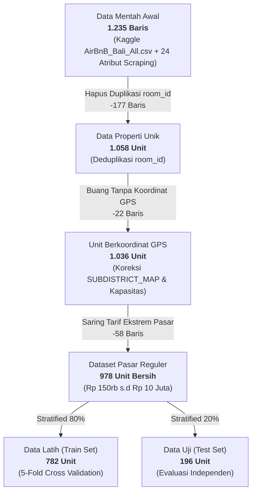
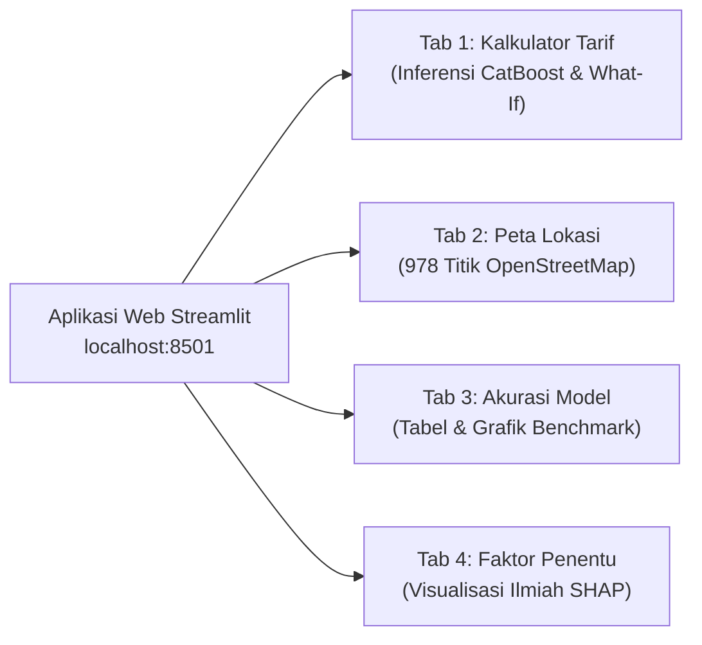

# PANDUAN PENGUASAAN BALI SMART PRICING ENGINE
### Buku Panduan Komprehensif, Cara Kerja Model Machine Learning, dan Strategi Asistensi Presentasi

> **Proyek**: Bali Smart Villa & Homestay Pricing Engine  
> **Mata Kuliah**: Pembelajaran Mesin (Machine Learning) — Teknologi Informasi, Fakultas Teknik, Universitas Udayana  
> **Dosen Pengampu**: Yogiswara Dharma Putra, S.TI., M.T.  
> **Tim Pengembang**:  
> 1. **Anthony Wisnu Jati** (NIM: 2305551138)  
> 2. **I Kadek Adi Sunetra** (NIM: 2305551053)  
> **Antarmuka Web**: Jalankan secara lokal pada `http://localhost:8501`  
> **Pembaruan Terakhir**: Disinkronkan Penuh dengan Pipeline Pure-ML (978 unit, 54 kecamatan) & Benchmark 3 Model Utama

---

## DAFTAR ISI

1. [Ringkasan Eksekutif & Jawaban Satu Menit](#1-ringkasan-eksekutif--jawaban-satu-menit)
2. [Kamus Angka Baku & Fakta Kunci Proyek](#2-kamus-angka-baku--fakta-kunci-proyek)
3. [Tahap 1: Pengumpulan Data & Strategi Scraping Tanggal](#3-tahap-1-pengumpulan-data--strategi-scraping-tanggal)
4. [Tahap 2: Pembersihan Data & Rekonsiliasi (1.235 ke 978 Baris)](#4-tahap-2-pembersihan-data--rekonsiliasi-1235-ke-978-baris)
5. [Tahap 3: Parameter Sistem & Rekayasa Fitur Data-Driven (0% Data Leakage)](#5-tahap-3-parameter-sistem--rekayasa-fitur-data-driven-0-data-leakage)
6. [Tahap 4: Bedah Arsitektur & Cara Kerja 3 Model Machine Learning](#6-tahap-4-bedah-arsitektur--cara-kerja-3-model-machine-learning)
   - [6.1 Mengapa Memilih Tepat 3 Model Ini?](#61-mengapa-memilih-tepat-3-model-ini)
   - [6.2 Model 1: Random Forest Regressor (Baseline Bagging)](#62-model-1-random-forest-regressor-baseline-bagging)
   - [6.3 Model 2: XGBoost Regressor (Gradient Boosting Klasik)](#63-model-2-xgboost-regressor-gradient-boosting-klasik)
   - [6.4 Model 3: CatBoost Regressor (Champion Model)](#64-model-3-catboost-regressor-champion-model)
   - [6.5 Mengapa LightGBM dan Stacking Ridge Dihapus?](#65-mengapa-lightgbm-dan-stacking-ridge-dihapus)
7. [Tahap 5: Analisis Hasil Evaluasi & Komparasi Metrik Ilmiah](#7-tahap-5-analisis-hasil-evaluasi--komparasi-metrik-ilmiah)
   - [7.1 Tabel Komparasi 3 Model Utama](#71-tabel-komparasi-3-model-utama)
   - [7.2 Cara Membaca Metrik: Mengapa MedAE & MdAPE Lebih Jujur?](#72-cara-membaca-metrik-mengapa-medae--mdape-lebih-jujur)
   - [7.3 Evaluasi Bertingkat Berdasarkan 4 Kelas Pasar Penginapan](#73-evaluasi-bertingkat-berdasarkan-4-kelas-pasar-penginapan-model-catboost)
8. [Tahap 6: Faktor Penentu Harga (Explainable AI - SHAP)](#8-tahap-6-faktor-penentu-harga-explainable-ai---shap)
9. [Tahap 7: Panduan Demo Aplikasi Web Streamlit (4 Tab Interaktif)](#9-tahap-7-panduan-demo-aplikasi-web-streamlit-4-tab-interaktif)
10. [Tahap 8: Bank Soal & Jawaban Asistensi Dosen (Cheat Sheet Pertanyaan Kritis)](#10-tahap-8-bank-soal--jawaban-asistensi-dosen-cheat-sheet-pertanyaan-kritis)
11. [Tahap 9: Cara Menjalankan Sistem di Komputer Lokal](#11-tahap-9-cara-menjalankan-sistem-di-komputer-lokal)

---

## 1. RINGKASAN EKSEKUTIF & JAWABAN SATU MENIT

### 1.1 Penjelasan dalam Satu Kalimat
**Kami membangun sistem machine learning cerdas berbasis CatBoost Regressor untuk menaksir tarif sewa harian wajar villa dan homestay di Bali secara objektif, memanfaatkan 38 fitur murni fisik dan geospasial tanpa kebocoran data (0% data leakage).**

### 1.2 Pitch Presentasi Pembuka (Hafalkan untuk 1 Menit Pertama di Depan Dosen)
> "Selamat pagi/siang Bapak Dosen Pengampu dan rekan-rekan.  
> Sebagian besar pemilik villa perorangan dan pengelola homestay lokal di Bali selama ini menentukan harga sewa harian hanya berdasarkan perkiraan kasar (*gut feeling*) atau sekadar meniru tarif tetangga sekitar. Meniru tarif tetangga tanpa memperhitungkan perbedaan kapasitas kamar, fasilitas private pool, reputasi, dan jarak fisik ke sentra wisata berisiko fatal: jika terlalu mahal (*overpricing*) kamar akan kosong, jika terlalu murah (*underpricing*) pendapatan mereka hilang.  
> 
> Melalui proyek **Bali Smart Pricing Engine**, kami merekayasa pipeline data science dari data mentah Airbnb Bali, menyelesaikan 4 anomali data (seperti tarif default 5-malam dan perbatasan wilayah yang tertukar), lalu membandingkan 3 arsitektur ensemble pohon: **Random Forest**, **XGBoost**, dan **CatBoost**.  
> 
> Hasil pengujian pada 196 data uji independen membuktikan **CatBoost Regressor** unggul sebagai Champion Model dengan **$R^2$ data uji 67,08%** dan nilai tengah selisih kesalahan (**MedAE**) hanya **Rp 391.492 per malam**. Khusus pada segmen terbesar di Bali yaitu **Villa Reguler** (89 dari 196 data uji), tingkat akurasi relatif median model mencapai **75,16%** (MdAPE 24,84%) dengan MedAE **Rp 306.870**. Model ini telah kami integrasikan penuh ke antarmuka web interaktif Streamlit yang dilengkapi analisis transparansi **Explainable AI (SHAP)** dan simulasi bisnis *What-If Analysis*."

### 1.3 Rumusan Masalah & Tujuan Penelitian (3 Pilar Kausalitas Logis)

Struktur rumusan masalah dan tujuan disusun secara konsisten dari masalah dasar pemilik, kendala data, hingga perancangan model:

* **Pilar 1 (Masalah Dasar Pemilik & Solusi Sistem Acuan)**:
  * **Rumusan Masalah 1**: Bagaimana membantu pemilik villa dan homestay di Bali yang mengalami kesulitan dalam menentukan tarif sewa harian wajar yang sesuai dengan karakteristik spesifik propertinya melalui sebuah sistem estimasi berbasis data?
  * **Tujuan Tugas 1**: Mengembangkan sistem pendukung keputusan (*Bali Smart Pricing Engine*) guna membantu pemilik villa dan homestay di Bali memperoleh acuan estimasi tarif sewa harian wajar per malam yang proporsional dengan karakteristik fisik, lokasi, dan fasilitas propertinya.
* **Pilar 2 (Keterbatasan Atribut Dataset & Solusi Pengayaan via URL Listing)**:
  * **Rumusan Masalah 2**: Bagaimana mengatasi keterbatasan atribut pada dataset awal yang belum memuat spesifikasi fisik dan fasilitas lengkap, dengan memanfaatkan kolom tautan listing yang tersedia pada dataset untuk melakukan pengayaan data?
  * **Tujuan Tugas 2**: Melakukan pengayaan data (*data enrichment*) terhadap dataset awal dengan mengekstrak rincian kapasitas fisik, fasilitas, dan koordinat geospasial melalui penelusuran tautan listing yang tersedia pada dataset.
* **Pilar 3 (Rancang Bangun Model Machine Learning & Implementasi Antarmuka Sistem)**:
  * **Rumusan Masalah 3**: Bagaimana merancang dan membangun model pembelajaran mesin (*machine learning*) yang mampu memprediksi tarif sewa penginapan secara akurat berdasarkan data hasil pengayaan tersebut, serta menyajikannya ke dalam sebuah antarmuka sistem yang fungsional?
  * **Tujuan Tugas 3**: Membangun model estimasi tarif sewa dengan pendekatan *ensemble tree machine learning* (Random Forest, XGBoost, dan CatBoost), mengevaluasi komparasi performanya secara objektif, serta mengintegrasikan model terbaik ke dalam sistem antarmuka web interaktif yang transparan dan mudah digunakan.

---

## 2. KAMUS ANGKA BAKU & FAKTA KUNCI PROYEK

Tabel ini adalah rujukan angka mati yang tidak boleh tertukar saat menjawab pertanyaan dosen:

| Parameter | Angka Baku | Keterangan & Batasan Ilmiah |
|---|:---:|---|
| **Data Mentah Awal** | **1.235 baris** | Berkas Kaggle `AirBnB_Bali_All.csv` (*Indonesia Airbnb Dataset: Bali*, Luthfi Abdillah / `pandaa12`), 6 kolom dasar. |
| **Listing Unik Awal** | **1.058 ID** | Setelah eliminasi 177 baris duplikat memakai kunci unik `room_id`. |
| **Unit Berkoordinat GPS** | **1.036 unit** | Setelah penyisihan 22 unit unik tanpa koordinat `latitude` / `longitude`. |
| **Dataset Bersih Final** | **978 unit** | Setelah penyaringan 58 tarif ekstrem di luar pasar reguler (< Rp 150rb, > Rp 10jt, atau > Rp 4jt/kamar). |
| **Data Latih (Train Set)** | **782 unit (80%)** | Diisolasi murni untuk melatih dan melakukan 5-Fold Cross Validation (*stratified* per kabupaten). |
| **Data Uji (Test Set)** | **196 unit (20%)** | Diisolasi penuh (tanpa dilibatkan dalam pelatihan) untuk menguji performa model final. |
| **Total Kolom Dataset** | **42 kolom** | 4 target/identitas (`room_id`, `name`, `price_idr`, `log_price`) + 38 fitur prediktor. |
| **Total Fitur Prediktor Murni** | **38 fitur** | 35 numerik/biner + 3 kategorikal (`regency`, `sub_district`, `property_type`). |
| **Jumlah Wilayah Administratif** | **9 Kab/Kota & 54 Kecamatan** | Terkanonisasi baku sesuai batas administratif Provinsi Bali pada dataset bersih. |
| **Kategori Properti Alami** | **4 Kategori Utama** | Total 978 unit: Villa (456), Homestay (271), Cottage/Bungalow (142), Entire House (109). |
| **Model Terbaik (Champion)** | **CatBoost Regressor** | Skor $R^2$ Test: **67,08%** \| Skor CV $R^2$: **66,36%** \| MedAE: **Rp 391.492**. |
| **Akurasi Segmen Villa Reguler** | **75,16%** *(MdAPE 24,84%)* | 89 sampel uji (Rp 750rb - Rp 2,5jt), MedAE tipikal hanya **Rp 306.870**. |
| **Port & URL Aplikasi** | `localhost:8501` | Dibangun menggunakan Python 3.11 dan Streamlit. |

---

## 3. TAHAP 1: PENGUMPULAN DATA & STRATEGI SCRAPING TANGGAL

### 3.1 Mengapa Parameter Tanggal Check-in & Check-out Krusial?
Jika Anda membuka halaman pencarian Airbnb tanpa mengisi tanggal sewa, Airbnb secara default menampilkan total harga paket sewa untuk durasi **5 malam** (*"untuk 5 malam"*).  
Jika data tersebut diambil secara mentah tanpa pemahaman parameter, harga sewa homestay sederhana akan tampak melambung hingga belasan juta rupiah. Karena itu, scraping harus menyematkan parameter sewa 1 malam murni.

### 3.2 Strategi "Golden Window" (Jendela Emas H+5 s.d. H+6)
Penarikan data menggunakan formula tanggal dinamis:
```python
today = datetime.date.today()
checkin_date = today + datetime.timedelta(days=5)   # Hari ini + 5 hari
checkout_date = today + datetime.timedelta(days=6)  # Tepat sewa 1 malam
```

**Alasan ilmiah pemilihan rentang H+5 s.d. H+6:**
1. **Lolos batas kunci kalender 14 hari**: Sebagian besar homestay lokal di Bali mengunci kalender pemesanan di atas 14 hari ke depan. Tanggal H+5 berada aman di dalam kalender terbuka.
2. **Lolos aturan persiapan tuan rumah (*lead time*)**: Pengelola villa umumnya membutuhkan waktu persiapan 1 hingga 2 hari sebelum tamu tiba. Rentang H+5 memberi jeda waktu persiapan yang cukup.
3. **Ketersediaan unit tertinggi**: Rentang 5 hari ke depan memiliki rasio kamar terbuka (*available*) paling optimal dibanding tanggal yang terlalu jauh di bulan-bulan berikutnya.

### 3.3 Pengayaan Detail (`/rooms/<id>`) & Verifikasi Search-Grid 1 Malam
Pengumpulan data pada `01_scrape_raw_data.py` memadukan dua tahap pelengkap:
* **Langkah 1 — Web Scraping Halaman Detail (`/rooms/<id>`):** Sistem menelusuri tautan unik dari `AirBnB_Bali_All.csv` satu per satu dengan jeda acak 4–7 detik dan masa tunggu berkala (*cooldown*) 45–65 detik, lalu menyimpannya menjadi **1.036 berkas cache JSON** di `aplikasi/data/scraped/`. Tahap ini menyediakan koordinat GPS, nama kecamatan, kapasitas fisik, daftar fasilitas, badge host, serta deskripsi properti (memadankan 1.212 dari 1.235 baris awal).
* **Langkah 2 — Search-Grid Pembanding 1 Malam (`H+5` s.d. `H+6`):** Sistem memanggil endpoint pencarian grid resmi Airbnb pada **3 koridor utama** (`Denpasar`, `Kuta`, dan `Canggu`):
  `https://www.airbnb.com/s/Bali--Indonesia/homes?checkin=YYYY-MM-DD&checkout=YYYY-MM-DD`
  Tahap ini menghasilkan **28 unit** bertarif 1 malam terverifikasi (`search_grid_1night_verified.json`), dengan **6 unit beririsan** langsung pada dataset Kaggle awal—cukup untuk memverifikasi pola paket 5 malam sebelum seluruh baris lainnya dibagi lima (`harga / 5`).

### 3.4 Tangga Prioritas Tanggal Adaptif
Jika koridor tertentu padat pada tanggal H+5:
* **Prioritas 1 (Utama)**: H+5 s.d. H+6 (Standar optimal).
* **Prioritas 2 (Cadangan A)**: H+8 s.d. H+9 (Jika terjadi lonjakan akhir pekan pada H+5).
* **Prioritas 3 (Cadangan B)**: H+12 s.d. H+13 (Batas aman maksimal sebelum batas kunci 14 hari).

### 3.5 Protokol Anti-Blokir IP & Cache Lokal
* **Rotasi User-Agent**: Menggunakan pengenal peramban modern (Chrome, Safari, Firefox).
* **Jeda Acak & Cooldown**: Jeda acak 4,0–7,0 detik pada *scraping* detail (plus *cooldown* berkala 45–65 detik), serta jeda 3,5–6,0 detik antar halaman Search-Grid.
* **Penyimpanan Cache Lokal**: 1.036 respons JSON disimpan di `data/scraped/` agar permintaan jaringan tidak perlu diulang ke server Airbnb.

---

## 4. TAHAP 2: PEMBERSIHAN DATA & REKONSILIASI (1.235 KE 978 BARIS)

### 4.1 Rincian Penurunan Baris Data



1. **Pembersihan Duplikat (-177 baris)**: Listing di area beririsan terjaring ganda pada data mentah. Seluruh duplikat disaring berdasarkan ID unik properti (`room_id`) menjadi 1.058 unit unik.
2. **Penyisihan Tanpa GPS (-22 baris)**: Sebanyak 22 unit yang tidak memiliki koordinat `latitude`/`longitude` (karena berkas JSON detailnya tidak berhasil ditarik) disisihkan sehingga tersisa 1.036 unit berkoordinat di Bali.
3. **Penyaringan Pasar Reguler (-58 baris)**: Membuang 1 unit bertarif < Rp 150 ribu/malam, 18 unit > Rp 10 juta/malam, serta 39 unit bertarif > Rp 4 juta per kamar tidur, menghasilkan 978 unit pasar reguler.
4. **Pembagian 80% Latih dan 20% Uji**:
   * **782 unit Data Latih**: Digunakan murni untuk melatih model dan validasi silang (Cross-Validation).
   * **196 unit Data Uji**: Diisolasi penuh (tidak pernah dilihat oleh model saat pelatihan) untuk menjamin objektivitas evaluasi akhir.

### 4.2 Perbaikan Kualitas Data (Data Engineering)
* **Kanonisasi Wilayah Baku (54 Kecamatan pada Dataset Bersih)**: Mengoreksi 402 baris data mentah yang salah label kabupaten akibat pelebaran radius pencarian (contoh: Ubud, Tegallalang, dan Tampaksiring yang salah tercatat sebagai Kabupaten Bangli dikembalikan ke Kabupaten Gianyar; Seririt yang salah tercatat sebagai Jembrana dikembalikan ke Buleleng), mencakup 56 kawasan di data mentah yang terfilter rapi menjadi 54 kecamatan resmi pada 978 unit bersih.
* **Rekonsiliasi Kapasitas Kamar (Regex XBR & Kata Bilangan)**: Memperbaiki anomali kapasitas pada 73 baris properti dengan mencocokkan teks judul ("5BR Villa"), kata bilangan pada deskripsi, dan rasio kamar tidur pada homestay/kamar sewa.
* **Konsolidasi 4 Kategori Alami Bali**: Mengonsolidasikan tipe penginapan menjadi 4 kelas seimbang:
  1. *Villa Pribadi* (364 unit latih; 456 total)
  2. *Kamar Sewa / Homestay* (221 unit latih; 271 total)
  3. *Bungalow / Cottage Unik* (109 unit latih; 142 total)
  4. *Rumah / Hunian Utuh* (88 unit latih; 109 total)  
  *Catatan*: Kategori mikro seperti Shared Room / Hostel yang hanya memiliki 5 sampel uji dibuang untuk mencegah ketidakseimbangan kelas (*class sparsity*).

---

## 5. TAHAP 3: PARAMETER SISTEM & REKAYASA FITUR DATA-DRIVEN (0% DATA LEAKAGE)

Sistem menggunakan **38 fitur prediktor murni** yang terbagi dalam 3 tingkatan:

### 5.1 Tingkatan 1: Parameter Masukan Pengguna (UI Web)
* **Lokasi & Administratif**: Kabupaten/Kota (9 wilayah), Kecamatan/Kawasan (54 wilayah pada dataset bersih), dan Koordinat GPS (`latitude`, `longitude`).
* **Tipe & Lingkup Properti**: 4 Kategori Alami Bali dan lingkup unit sewa (`is_room_only`: 1 untuk sewa kamar tunggal, 0 untuk seluruh unit).
* **Kapasitas Fisik**: Kapasitas tamu (`accommodates`), kamar tidur (`bedrooms`), tempat tidur (`beds`), dan kamar mandi (`bathrooms`).
* **Reputasi & Kepuasan Tamu**: Skor rating (`3.50–5.00`, median `4.95` pada 711 unit berulasan; sedangkan **267 unit baru ber-`review_count = 0` dibiarkan `rating = NaN` alami** agar tidak disamakan dengan bintang nol), jumlah ulasan (`review_count`), status listing baru (`is_new_listing`), dan status `is_superhost`.
* **Fasilitas & Suasana**: Kolam renang pribadi, kolam bersama, bathtub, jacuzzi, staf/sarapan, parkir, meja kerja, check-in mandiri, serta fitur kata kunci suasana (mewah, pantai, pemandangan alam, ekonomis).

### 5.2 Tingkatan 2: Parameter Rekayasa Fitur Domain (Otomatis & Bebas Bias)
Fitur turunan yang dihitung secara matematis oleh sistem:
* **Rasio Proporsi Kapasitas Fisik**:
  * Kepadatan Tamu per Kamar: $\text{guests\_per\_bedroom} = \frac{\text{accommodates}}{\text{bedrooms}}$
  * Rasio Kamar Mandi per Kamar: $\text{baths\_per\_bedroom} = \frac{\text{bathrooms}}{\text{bedrooms}}$
  * Rasio Ranjang per Kamar: $\text{beds\_per\_bedroom} = \frac{\text{beds}}{\text{bedrooms}}$
  * Indeks Total Ruangan: $\text{total\_rooms\_index} = \text{bedrooms} + \text{bathrooms}$
* **Total Fasilitas Mewah Objektif (`total_luxury_amenities`)**:
  Dihitung murni sebagai penjumlahan fasilitas tanpa pembobotan subjektif tebakan manusia:
  $$\text{total\_luxury\_amenities} = \text{has\_private\_pool} + \text{has\_pool} + \text{has\_bathtub} + \text{has\_jacuzzi} + \text{has\_service_staff}$$
* **Jarak Geospasial Haversine Riil ke 6 Sentra Wisata & Bandara**:
  Menghitung jarak lengkung bumi (km) dari koordinat listing ke:
  1. Sentra Wisata Seminyak & Canggu (`dist_canggu_seminyak_km`)
  2. Pusat Budaya Ubud (`dist_ubud_center_km`)
  3. Kawasan Tebing Uluwatu (`dist_uluwatu_km`)
  4. Pantai Sanur (`dist_sanur_km`)
  5. Kaldera Kintamani (`dist_kintamani_km`)
  6. Bandara Internasional I Gusti Ngurah Rai (`dist_airport_km`)
  7. Jarak ke Hub Terdekat (`min_dist_tourism_hub_km`): Nilai minimum dari 4 sentra keramaian utama.

### 5.3 Mengapa Target-Lag dan Spatial KNN Dibuang Total?
Pada eksperimen tahap awal, sempat diuji penambahan fitur harga tetangga (`spatial_knn_log_price`). Namun, pada evaluasi ilmiah mendalam, fitur tersebut **dieliminasi secara permanen** karena dua alasan mendasar:
1. **Mencegah Kebocoran Data (*Data Leakage*)**: Menyertakan rata-rata harga tetangga saat pelatihan dapat membocorkan informasi label target ke dalam matriks fitur.
2. **Kemandirian Saat Deployment**: Saat sebuah villa baru didaftarkan di kawasan pedesaan yang belum banyak listing, fitur harga tetangga tidak tersedia atau menghasilkan halusinasi. Model harus mampu menaksir harga secara objektif **murni dari karakteristik fisik dan koordinat geografis bumi**.

---

## 6. TAHAP 4: BEDAH ARSITEKTUR & CARA KERJA 3 MODEL MACHINE LEARNING

### 6.1 Mengapa Memilih Tepat 3 Model Ini?
Pemilihan 3 model ini bukan kebetulan, melainkan mewakili **tiga generasi arsitektur ensemble berbasis pohon (*Tree-Based Ensemble*)** paling standar dalam literatur data tabular internasional:

| Generasi | Model | Paradigma Algoritma | Peran dalam Proyek |
|:---:|---|---|---|
| **Gen 1** | **Random Forest Regressor** | Bagging (Pohon Paralel Independen) | Baseline Model Pembanding |
| **Gen 2** | **XGBoost Regressor** | Gradient Boosting Klasik (Residual Fitting + L1/L2) | Pembanding Boosting Standar Industri |
| **Gen 3** | **CatBoost Regressor** | Ordered Boosting + Oblivious Symmetric Trees | **Champion Model (Pemenang Evaluasi)** |

---

### 6.2 Model 1: Random Forest Regressor (Baseline Bagging)

#### A. Cara Kerja Mekanis
Random Forest bekerja dengan paradigma **Bagging (*Bootstrap Aggregating*)**:
1. **Bootstrap Sampling**: Algoritma membuat ratusan subset data latih secara acak dengan pengembalian (*replacement*). Setiap pohon dilatih pada sampel data yang berbeda.
2. **Random Feature Subspacing**: Pada setiap percabangan simpul (*node split*), algoritma hanya mempertimbangkan subset acak dari fitur prediktor (bukan seluruh 38 fitur sekaligus). Hal ini memutus korelasi antar-pohon (*decorrelating trees*).
3. **Agregasi Rata-rata**: Saat melakukan prediksi, keluaran seluruh pohon dirata-ratakan secara matematis:
   $$\hat{y} = \frac{1}{B} \sum_{b=1}^{B} T_b(x)$$
   Mekanisme ini secara efektif **memangkas variansi kesalahan (*variance reduction*)** tanpa meningkatkan bias.

#### B. Hyperparameter yang Diterapkan
* `n_estimators = 300`: Membangun 300 pohon keputusan independen untuk stabilitas variansi.
* `max_depth = 14`: Membatasi kedalaman maksimum pohon hingga 14 tingkat untuk mencegah pohon menghafal data (*overfitting*).
* `min_samples_leaf = 2`: Setiap daun terminal wajib memiliki minimal 2 sampel data.
* `random_state = 42`: Menjamin replikasi hasil eksperimen yang konsisten.

#### C. Kelebihan & Kelemahan pada Data Properti Bali
* **Kelebihan**: Sangat stabil, tidak mudah overfitting, dan proses pelatihan dapat diparalelkan secara penuh (*multithreading* penuh).
* **Kelemahan**: Pada pipeline `ColumnTransformer` proyek ini, kategori teks (`9` kabupaten + `53` kecamatan latih + `4` tipe = **66 kolom biner dummy**) dan imputasi `SimpleImputer(strategy="median")` pada `rating` menghasilkan total **101 kolom masukan** (`66 dummy + 35 numerik`) yang renggang (*sparse*). Random Forest kesulitan menangani interaksi non-linier kompleks antar-kategori geografis dibanding boosting.

---

### 6.3 Model 2: XGBoost Regressor (Gradient Boosting Klasik)

#### A. Cara Kerja Mekanis
Berbeda dengan Random Forest yang membangun pohon secara independen, XGBoost (*Extreme Gradient Boosting*) bekerja secara **berurutan (*sequential residual learning*)**:
1. **Koreksi Residual Berkelanjutan**: Pohon pertama membuat estimasi awal. Pohon kedua tidak memprediksi harga, melainkan memprediksi **residual (selisih error)** antara harga aktual dan prediksi pohon pertama. Pohon ketiga mengoreksi sisa error pohon kedua, dan seterusnya.
2. **Aproksimasi Taylor Orde Kedua**: XGBoost menghitung gradien tingkat pertama ($g_i$) dan Hessian tingkat kedua ($h_i$) dari fungsi kerugian (*loss function*):
   $$\mathcal{L}^{(t)} \approx \sum_{i=1}^{n} \left[ l(y_i, \hat{y}^{(t-1)}) + g_i f_t(x_i) + \frac{1}{2} h_i f_t^2(x_i) \right] + \Omega(f_t)$$
3. **Regularisasi Kompleksitas Pohon ($\Omega$)**: XGBoost menyematkan penalti regularisasi L1 ($\alpha$) dan L2 ($\lambda$) pada bobot daun untuk mencegah pohon tumbuh terlalu spesifik:
   $$\Omega(f) = \gamma T + \frac{1}{2} \lambda \sum_{j=1}^{T} w_j^2$$
   di mana $T$ adalah jumlah daun dan $w_j$ adalah bobot skor pada daun ke-$j$.

#### B. Hyperparameter yang Diterapkan
* `n_estimators = 350`: Membangun 350 pohon residual secara sekuensial.
* `learning_rate = 0.035`: Langkah penyusutan bobot (*shrinkage*) konservatif agar pohon baru tidak mengoreksi secara agresif (*overshooting*).
* `max_depth = 5`: Pohon dangkal (5 tingkat) untuk membatasi interaksi fitur berlebih.
* `subsample = 0.8`: Mengambil 80% baris data latih per pohon untuk mencegah overfitting.
* `colsample_bytree = 0.8`: Mengambil 80% kolom fitur secara acak per pohon.

#### C. Kelemahan XGBoost pada Pipeline Bali Ini
Seperti Random Forest, jalur `ColumnTransformer` di skrip proyek ini memecah 3 kategori menjadi **66 kolom dummy** (dari `782` data latih, dengan `handle_unknown="ignore"` agar 1 kecamatan khusus data uji yaitu `Kuta Selatan` tetap aman dipetakan nol) dan menambal `rating = NaN` dengan `SimpleImputer(median)` hingga menjadi **101 kolom tersandi** (`66 + 35`). Meskipun XGBoost secara arsitektur mampu menangani `NaN` secara native, penyandian kategori tetap memecah kerapatan simpul di banyak kolom kecamatan.

---

### 6.4 Model 3: CatBoost Regressor (Champion Model)

#### A. Cara Kerja Mekanis & Tiga Inovasi Kunci
CatBoost (*Categorical Boosting*) dikembangkan khusus untuk mengatasi kelemahan algoritma GBDT standar pada data tabular yang kaya fitur kategori (seperti kabupaten, kecamatan, dan tipe properti di Bali). Tiga pilar inovasi CatBoost:

1. **Ordered Target Statistics (Penanganan Kategori Native Bebas Leakage)**:  
   Pada algoritma biasa, mengubah kategori teks menjadi angka target sering membocorkan informasi (*target leakage*). CatBoost menggunakan prinsip *Ordered Target Encoding*: sistem mengacak urutan observasi secara acak, lalu nilai statistik kategori suatu baris hanya dihitung dari observasi yang berada **sebelum baris tersebut dalam urutan acak**:
   $$\hat{x}_{k}^i = \frac{\sum_{j=1}^{i-1} [x_{j}^i = x_{k}^i] \cdot y_j + a \cdot P}{\sum_{j=1}^{i-1} [x_{j}^i = x_{k}^i] + a}$$
   di mana $P$ adalah prior rata-rata target pulau Bali dan $a > 0$ adalah parameter pembobot prior. Hal ini membuat 54 kecamatan dan 9 kabupaten di Bali dapat dipelajari langsung tanpa One-Hot Encoding dan tanpa kebocoran data.

2. **Ordered Boosting (Mencegah Pergeseran Prediksi / Prediction Shift)**:  
   Pada GBDT tradisional, gradien yang digunakan untuk melatih pohon residual dihitung dari model yang telah melihat data yang sama, menyebabkan bias kondisional. CatBoost mempertahankan model independen untuk setiap sampel data sehingga perhitungan gradien selalu tidak bias (*unbiased residual estimation*).

3. **Oblivious Trees (Pohon Simetris)**:  
   Pohon CatBoost bersifat simetris (*oblivious*), di mana kriteria pemisah (*split condition*) yang sama digunakan pada seluruh simpul di kedalaman yang sama.
   * **Struktur Seimbang**: Menghasilkan representasi model yang sangat teratur dan tidak rentan terhadap pencilan (*outliers*).
   * **Inferensi Kilat**: Struktur simetris dapat dievaluasi menggunakan instruksi biner (*bitwise operations*) pada tingkat prosesor komputer, membuat waktu inferensi aplikasi web berada di bawah 5 milidetik.

#### B. Hyperparameter yang Diterapkan
* `iterations = 600`: 600 pohon residual simetris.
* `learning_rate = 0.035`: Laju belajar konservatif.
* `depth = 6`: Kedalaman simetris 6 level ($2^6 = 64$ daun simetris).
* `l2_leaf_reg = 3.0`: Koefisien regularisasi L2 pada nilai daun untuk menekan overfitting.
* `loss_function = 'RMSE'`: Optimasi galat kuadrat rata-rata pada skala logaritmik tarif.
* `cat_features = ['regency', 'sub_district', 'property_type']`: Diberikan langsung ke mesin CatBoost tanpa encoding manual.

#### C. Mengapa CatBoost Keluar Sebagai Juara?
Di Provinsi Bali, lokasi properti memiliki struktur hirarkis yang unik: Kabupaten (9 wilayah) memiliki Kecamatan/Kawasan Wisata (54 wilayah pada data bersih) dengan variasi harga yang sangat tajam (misal: Kuta Utara vs Kintamani vs Seririt). CatBoost mampu memetakan interaksi kategori lokasi ini dengan fitur fisik secara simultan tanpa distorsi matriks sparse.

---

### 6.5 Mengapa LightGBM dan Stacking Ridge Dihapus?
Pada evaluasi sebelumnya, sempat disertakan LightGBM dan Stacking Super-Ensemble berbasis Ridge Regression. Keduanya **dieliminasi** demi kepatuhan pada prinsip rekayasa data science murni (*Occam's Razor*):
1. **Redundansi Algoritma**: LightGBM menghasilkan pola prediksi boosting berbasis histogram yang mirip dengan XGBoost pada dataset berukuran 978 baris, namun tetap membutuhkan penanganan kategori terpisah.
2. **Kompleksitas yang Tidak Sebanding dengan Kenaikan Akurasi**: Stacking Ridge meta-learner mengharuskan aplikasi memuat banyak model sekaligus ke memori dan menghilangkan transparansi visualisasi SHAP langsung berbasis pohon (*TreeExplainer*) pada model tunggal.
3. **Pilihan Arsitektur Bersih**: 3 model terpilih (Random Forest, XGBoost, CatBoost) memberikan perbandingan arsitektur yang tajam, elegan, dan berbobot ilmiah tinggi.

---

## 7. TAHAP 5: ANALISIS HASIL EVALUASI & KOMPARASI METRIK ILMIAH

### 7.1 Tabel Komparasi 3 Model Utama
Pengujian dilakukan pada **196 sampel data uji independen (20% data terisolasi)** dengan 38 fitur prediktor:

| Peringkat | Algoritma Machine Learning | 5-Fold CV $R^2$ | Test $R^2$ (Data Uji) | Nilai Tengah Selisih (MedAE) | Rata-rata Selisih (MAE) | Tingkat Error (MdAPE) | Akurasi Relatif ($100\% - \text{MdAPE}$) |
| :---: | :--- | :---: | :---: | :---: | :---: | :---: | :---: |
| 1 | **CatBoost Regressor (Champion)** | **66,36%** | **67,08%** | **Rp 391.492** | **Rp 764.207** | 30,09% | 69,91% |
| 2 | **XGBoost Regressor** | 66,31% | 66,22% | Rp 411.693 | Rp 773.730 | **27,61%** | **72,39%** |
| 3 | **Random Forest (Baseline)** | 62,91% | 65,60% | Rp 470.400 | Rp 809.098 | 31,63% | 68,37% |

*(Sumber: `aplikasi/reports/model_benchmark_results.csv`. CatBoost unggul sekaligus pada CV $R^2$ 66,36%, Test $R^2$ 67,08%, MedAE terendah Rp 391.492, MAE terendah Rp 764.207, serta RMSE terendah Rp 1.231.953).*

---

### 7.2 Cara Membaca Metrik: Mengapa MedAE & MdAPE Lebih Jujur?

Saat dosen bertanya mengenai evaluasi error, jelaskan dengan kaidah statistika berikut:

1. **Koefisien Determinasi ($R^2$)**:
   Menjelaskan seberapa besar variasi tarif sewa di Bali yang berhasil ditangkap oleh fitur-fitur properti. Nilai Test $R^2 = \mathbf{67,08\%}$ membuktikan bahwa 38 fitur fisik, lokasi kecamatan, jarak sentra wisata, dan fasilitas telah menjelaskan mayoritas variasi tarif sewa pada dataset pasar reguler Bali.

2. **Perbedaan MAE vs MedAE (Isu Distribusi Skewed Kanan)**:
   * **MAE (*Mean Absolute Error*)**: Rp 764.207 per malam.
   * **MedAE (*Median Absolute Error*)**: Rp 391.492 per malam.
   * **Mengapa MedAE Jauh Lebih Rendah?**  
     Distribusi harga properti di Bali mengalami kemiringan tajam ke kanan (*positive skewness*). Terdapat beberapa villa ultra-mewah seharga Rp 8 juta s.d Rp 10 juta per malam. Jika pada villa Rp 9 juta model memprediksi Rp 7 juta (selisih Rp 2 juta), nilai MAE akan langsung terangkat naik secara dramatis karena sifat rata-rata aritmatika yang sensitif terhadap angka besar.  
     Sebaliknya, **MedAE (Nilai Tengah Selisih)** memotong pengaruh pencilan ekstrim tersebut. MedAE menunjukkan bahwa **untuk 50% penginapan di Bali, selisih kesalahan prediksi model berada di bawah Rp 391.492 per malam**. Angka ini sangat wajar dan dapat diterima dalam bisnis pariwisata.

3. **MdAPE (*Median Absolute Percentage Error*)**:
   $$\text{MdAPE} = \text{median}\left(\left|\frac{y_{\text{aktual}} - \hat{y}_{\text{prediksi}}}{y_{\text{aktual}}}\right|\right) \times 100\%$$
   Dengan MdAPE CatBoost sebesar **30,09%** di seluruh 196 sampel uji, maka tingkat akurasi relatif pasar model dihitung sebagai:
   $$\text{Akurasi Relatif} = 100\% - 30,09\% = \mathbf{69,91\%}$$

---

### 7.3 Evaluasi Bertingkat Berdasarkan 4 Kelas Pasar Penginapan (Model CatBoost)

Evaluasi ini membuktikan bahwa model tidak bias pada segmen tertentu, melainkan bekerja secara proporsional di seluruh tingkatan ekonomi:

| Kelas Pasar Penginapan | Rentang Tarif per Malam | Sampel Uji | Rata-rata Pasar Aktual | Rata-rata Prediksi Model | Nilai Tengah Selisih (MedAE) | Tingkat Akurasi Relatif |
| :--- | :--- | :---: | :---: | :---: | :---: | :---: |
| **Homestay / Budget** | < Rp 750 Ribu | 41 unit | Rp 488.600 | Rp 717.705 | **Rp 150.589** | **61,20%** *(MdAPE 38,80%)* |
| **Villa Reguler** | Rp 750 Ribu - Rp 2,5 Juta | **89 unit** | Rp 1.467.322 | Rp 1.456.611 | **Rp 306.870** | **75,16%** *(MdAPE 24,84%)* |
| **Villa Menengah** | Rp 2,5 Juta - Rp 6 Juta | 56 unit | Rp 3.732.744 | Rp 2.903.795 | Rp 1.231.149 | **65,31%** *(MdAPE 34,69%)* |
| **Villa Premium** | Rp 6 Juta - Rp 10 Juta | 10 unit | Rp 7.513.136 | Rp 4.347.002 | Rp 3.501.920 | **53,06%** *(MdAPE 46,94%)* |

#### Poin Emas untuk Dosen:
> "Bapak Dosen, segmen pasar penginapan terbesar di Bali adalah **Villa Reguler (89 dari 196 sampel uji)** dengan tarif Rp 750 ribu hingga Rp 2,5 juta. Pada segmen mayoritas ini, model CatBoost kami mencatatkan performa terbaik dengan **tingkat akurasi relatif median 75,16% (MdAPE 24,84%)** dan selisih kesalahan tipikal (MedAE) hanya **Rp 306.870 per malam**."

---

## 8. TAHAP 6: FAKTOR PENENTU HARGA (EXPLAINABLE AI - SHAP)

Sistem mengadopsi prinsip transparansi model (*Explainable AI*) menggunakan **SHAP (*Shapley Additive exPlanations*)** berbasis Teori Permainan Kooperatif (*Cooperative Game Theory* oleh Lloyd Shapley, peraih Nobel Ekonomi).

Tiga visualisasi ilmiah dihasilkan di `reports/` dan ditampilkan pada Tab 4 aplikasi web:

### 8.1 Gambar 1: SHAP Feature Importance (`shap_feature_importance.png`)
* **Apa yang ditunjukkan**: Peringkat 12 fitur teratas paling berpengaruh terhadap pembentukan tarif sewa harian di Bali (pada 196 data uji) berdasarkan nilai rata-rata kontribusi absolut $|\text{SHAP value}|$.
* **Temuan Ilmiah**:
  1. Faktor paling dominan adalah **Tipe Penginapan** (`property_type`, $|\text{SHAP}| = 0,183$) yang memisahkan struktur pasar antara villa utuh, bungalow/cottage, rumah, dan kamar/homestay.
  2. Faktor kedua adalah **Kapasitas Fisik & Ruangan** (jumlah kamar tidur `bedrooms` $= 0,134$, indeks total ruangan `total_rooms_index` $= 0,068$, dan kapasitas tamu `accommodates` $= 0,054$).
  3. Faktor penentu kuat berikutnya adalah **Kelengkapan Fasilitas Mewah** (keberadaan bak mandi `has_bathtub` $= 0,101$ dan agregasi fasilitas mewah `total_luxury_amenities` $= 0,099$) serta **Kawasan / Kecamatan Wisata** (`sub_district` $= 0,067$).

### 8.2 Gambar 2: SHAP Beeswarm Summary Plot (`shap_summary_beeswarm.png`)
* **Apa yang ditunjukkan**: Menampilkan arah pengaruh setiap fitur (apakah menaikkan harga atau menurunkan harga). Setiap titik mewakili satu listing properti. Warna merah menandakan nilai fitur tinggi, warna biru menandakan nilai fitur rendah.
* **Temuan Ilmiah**:
  * **Titik merah di sisi kanan**: Kolam renang pribadi (`has_private_pool`), bathtub, desain mewah (`nlp_luxury`), dan status `is_superhost` secara konsisten mendorong kenaikan harga ke arah positif.
  * **Titik merah di sisi kiri**: Properti sewa kamar tunggal (`is_room_only = 1`) dan jarak sentra wisata yang semakin jauh (`dist_canggu_seminyak_km` bernilai tinggi) secara konsisten menekan harga sewa ke arah lebih murah.

### 8.3 Gambar 3: SHAP Waterfall Plot Kasus Riil (`shap_waterfall_example.png`)
* **Apa yang ditunjukkan**: Rekonstruksi pembentukan harga pada satu contoh properti riil langkah demi langkah, dimulai dari nilai rata-rata log harga dasar pulau Bali ($E[f(X)] \approx 14,16$ atau sekitar Rp 1,41 juta) lalu ditambah dan dikurangi oleh masing-masing atribut spesifik properti hingga mencapai taksiran akhir $f(x)$.

---

## 9. TAHAP 7: PANDUAN DEMO APLIKASI WEB STREAMLIT (4 TAB INTERAKTIF)

Aplikasi web dapat diakses di peramban pada alamat: **`http://localhost:8501`**.



### 9.1 Alur Demonstrasi Tab 1: Cek Estimasi Harga Properti
1. **Pilih Wilayah**: Pilih Kabupaten Gianyar, Kecamatan Ubud (koordinat pusat terisi otomatis secara dinamis).
2. **Pilih Tipe**: Pilih "Villa Pribadi" (4 Kategori Alami).
3. **Atur Kapasitas**: Masukkan 2 kamar tidur, 4 tamu, 2 kamar mandi, rating 4.88.
4. **Pilih Fasilitas**: Centang Kolam Renang Pribadi, Bathtub, Meja Kerja, Superhost.
5. **Perhatikan Kotak Hasil Prediksi**:
   * Sistem langsung menampilkan estimasi tarif sewa wajar per malam (misalnya Rp 1.650.000 / malam).
   * Menampilkan **Rentang Pasar Wajar** dengan toleransi error MedAE data uji (`± Rp 391.492`, misalnya Rp 1.258.508 s.d. Rp 2.041.492).
6. **Buka Tabel Simulasi *What-If Analysis***:
   * Tunjukkan kepada dosen tabel simulasi 4 skenario peningkatan nilai tambah fasilitas berbasis ML:
     - Skenario 1: Dampak penambahan Kolam Renang Pribadi (*Private Pool*).
     - Skenario 2: Dampak penambahan Fasilitas Bak Mandi (*Bathtub*) Kamar Utama.
     - Skenario 3: Dampak penataan desain interior Eksklusif / Mewah (`nlp_luxury`).
     - Skenario 4: Dampak meraih lencana reputasi pelayanan *Superhost*.

### 9.2 Alur Demonstrasi Tab 2: Peta Persebaran Lokasi
* Tampilkan peta geospasial interaktif yang memetakan seluruh **978 unit properti riil** di 9 Kabupaten/Kota Bali.
* Peta menggunakan basemap **OpenStreetMap resmi** yang jernih, bebas watermark pihak ketiga, dan dilengkapi fitur zoom interaktif.

### 9.3 Alur Demonstrasi Tab 3: Akurasi Model Prediksi
* Tampilkan tabel metrik ilmiah komparasi 3 model utama (Random Forest, XGBoost, CatBoost).
* Tunjukkan grafik batang Plotly yang membandingkan skor $R^2$ data uji dan perbandingan MAE vs MedAE.

### 9.4 Alur Demonstrasi Tab 4: Faktor Penentu Harga (SHAP)
* Tampilkan 3 gambar resolusi tinggi (Feature Importance, Beeswarm Summary, Waterfall Plot).
* Jelaskan kepada dosen bahwa label fitur telah diterjemahkan ke bahasa Indonesia ilmiah yang ramah publik (misal: `has_private_pool` menjadi *"Kolam Renang Pribadi"*).

---

## 10. TAHAP 8: BANK SOAL & JAWABAN ASISTENSI DOSEN (CHEAT SHEET PERTANYAAN KRITIS)

Berikut adalah daftar pertanyaan tersulit yang berpeluang besar ditanyakan dosen pengampu, lengkap dengan panduan jawaban taktis:

#### Pertanyaan 1: "Mengapa Anda membandingkan tepat 3 model ini (Random Forest, XGBoost, CatBoost)?"
* **Jawaban Taktis**:  
  *"Pemilihan 3 model ini mewakili evolusi arsitektur ensemble pohon tabular paling fundamental, Pak. Random Forest mewakili paradigma Bagging (pohon independen paralel), XGBoost mewakili paradigma Gradient Boosting klasik dengan regularisasi L1/L2, dan CatBoost mewakili generasi mutakhir Ordered Boosting dengan penanganan kategori native. Dengan 3 model ini, komparasi algoritma menjadi fokus, tajam, dan memenuhi standar kajian ilmiah tanpa over-bloat."*

#### Pertanyaan 2: "Bagaimana Anda menjamin tidak terjadi kebocoran data (*data leakage*)?"
* **Jawaban Taktis**:  
  *"Kami menjamin 0% data leakage melalui 3 mekanisme ketat:  
  1. Seluruh fitur numerik yang dihitung sebelum pemisahan data (rasio per kamar, hitungan fasilitas, dan jarak Haversine ke sentra wisata) bersifat deterministik per baris properti tanpa melibatkan rata-rata silang maupun variabel target. Pembagian 80% data latih (782 unit) dan 20% data uji (196 unit) dilakukan *stratified* sebelum pelatihan dan penyandian statistik apa pun.  
  2. Kami membuang seluruh fitur target-lag tetangga (seperti spatial KNN price) sehingga model tidak pernah mengintip harga properti sekitar.  
  3. Seluruh statistik kategori wilayah (*Ordered Target Statistics* di CatBoost) dan skala pembobotan dipelajari murni pada himpunan latih."*

#### Pertanyaan 3: "Mengapa nilai MedAE lebih ditonjolkan dibanding MAE atau RMSE?"
* **Jawaban Taktis**:  
  *"Karena data harga sewa properti di Bali berdistribusi menceng ke kanan (*skewed*), Pak. Ada beberapa villa mewah seharga Rp 9 juta per malam yang selisih prediksinya besar dan menarik nilai rata-rata MAE ke atas. MedAE (*Median Absolute Error*) adalah estimator yang robust (tahan pencilan) yang mencerminkan selisih kesalahan riil pada 50% populasi listing sewa di Bali."*

#### Pertanyaan 4: "Bagaimana cara menangani variabel kategori seperti 54 kecamatan dan 9 kabupaten?"
* **Jawaban Taktis**:  
  *"Pada Random Forest dan XGBoost, kami memakai `ColumnTransformer` dengan `OneHotEncoder(handle_unknown='ignore')` di dalam tiap lipatan latih, sehingga 9 kabupaten, 53 kecamatan di data latih, dan 4 tipe properti mekar menjadi 66 kolom biner dummy (total 101 fitur termasuk 35 kolom numerik), sedangkan 1 kecamatan yang hanya muncul di data uji (Kuta Selatan) aman dipetakan nol. Sebaliknya, CatBoost menggunakan `cat_features` melalui Ordered Target Statistics langsung pada 38 fitur asli tanpa memecah kolom dan tanpa kebocoran data."*

#### Pertanyaan 5: "Mengapa tipe penginapan dikonsolidasikan menjadi 4 kategori?"
* **Jawaban Taktis**:  
  *"Berdasarkan audit data mentah Airbnb Bali, unit akomodasi secara alami terkonsentrasi pada 4 kelompok: Villa Pribadi, Kamar Sewa/Homestay, Bungalow/Cottage, dan Rumah Utuh. Menambahkan kategori langka seperti Shared Room/Hostel yang hanya ada 5 sampel akan menimbulkan masalah ketidakseimbangan kelas (*class sparsity*) yang merusak stabilitas pohon regresi."*

#### Pertanyaan 6: "Apakah harga yang diprediksi ini adalah tarif transaksi riil atau harga listing?"
* **Jawaban Taktis**:  
  *"Harga yang diprediksi adalah tarif penawaran listing resmi harian 1 malam (*daily listing price*), bukan harga transaksi final setelah tawar-menawar atau diskon personal host. Model ini memposisikan diri sebagai sistem pendukung keputusan (*Decision Support System*) untuk memberikan batas wajar tarif pasar bagi pemilik properti."*

#### Pertanyaan 7: "Mengapa Anda menggunakan logaritma natural (`log1p`) pada variabel target harga?"
* **Jawaban Taktis**:  
  *"Distribusi harga properti memiliki variansi yang melebar (*heteroskedastisitas*). Transformasi $\log(y+1)$ menstabilkan variansi residual dan mengubah distribusi harga menjadi mendekati kurva normal, sehingga fungsi kerugian kuadratik (RMSE) pada algoritma boosting dapat konvergen secara optimal. Saat inferensi, hasil dikembalikan ke skala Rupiah menggunakan fungsi eksponensial $\text{expm1}$."*

---

## 11. TAHAP 9: CARA MENJALANKAN SISTEM DI KOMPUTER LOKAL

### 11.1 Menjalankan Web Dashboard Interaktif Langsung
Cukup buka terminal PowerShell di folder workspace dan jalankan:
```powershell
.\aplikasi\run_app.bat
```
Atau jika ingin menjalankan secara manual via virtual environment:
```powershell
.\aplikasi\.venv\Scripts\streamlit.exe run .\aplikasi\app.py
```
Aplikasi akan langsung membuka peramban di alamat `http://localhost:8501`.

### 11.2 Menjalankan Ulang Seluruh Pipeline Data Science (Bila Diperlukan)
Untuk mengeksekusi ulang seluruh modul dari awal (data merge, preprocessing, pelatihan 3 model, hingga visualisasi SHAP):
```powershell
.\aplikasi\run_pipeline.bat
```
Skrip ini akan mengeksekusi Modul 02, 03, 04, 05, dan 06 secara berurutan dengan penanganan error otomatis.

---

> **Catatan Penguasaan**:  
> Bacalah Bagian 1, Bagian 2, dan Bagian 10 sebelum memasuki ruang asistensi. Dengan memahami alur sebab-akibat data dan arsitektur model, Anda dapat menjawab seluruh pertanyaan dosen secara tenang, percaya diri, dan berlandaskan bukti empiris yang kokoh.
